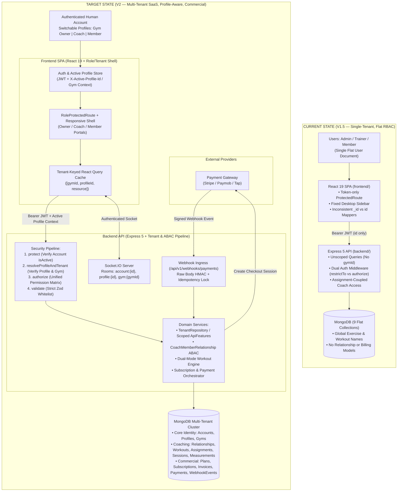

# 01 — Target Multi-Tenant SaaS Architecture

**Classification:** `[VERIFIED SOURCE]` (Current State) + `[APPROVED DECISION]` & `[ARCHITECTURAL PROPOSAL]` (Target State)

---

## 1. Current vs. Target System Context (Mermaid Diagram 1)

The diagram below contrasts the **Current V1.5 Single-Tenant Architecture** (`[VERIFIED SOURCE]`) with the **Target V2 Multi-Tenant SaaS Architecture** (`[ARCHITECTURAL PROPOSAL]`):

---

## 2. Core Architectural Pillars (`[ARCHITECTURAL PROPOSAL]`)

### 2.1 Logical Multi-Tenancy with Mandatory Context Resolution
STREN V2 uses a **shared-database, shared-schema logical multi-tenancy model** partitioned by `gymId: ObjectId` (referencing `Gym`).
- **Why Shared-Schema over Database-per-Tenant:**
  1. **Cross-Gym Account & Profile Switching (`[APPROVED DECISION]`):** A single human user (Account) may train as a Member at Gym A and work as a Coach at Gym B, or switch between personal self-training and gym-affiliated training. A unified database allows instant profile discovery and context switching without cross-database joins.
  2. **Shared Exercise & Workout Library (`[APPROVED DECISION]`):** Platform-level (`SYSTEM`) exercises and templates must be referenceable by workouts and sessions across all gyms without duplicating catalog collections across dozens of databases.
  3. **Operational Simplicity:** Single MongoDB connection pool (`backend/src/config/db.ts`), atomic multi-document transactions across `PaymentTransaction`, `Invoice`, and `MemberSubscription`, and unified index management.

### 2.2 The 4-Stage Backend Request Pipeline
Currently (`[VERIFIED SOURCE]`), routes in `backend/src/routes/*.ts` run `protect` → `restrictTo(...)` → `validate(...)` → `controller`. In Target V2, every authenticated API request passes through a strict 4-stage middleware chain:

1. **Stage 1 — `protect` (Account Authentication):**
   - Verifies the JWT signature (`backend/src/middleware/auth.middleware.ts:10-45`).
   - Loads the `UserAccount` (or `User` during transitional phases) and **enforces `account.isActive === true`** (fixing `RISK-03`).
2. **Stage 2 — `resolveActiveProfile` / `requireTenantContext` (Profile & Tenant Resolution):**
   - Extracts the active profile/membership context from either the JWT claim (`activeProfileId`) or the `X-Profile-Id` request header.
   - Verifies that the `UserProfile` belongs to `req.account._id`, has `status === "ACTIVE"`, and (for tenant-scoped profiles: `GYM_OWNER`, `COACH`, `MEMBER` at a gym) loads the associated `Gym` and verifies `gym.status === "ACTIVE"`.
   - Populates `req.context = { accountId, profileId, role, gymId }` as an immutable request context object.
3. **Stage 3 — `authorize(permission)` (Unified RBAC):**
   - Replaces all 15 instances of `restrictTo(...)` (`RISK-23`) with a single permission-matrix middleware backed by `backend/src/constants/permissions.ts` and `role-permissions.ts`.
   - Evaluates whether `req.context.role` (`PLATFORM_ADMIN`, `GYM_OWNER`, `COACH`, `MEMBER`) holds the required permission.
4. **Stage 4 — Service-Level Tenant & Relationship ABAC:**
   - Every database query in a tenant-scoped service receives `req.context.gymId` as a **mandatory, non-overridable base filter** injected *after* `ApiFeatures.filter()` sanitizes user query parameters (fixing `RISK-08`).
   - Coach operations on a specific Member additionally pass through `CoachMemberRelationshipService.assertActiveAccess(gymId, coachProfileId, memberProfileId)` (fixing `RISK-07`).

---

## 3. Frontend Target Architecture (`[ARCHITECTURAL PROPOSAL]`)

### 3.1 Context-Aware State & Cache Isolation
1. **Auth & Profile Store (`frontend/src/store/auth.store.ts`):**
   - Stores `{ account, activeProfile, availableProfiles, activeGym }`.
   - When a user switches profiles in the Header profile switcher (Facebook-style), the frontend calls `POST /api/v1/auth/switch-profile`, receives a refreshed JWT (or updates the active profile context), **clears the React Query cache (`queryClient.clear()`)**, and navigates to the target profile's default home route:
     - `GYM_OWNER` → `/owner/dashboard`
     - `COACH` → `/coach-dashboard`
     - `MEMBER` → `/dashboard`
2. **Tenant- & Profile-Scoped Query Keys:**
   - All React Query keys incorporate `{ gymId: activeProfile.gymId, profileId: activeProfile.id }` (or are cleared on profile switch) so cached data from a user's Coach profile never bleeds into their Member profile view.
   - Resolves the existing `["my-assignments"]` cache key collision (`RISK-12`) by splitting into `["assignments", "member", profileId, "list"]` and `["assignments", "member", profileId, "active-workout"]`.

### 3.2 Canonical DTO Contract Boundary (`id` Normalization)
- **Rule:** All backend API responses must pass through a backend mapper (`backend/src/mappers/*.mapper.ts`) that outputs `id: string` (converted from `_id.toString()`) and never exposes raw Mongoose `__v` or unmapped `_id` fields.
- **Rule:** Frontend API clients (`frontend/src/features/*/api/*.ts`) consume the backend DTO directly without re-mapping `_id -> id` (eliminating `RISK-04` and `RISK-11`).

### 3.3 Responsive Multi-Portal Layout Shell
- `AppLayout.tsx` (`frontend/src/components/shared/layouts/AppLayout.tsx`) and `Sidebar.tsx` (`frontend/src/components/shared/sidebar/Sidebar.tsx`) are restructured into:
  - **Desktop (`md:flex`):** Collapsible left navigation rail (`w-20` collapsed / `w-[280px]` expanded) filtered strictly by `activeProfile.role`.
  - **Mobile (`< 768px`):** Full-width `<main className="w-full min-w-0 flex-1">` with a slide-over drawer (`<Sheet>` / backdrop overlay) triggered from `Header.tsx` plus an optional bottom navigation bar for `MEMBER` active workout execution (fixing `RISK-10`).

---

## 4. Real-Time & Asynchronous Event Architecture (`[ARCHITECTURAL PROPOSAL]`)

### 4.1 Tenant- & Profile-Scoped Socket.IO Rooms
Currently (`[VERIFIED SOURCE]`, `backend/src/socket/index.ts:47`), Socket.IO joins only `socket.join(userId)`.
In Target V2:
- On connection, the socket middleware verifies the JWT and joins:
  - `account:${accountId}` (account-wide security alerts)
  - `profile:${profileId}` (profile-specific notifications: assignments, measurements, workout completions)
  - `gym:${gymId}:role:${role}` (optional gym-wide broadcasts, e.g., owner announcements or front-desk check-in feed)
- Notifications (`Notification.model.ts`) store both `recipientProfileId` and `gymId`, ensuring notifications earned as a `COACH` do not clutter the `MEMBER` notification bell until the user switches to their Coach profile (or are badge-grouped by profile in the switcher).

### 4.2 Webhook & Background Job Pipeline
- **Webhook Endpoint (`/api/v1/webhooks/payments/:provider`):**
  - Mounted in `backend/src/app.ts` *before* `express.json()` using `express.raw({ type: "application/json" })` so cryptographic signature verification (`Stripe-Signature` or Paymob HMAC) can validate the exact raw payload bytes.
- **Subscription Lifecycle Cron / Scheduler:**
  - Daily scheduled job transitions `MemberSubscription` records from `ACTIVE` → `PAST_DUE` / `EXPIRED` when `currentPeriodEnd < now`, emitting `SUBSCRIPTION_EXPIRING` and `SUBSCRIPTION_EXPIRED` notifications.
