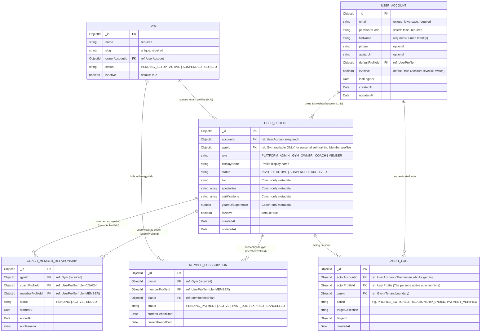

# 03 — Account, Multiple Profiles, Role & Gym Membership Model

**Classification:** `[OPEN DECISION]` (Final Product Selection of Profile Model) + `[ARCHITECTURAL PROPOSAL]` (Comparative Analysis & Recommended Architecture)

---

## 1. The Architectural Problem (`[VERIFIED SOURCE]`)

Currently, `backend/src/models/User.model.ts:1-129` combines five distinct domain concepts into a single MongoDB document:
1. **Authentication Credentials (`Account`):** `email` (unique), `password` (bcrypt hash).
2. **Human Person (`Person`):** `name`, `phone`.
3. **Platform/Tenant Role (`Role`):** `role: "admin" | "trainer" | "member"` (single scalar string).
4. **Professional Coach Persona (`Coach Profile`):** `bio`, `specialties`, `certifications`, `yearsOfExperience`.
5. **Implicit Tenant Membership:** Assumed global because no `gymId` exists.

The product owner wants a **Facebook-inspired account/profile switching experience**: one login with the ability to switch between multiple profiles or training identities. However, three distinct product interpretations exist (**Models A, B, and C**). Below, we rigorously evaluate each model without conflating **Accounts**, **People**, **Profiles**, **Gym Memberships**, and **Roles**.

---

## 2. Comparative Analysis of Models A, B, and C (`[ARCHITECTURAL PROPOSAL]`)

### Model A: One Human Account with Multiple Personal Training Profiles
- **Product Meaning:** A single human logs in and creates multiple personal fitness personas for themselves (e.g., *"Powerlifting Bulk Profile"*, *"Marathon Prep Profile"*, or *"Gym A Member Profile"* vs. *"Home Self-Training Profile"*).
- **How It Works:**
  - `UserAccount` (1) → `Person` (1) → `TrainingProfile` (N).
  - Body height/age belong to the `Person`, but workouts, sessions, and goals belong to each `TrainingProfile`.
- **Pros:**
  - Lets an athlete separate distinct training blocks or keep a personal self-training log separate from a gym-coached profile.
- **Cons & Risks:**
  - **Physiological Fragmentation:** A single human body only has **one real body weight, body fat percentage, and fatigue state** on any given date! Splitting `BodyMeasurement` and `WorkoutSession` volume across multiple personal training profiles corrupts `MemberInsights` recovery/volume analytics and confuses a supervising Coach ("Did the member train yesterday on their other profile?").
  - Does not solve how one login acts as both a **Coach** and a **Member** or **Gym Owner**.

### Model B: One Login Managing Multiple Distinct People (Household / Dependent Model)
- **Product Meaning:** A single login (`UserAccount`) manages profiles representing **different physical human beings** (e.g., a parent managing their own profile plus two minor children's profiles who do not have their own email/login, similar to Netflix profiles or healthcare patient portals).
- **How It Works:**
  - `UserAccount` (1) → `ManagedPerson` (N) → `MemberProfile` (N).
  - Each `ManagedPerson` has their own `name`, `dateOfBirth`, `height`, `BodyMeasurement` history, `CoachMemberRelationship`, and `MemberSubscription`.
- **Pros:**
  - Essential if target gyms run youth athletics, kids' martial arts/swimming, or family membership bundles billed to one parent's credit card.
- **Cons & Risks:**
  - **Billing & Check-In Complexity:** Subscriptions, waivers, and QR check-ins must bind to the specific `ManagedPerson`, while `Invoice` and `PaymentTransaction` bind to the parent `UserAccount`.
  - **Account Graduations:** Requires a future workflow to "detach" a child's `ManagedPerson` profile into their own independent `UserAccount` when they turn 18 or get a phone.
  - **Security Boundary:** A dependent profile must **never** be allowed to hold `COACH` or `GYM_OWNER` privileges without its own authenticated `UserAccount`.

### Model C: One Login with Separate Role & Tenant Identities (Member + Coach + Gym Owner)
- **Product Meaning:** Directly mirrors **Facebook / Instagram / Slack workspace & page switching**:
  - One human logs in once (`UserAccount` + `Person`).
  - Every human has a default **Personal Member Profile** (which can train independently in self-training mode or join one or more Gyms as a Member).
  - That same human can be authorized as a **Coach Profile** at Gym X (and/or Gym Y), and/or own Gym Z as a **Gym Owner Profile**.
  - Clicking the top-right profile switcher in `Header.tsx` switches the active persona (`Member @ Iron Paradise Gym` ↔ `Coach @ Iron Paradise Gym` ↔ `Owner @ Downtown Fitness`), immediately switching the navigation sidebar, permissions, dashboard, and tenant context (`gymId`).
- **Pros:**
  - **Solves a Universal Real-World Gym Problem:** Gym Owners are almost always also Coaches or active lifters; Coaches almost always log their own workouts and body measurements as Members! Under the current `User.model.ts` (`role: "trainer"`), a Coach **cannot** use STREN to track their own workouts because `workout-session.routes.ts` is restricted to `Roles.MEMBER`!
  - **Clean Physiological Integrity:** Because all profiles under one `UserAccount` represent the **same physical human**, personal health metrics (`BodyMeasurement`) remain unified for that human while coaching rosters (`CoachMemberRelationship`) and gym operations (`Gym`) stay strictly isolated per role and `gymId`.
  - **Zero Credential Proliferation:** Users never need to register `john+coach@gmail.com` and `john+member@gmail.com`.

---

## 3. Comparison Matrix Across Architecture Dimensions

| Dimension | Model A (Multiple Personal Training Profiles) | Model B (Household / Parent-Child Profiles) | Model C (Role & Gym Context Profiles: Member / Coach / Owner) |
| :--- | :--- | :--- | :--- |
| **Primary Use Case** | One lifter splitting their own training logs | Parent managing children/dependents under one email | Coach who also trains as a Member; Owner who also Coaches; Member at 2 gyms |
| **Relation to `User` & `Role`** | Splits `User` into `Account` + N `Member` profiles | Splits `User` into `Account` + N `Person` records (all `MEMBER`) | Splits `User` into `UserAccount` (1 human) + N `UserProfile`s (`role` + `gymId`) |
| **Body Measurements & Telemetry** | **Broken/Fragmented** (splits one body's weight/volume across profiles) | **Isolated per Person** (Child A vs. Child B have separate bodies) | **Coherent** (1 physical human; Member profile tracks own body, Coach profile manages clients) |
| **Authorization Impact** | Low (all profiles are `MEMBER`) | Medium (Parent account acts as legal guardian for child `MemberProfile`) | **High Value** (Cleanly scopes RBAC + `gymId` per active `UserProfile`) |
| **Audit Log Clarity** | `accountId` + `profileId` | `accountId` (actor) acting on behalf of `personId` | `accountId` (authenticated human) acting in `profileId` (`role` @ `gymId`) |
| **Recommendation** | **Do NOT adopt** as separate profiles (use Workout Categories/Tags instead) | **Optional Phase 2 Extension** (only if youth/family memberships are required) | **RECOMMENDED CORE V2 ARCHITECTURE** |

---

## 4. Recommended Architecture: Model C Core (with Extensible Person Boundary) (`[ARCHITECTURAL PROPOSAL]`)

We strongly recommend implementing **Model C** as the foundational V2 identity architecture, while keeping a clean distinction between `UserAccount` (login + human identity) and `UserProfile` (role + tenant membership) so that Model B (dependent `Person`) can be added later if family plans are introduced.

### 4.1 Entity-Relationship Diagram: Account, Profile, Role, Gym & Membership (Mermaid Diagram 2)



---

## 5. Authentication, Profile Switching & Audit Log Mechanics (`[ARCHITECTURAL PROPOSAL]`)

### 5.1 Login & Default Context Resolution (`POST /api/v1/auth/login`)
1. User authenticates once with `email` and `password` against `UserAccount`.
2. Backend verifies `account.isActive === true`.
3. Backend fetches all `UserProfile` documents where `{ accountId: account._id, isActive: true, status: "ACTIVE" }`.
4. Backend selects `account.defaultProfileId` (or the first active `UserProfile`).
5. Backend signs a JWT containing:
   ```json
   {
     "sub": "<accountId>",
     "pid": "<activeProfileId>",
     "gid": "<gymId | null>",
     "role": "GYM_OWNER | COACH | MEMBER | PLATFORM_ADMIN",
     "iat": 1760000000,
     "exp": 1760604800
   }
   ```
6. Response returns `{ account, activeProfile, availableProfiles }` so the frontend `Header.tsx` immediately renders the Facebook-style Profile Switcher dropdown.

### 5.2 Facebook-Style Profile Switching Flow (`POST /api/v1/auth/switch-profile`)
- **Request Body:** `{ targetProfileId: string }`
- **Server-Side Authorization Check (Critical):**
  1. `protect` middleware validates the caller's `accountId` and `account.isActive === true`.
  2. Service queries `UserProfile.findOne({ _id: targetProfileId, accountId: req.account._id, isActive: true, status: "ACTIVE" })`.
  3. **Rule:** A user **cannot** self-create a `COACH` or `GYM_OWNER` profile via profile switching. Coach profiles at a Gym must be invited/provisioned by that Gym's `GYM_OWNER`, and Gym Owner profiles are created only through verified Gym Onboarding (`POST /api/v1/gyms/onboard`) or Platform Admin provisioning.
  4. Server writes an `AuditLog` entry (`action: "PROFILE_SWITCHED"`, `actorAccountId`, `actorProfileId: targetProfileId`, `gymId: targetProfile.gymId`).
  5. Server issues a new JWT scoped to `targetProfileId` and returns `{ token, activeProfile }`.
- **Frontend Handling:**
  1. `tokenService.setToken(newToken)` updates the stored token.
  2. `authStore.setActiveProfile(activeProfile)` updates Zustand state.
  3. `queryClient.clear()` purges all cached queries from the previous profile/tenant.
  4. Router redirects to the role-appropriate dashboard (`/owner/dashboard`, `/coach-dashboard`, or `/dashboard`).

### 5.3 Product Questions Requiring Approval Before Implementation (`[OPEN DECISION]`)
See `09-open-decisions.md` (`DECISION-01` and `DECISION-02`) for stakeholder sign-off on:
1. Confirming **Model C** (Role + Gym Context Switching) as the V2 foundation vs. adding **Model B** (Parent/Child household dependents).
2. Whether a Member who belongs to **two different gyms** (`Gym A` and `Gym B`) sees two separate `MEMBER` entries in their Profile Switcher (`Member @ Gym A` vs. `Member @ Gym B`) with shared personal `BodyMeasurement` history or strictly separated gym measurements.
