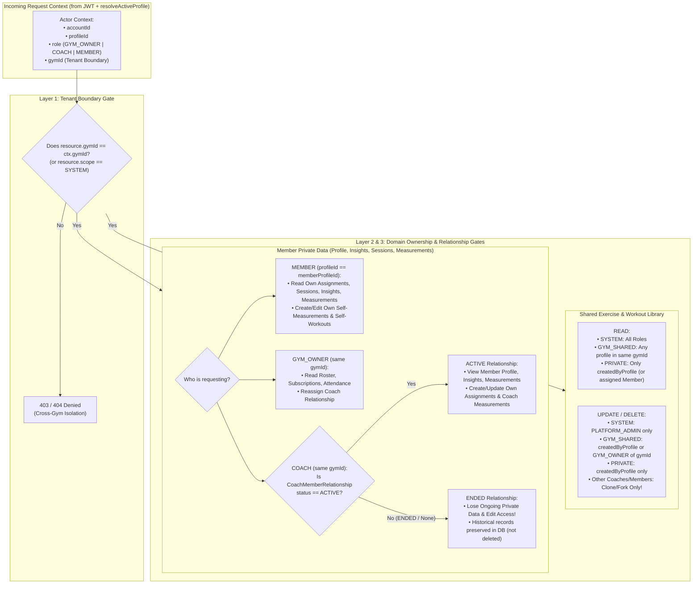
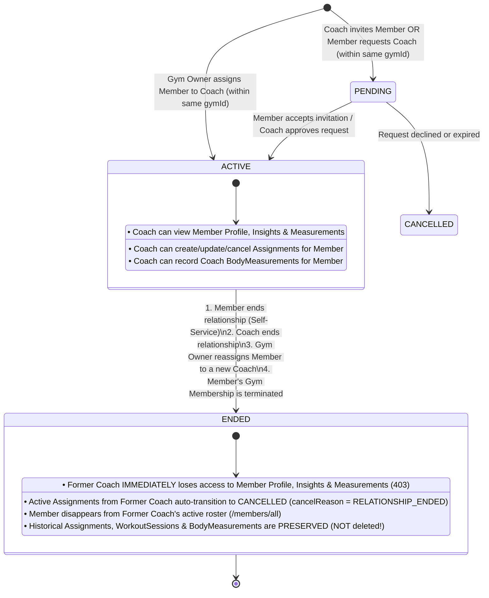

# 04 — Authorization, Shared Library Ownership & Coach–Member Lifecycle

**Classification:** `[APPROVED DECISION]` (Multi-Tenant Isolation, Shared Library, Persistent Coach–Member Relationship) + `[ARCHITECTURAL PROPOSAL]` (RBAC/ABAC Engine & Lifecycle State Machine)

---

## 1. Multi-Tenant Data Ownership & Authorization Boundaries (Mermaid Diagram 3)

The diagram below illustrates how **Tenant Isolation (`gymId`)**, **Role-Based Access Control (RBAC)**, **Resource Visibility (`SYSTEM | GYM_SHARED | PRIVATE`)**, and **Relationship-Based Access Control (`CoachMemberRelationship`)** intersect to govern every request:



---

## 2. Shared Exercise and Workout Library Model (`[APPROVED DECISION]` + `[ARCHITECTURAL PROPOSAL]`)

### 2.1 Current Implementation Flaws (`[VERIFIED SOURCE]`)
1. **`Exercise` (`backend/src/models/Exercise.model.ts` & `exercise.service.ts`):**
   - Has no `createdBy` or `gymId` field.
   - Any authenticated `TRAINER` in `exercise.routes.ts:84,122,156` can edit (`PATCH /exercises/:id`) or soft-delete (`DELETE /exercises/:id`) any exercise in the global catalog, immediately affecting every other coach across all gyms!
2. **`Workout` (`backend/src/models/Workout.model.ts` & `workout.service.ts`):**
   - `GET /workouts/:id` (`workout.service.ts:86-92`) has zero ownership or tenant check—any user can read any workout by ID.
   - `POST /workouts` (`workout.service.ts:20-27`) enforces global `title` uniqueness across the entire database (`Workout.findOne({ title })`), so if Coach A in Gym 1 names a workout `"Push Day A"`, Coach B in Gym 2 gets `409 Conflict`!

### 2.2 Target 3-Tier Library Ownership & Permission Matrix (`[ARCHITECTURAL PROPOSAL]`)

To honor the approved direction (**"keep the library shared for now, with a safe ownership and permission model that supports shared resources without allowing unauthorized cross-gym access or destructive edits"**), every `Exercise` and `Workout` carries `{ scope/visibility, gymId, createdByProfile }`:

| Tier | Scope / Visibility | Who Can View (`GET`) | Who Can Edit (`PATCH`) or Soft-Delete (`DELETE`) | How Other Users Customize It |
| :--- | :--- | :--- | :--- | :--- |
| **1. Platform Curated Catalog** | `SYSTEM`<br>(`gymId: null`) | Every authenticated `GYM_OWNER`, `COACH`, and `MEMBER` across all gyms. | **`PLATFORM_ADMIN` only.** Neither Gym Owners nor Coaches can mutate or delete system exercises/templates. | **Clone / Fork (`POST /workouts/:id/clone`):** Creates a new `GYM_SHARED` or `PRIVATE` copy owned by the caller (`forkedFrom: sourceId`). |
| **2. Gym-Shared Library** | `GYM_SHARED`<br>(`gymId: <gymId>`) | Any `GYM_OWNER`, `COACH`, or `MEMBER` belonging to **that specific `gymId`**. Never visible to other gyms. | **Creator (`createdByProfile === ctx.profileId`)** OR **`GYM_OWNER` of that `gymId`**. Other coaches in the same gym have **read + assign + clone** access only. | Another Coach in the same gym can assign a `GYM_SHARED` workout directly OR clone it into their own library to modify sets/reps. |
| **3. Personal / Private Library** | `PRIVATE`<br>(`createdByProfile: <id>`) | • **Creator (`COACH` or `MEMBER`)**<br>• **Assigned Member** (read-only view when referenced by an `Assignment` for that Member). | **Creator (`createdByProfile === ctx.profileId`) only.** | Cannot be edited by anyone else. Members cannot edit a Coach's workout (`[APPROVED DECISION]`). |

### 2.3 Protection Against Destructive Edits on Active Prescriptions
- Even when a Coach owns a `GYM_SHARED` or `PRIVATE` workout (`createdByProfile === ctx.profileId`), `WorkoutService.delete` retains and strengthens the active-reference check (`workout.service.ts:199-214`): a workout cannot be hard-deleted if referenced by any `Assignment` or `WorkoutSession`, and soft-deleting (`isActive: false`) hides it from future picker lists while keeping it readable on historical `AssignmentDetailsPage` and `WorkoutSession` views.

---

## 3. Persistent Coach–Member Relationship Lifecycle (`[APPROVED DECISION]` + `[ARCHITECTURAL PROPOSAL]`)

### 3.1 Current Implementation Flaws (`[VERIFIED SOURCE]`, `RISK-07`)
- Five backend services (`body-measurement.service.ts:18-28`, `member-profile.service.ts:15-25`, `member-insights.service.ts:23-33`, `members-management.service.ts:42-63`, `coach-dashboard.service.ts:164-174`) check:
  ```ts
  Assignment.exists({ trainer: trainerId, member: memberId, status: "ACTIVE", isActive: true })
  ```
- Furthermore, `AssignmentService.create` (`assignment.service.ts:33-44`) allows any Trainer to pass any `memberId` in `POST /assignments`, unilaterally granting themselves access to that Member's profile, measurements, and insights!

### 3.2 Relationship Lifecycle State Machine (Mermaid Diagram 4)



### 3.3 Detailed Lifecycle & Authorization Rules

#### Rule 1: Establishing the Relationship (`PENDING` → `ACTIVE`)
- A `CoachMemberRelationship` can only be created when **both `coachProfile` and `memberProfile` belong to the same `gymId`** and are `ACTIVE`.
- **Who can initiate:**
  1. **Gym Owner (`GYM_OWNER`):** Can directly assign or reassign a Member to a Coach in their gym (`status: "ACTIVE"` immediately).
  2. **Member (`MEMBER`):** Can select an available Coach in their gym (or accept a Coach's assignment invitation).
  3. **Coach (`COACH`):** Can send a coaching request (`status: "PENDING"`)—cannot unilaterally access a Member's private data until the relationship is `ACTIVE` (fixing `SEC-06`!).

#### Rule 2: What Happens When a Member Ends the Relationship (`ACTIVE` → `ENDED`)
When a Member invokes `POST /api/v1/relationships/:id/end` (or a Gym Owner reassigns the Member):
1. **Relationship State Transition:**
   - `status` becomes `"ENDED"`, `endedAt = new Date()`, `endedByProfile = ctx.profileId`, `endReason = "MEMBER_ENDED"` (or `"OWNER_REASSIGNED"`).
2. **Handling of Active `Assignment`s (`[ARCHITECTURAL PROPOSAL]`):**
   - Any `Assignment` where `{ relationshipId: rel._id, status: "ACTIVE" }` is automatically transitioned in the same database transaction to:
     - `status: "CANCELLED"`
     - `cancelledAt: new Date()`
     - `cancelReason: "Coach-Member relationship ended"`
   - If the Member currently has an `IN_PROGRESS` `WorkoutSession` tied to one of those assignments, see `09-open-decisions.md` (`DECISION-04` — either allow finishing the current in-progress session or cancel it immediately; our default proposal is to auto-cancel future `ACTIVE` assignments while allowing an already-started `IN_PROGRESS` session to finish or be cancelled by the member).
3. **Revocation of Former Coach's Ongoing Access (`[APPROVED DECISION]`):**
   - All 5 member-supervision services (`MemberProfileService`, `MemberInsightsService`, `BodyMeasurementService`, `MembersManagementService`, `CoachDashboardService`) replace `Assignment.exists(...)` with:
     ```ts
     CoachMemberRelationship.exists({
       gymId: ctx.gymId,
       coachProfile: ctx.profileId,
       memberProfile: targetMemberProfileId,
       status: "ACTIVE",
       isActive: true,
     })
     ```
   - Immediately upon `status: "ENDED"`, the former Coach receives `403 Forbidden` if they attempt to view the Member's profile (`/members/:memberId`), insights (`/members/:memberId/insights`), or measurement history (`/members/:memberId/measurements`), or create new assignments/measurements for that Member.
4. **Preservation of Historical Data (`[APPROVED DECISION]`):**
   - **Zero historical records are deleted:**
     - The Member retains 100% of their historical `Assignment`s, `WorkoutSession`s, `WorkoutExerciseLog`s, `WorkoutSetLog`s, and `BodyMeasurement`s (including measurements recorded by the former Coach, which display the historical Coach's name as read-only attribution).
     - If the Member is reassigned to a **New Coach** (`newRelationship.status === "ACTIVE"`), see `09-open-decisions.md` (`DECISION-03`) for whether the New Coach can view historical measurements/sessions recorded during prior coaching relationships at the same gym.
     - Aggregate anonymization for the Former Coach: The former Coach's high-level lifetime counter (e.g., *"Total Sessions Coached"* on `CoachProfile`) may retain aggregate counts of sessions completed while `relationshipId` was active, without exposing the former Member's ongoing identity, profile, or new logs.

---

## 4. Unified RBAC + ABAC Permission Matrix (`[ARCHITECTURAL PROPOSAL]`)

This matrix replaces the fragmented `restrictTo` vs. `authorize` split (`RISK-23`):

| Domain & Action | `PLATFORM_ADMIN` | `GYM_OWNER` (Scoped to `gymId`) | `COACH` (Scoped to `gymId`) | `MEMBER` (Scoped to `gymId` or Self) |
| :--- | :--- | :--- | :--- | :--- |
| **Gym Settings & Staff Roster** | Read/Suspend All Gyms | Full CRUD on own `Gym`; Invite/Deactivate Coaches | Read basic Gym info | Read basic Gym info |
| **Coach–Member Relationships** | Audit Only | View all in `gymId`; Assign / Reassign / End | View own `ACTIVE` roster; Request/End own relationship | View own Coach; Accept/End relationship with current Coach |
| **Exercises (`SYSTEM`)** | Full CRUD | Read Only | Read Only | Read Only |
| **Exercises (`GYM`)** | Read Only | Full CRUD in `gymId` | Create in `gymId`; Update/Delete own (`createdByProfile`) | Read Only |
| **Workouts (`SYSTEM` / `GYM_SHARED` / `PRIVATE`)** | Full CRUD on `SYSTEM` | Read `GYM_SHARED`; Delete/Unshare in `gymId` | Full CRUD on own; Read & Clone `SYSTEM` + `GYM_SHARED` | Full CRUD on own `PRIVATE` self-training workouts; Read assigned Coach workouts |
| **Assignments** | Audit Only | Read all in `gymId` | Full CRUD for Members with `ACTIVE` `CoachMemberRelationship` | **Read Only (`GET /assignments/me`, `GET /assignments/:id` for own assignments)** |
| **Workout Sessions (`COACH_GUIDED`)** | Audit Only | Aggregate stats in `gymId` | Read sessions belonging to own Assignments while relationship `ACTIVE` | Start, Log/Edit Sets while `IN_PROGRESS`, Cancel, Finish, Read Own (No extra sets!) |
| **Workout Sessions (`SELF_TRAINING`)** | Audit Only | Aggregate stats in `gymId` | Read if `ACTIVE` relationship & Member shares self-training logs | Start from own/library workout, Log/Edit Sets, **Add Extra Sets**, Cancel, Finish, Read Own |
| **Body Measurements** | Audit Only | None (Privacy boundary) | Read Member's measurements + Create/Update/Delete **own Coach-recorded** measurements while relationship `ACTIVE` | Read **all own** measurements (Coach + Self) + Create/Update/Delete **own Self-recorded** measurements |
| **Subscriptions & Payments** | Platform billing view | Full CRUD on `MembershipPlan`s; View `MemberSubscription`s, `Invoice`s, `PaymentTransaction`s in `gymId` | View active membership status badge of assigned Members | View `MembershipPlan`s; Purchase via Online Checkout; View own `MemberSubscription` & `Invoice`s |
