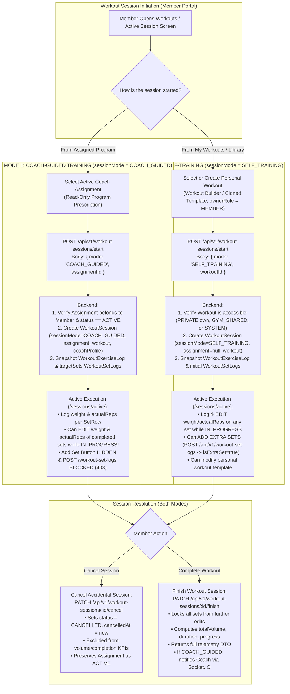

# 05 — Member Self-Service & Dual-Mode Workout Execution Journeys

**Classification:** `[APPROVED DECISION]` (Member Self-Service, Unified Measurements, Coach-Guided vs. Self-Training Workout Rules) + `[ARCHITECTURAL PROPOSAL]` (API Contracts & UI Workflows)

---

## 1. Coach-Guided vs. Self-Training Workflows (Mermaid Diagram 5)

The diagram below models the complete end-to-end execution paths for **Coach-Guided Training** versus **Member Self-Training**, including in-progress set editing, extra-set enforcement, and session cancellation:

---

## 2. Workout Session Rules & Technical Design (`[APPROVED DECISION]` + `[ARCHITECTURAL PROPOSAL]`)

### 2.1 Distinguishing Coach-Guided vs. Self-Training Without Conflating Roles
- **Architectural Principle:** Both modes are executed by a user acting in a `MEMBER` profile. The difference is **not** a user role difference; it is an **execution contract on `WorkoutSession` (`sessionMode: "COACH_GUIDED" | "SELF_TRAINING"`)** determined by the origin of the workout prescription:
  1. **`COACH_GUIDED`:**
     - Originated from a Coach's `Assignment` (`session.assignment !== null`).
     - The Coach prescribed a specific number of sets (`targetSets`) and reps (`targetReps`) to manage fatigue and progressive overload.
     - **Rule (`[APPROVED DECISION]`):** The Member **cannot** edit the underlying `Assignment` or `Workout`, and **cannot** add extra sets (`POST /api/v1/workout-set-logs` returns `403 AppError("Cannot add extra sets to a coach-prescribed workout session", 403)`).
  2. **`SELF_TRAINING`:**
     - Originated from the Member's own personal workout (`Workout.createdByProfile === memberProfileId, ownerRole: "MEMBER"`) or a self-selected `SYSTEM` / `GYM_SHARED` workout (`session.assignment === null`).
     - **Rule (`[APPROVED DECISION]`):** The Member **can** create and modify their own personal workouts in `/my-workouts` and **can** add extra sets dynamically during an active `SELF_TRAINING` session (`POST /api/v1/workout-set-logs` is mounted and allowed when `session.sessionMode === "SELF_TRAINING"`).

### 2.2 Editing Logged Weights & Repetitions While `IN_PROGRESS`
- **Current Bug (`[VERIFIED SOURCE]`):**
  - In `frontend/src/features/workout-sessions/components/SetRow.tsx:76,84`, the weight and reps `<input>` elements have `disabled={isCompleted}`, permanently locking the inputs the instant the Member clicks the checkmark!
  - In `backend/src/services/workout-set.service.ts:68-127` (`completeSet`), once `set.completed` is `true`, there is no dedicated update path to revise `weight` or `actualReps` without re-triggering completion logic.
- **Target Design (`[ARCHITECTURAL PROPOSAL]`):**
  1. **Backend (`PATCH /api/v1/workout-set-logs/:id`):**
     - Verify the parent `WorkoutSession` belongs to `ctx.profileId` and has `status === "IN_PROGRESS"`. (If `session.status !== "IN_PROGRESS"`, reject with `400 AppError("Cannot modify sets of a finished or cancelled session", 400)`).
     - Allow updating `weight`, `actualReps`, `restDuration`, and toggling `completed` (`true` ↔ `false`) at any time while `session.status === "IN_PROGRESS"`.
     - Recalculate parent `WorkoutExerciseLog.completed` (true if all sets are completed) and `WorkoutSession` live metrics (`setsCompleted`, `exercisesCompleted`, `progress`, `totalVolume`).
  2. **Frontend (`SetRow.tsx`):**
     - Remove `disabled={isCompleted}` while `session.status === "IN_PROGRESS"`.
     - If a set is already marked `completed: true` and the Member edits `weight` or `actualReps` (on blur or via an inline "Update" / checkmark sync), fire `useUpdateSetMutation` (`PATCH /api/v1/workout-set-logs/:id`) and invalidate `["active-workout-session"]`.

### 2.3 Cancelling an Accidentally Started Session
- **Current Bug (`[VERIFIED SOURCE]`):**
  - `WORKOUT_SESSION_STATUS.CANCELLED` exists in `backend/src/constants/workout-session.ts:4`, but no controller/service/route implements session cancellation!
- **Target Design (`[ARCHITECTURAL PROPOSAL]`):**
  1. **Backend Endpoint (`PATCH /api/v1/workout-sessions/:id/cancel`):**
     - Restricted to the `MEMBER` who owns the session (`session.memberProfile === ctx.profileId`).
     - Verifies `session.status === "IN_PROGRESS"` (cannot cancel an already `COMPLETED` session).
     - Updates `session.status = "CANCELLED"`, `session.cancelledAt = new Date()`, `session.endedAt = new Date()`, and optional `session.cancelReason = req.body.cancelReason`.
     - **Does NOT mark the parent `Assignment` as `COMPLETED` or `CANCELLED`**—the `Assignment` remains `ACTIVE` so the Member can start it again when ready.
     - **Analytics Exclusion:** All dashboard/insights aggregations (`CoachDashboardService`, `MemberInsightsService`, `MemberProfileService`, `DashboardService`) explicitly filter `WorkoutSession` metrics by `status: "COMPLETED"` for volume/duration/streak totals so cancelled sessions never skew training analytics.
  2. **Frontend (`ActiveWorkoutPage.tsx` & `SessionHeader.tsx`):**
     - Add a `"Cancel Session"` secondary destructive action with a confirmation dialog (`"Discard this in-progress session? Your assignment will remain active."`).
     - On success, invalidate `["active-workout-session"]` and `["assignments"]`, and redirect the Member to `/dashboard`.

---

## 3. Member Self-Service: Assignments, Insights & Unified Body Measurements (`[APPROVED DECISION]` + `[ARCHITECTURAL PROPOSAL]`)

### 3.1 Member Read-Only Access to Own Assignment Details
- **Current Bug (`[VERIFIED SOURCE]`):**
  - When a Coach assigns a workout, `assignment.service.ts:99-109` sends the Member a notification with `actionUrl: "/assignments/${assignment._id}"`.
  - However, `GET /api/v1/assignments/:id` (`backend/src/routes/assignment.routes.ts:36`) has `restrictTo(Roles.ADMIN, Roles.TRAINER)`, returning `403 Forbidden` to the Member!
- **Target Design (`[ARCHITECTURAL PROPOSAL]`):**
  1. **Backend (`GET /api/v1/assignments/:id`):**
     - Allow `MEMBER` role on `GET /api/v1/assignments/:id`.
     - In `AssignmentService.getById(id, ctx)`:
       - If `ctx.role === "COACH"`, enforce `assignment.coachProfile.equals(ctx.profileId) && assignment.gymId.equals(ctx.gymId)`.
       - If `ctx.role === "MEMBER"`, enforce `assignment.memberProfile.equals(ctx.profileId)`.
  2. **Frontend (`AssignmentDetailsPage.tsx`):**
     - Render in **read-only mode** when `activeProfile.role === "MEMBER"`: hide the `"Edit Assignment"`, `"Cancel Assignment"`, and `"Delete Assignment"` coach action buttons, and display a primary `"Start Workout Session"` CTA button if `assignment.status === "ACTIVE"`.

### 3.2 Unified `BodyMeasurement` Domain Model & Self-Service API
- **Approved Direction (`[APPROVED DECISION]`):**
  - Members may view their own measurements and progress and record their own measurements.
  - Distinguish self-reported measurements from coach-recorded measurements.
  - Use **one coherent underlying measurement domain model and API contract** rather than duplicating the feature for Coaches and Members, separating role-specific UI where useful.
- **Current Bug (`[VERIFIED SOURCE]`):**
  - `BodyMeasurement.model.ts:18` requires `trainer: ObjectId`.
  - `body-measurement.routes.ts:31,80,99` restricts `POST`, `PATCH`, and `DELETE` to `Roles.ADMIN, Roles.TRAINER`.
  - `body-measurement.service.ts:146,179` (`update`, `delete`) only checks `checkTrainerAccess`, allowing Coach B to edit/delete a measurement recorded by Coach A, and blocking Coach A if their assignment completes.
  - `body-measurement.mapper.ts:12` calls `doc.trainer.toString()` on a populated `trainer` object (`"[object Object]"` bug, `RISK-13`).
- **Target Unified API & Ownership Rules (`[ARCHITECTURAL PROPOSAL]`):**

| Endpoint | Coach (`role === "COACH"`) | Member (`role === "MEMBER"`) |
| :--- | :--- | :--- |
| **`POST /api/v1/body-measurements`** | • Requires `memberProfileId` in body. • Verifies `ACTIVE` `CoachMemberRelationship` with that Member in `ctx.gymId`. • Sets `recordedByProfile = ctx.profileId`, `recordedByRole = "COACH"`, `coachProfile = ctx.profileId`. | • `memberProfileId` defaults to `ctx.profileId` (cannot log for anyone else!). • Sets `recordedByProfile = ctx.profileId`, `recordedByRole = "MEMBER"`, `coachProfile = null`, `trainer = null`. |
| **`GET /api/v1/body-measurements/member/:memberId`** & **`/latest`** | • Verifies `ACTIVE` `CoachMemberRelationship` with `:memberId` in `ctx.gymId`. • Returns both `COACH` and `MEMBER` recorded measurements for that Member (filterable by `?source=COACH\|MEMBER`). | • Enforces `:memberId === ctx.profileId` (or provides convenience alias `GET /api/v1/body-measurements/me`). • Returns all own measurements with `recordedByRole` badge. |
| **`PATCH /api/v1/body-measurements/:id`** & **`DELETE /api/v1/body-measurements/:id`** | • Must have `ACTIVE` `CoachMemberRelationship` with `measurement.memberProfile` **AND** `measurement.recordedByProfile.equals(ctx.profileId)` (`recordedByRole === "COACH"`). • A Coach **cannot** edit or delete a Member's self-reported measurement or another Coach's measurement! | • Must own the measurement (`measurement.memberProfile.equals(ctx.profileId)`) **AND** `measurement.recordedByRole === "MEMBER"`. • A Member **cannot** edit or delete a Coach-recorded measurement! |

### 3.3 Role-Specific UI Separation Over Shared Measurement Components
- **Shared Frontend Infrastructure (`frontend/src/features/body-measurements/`):**
  - Reuses the same `bodyMeasurementsApi`, React Query hooks (`useBodyMeasurements`, `useCreateMeasurement`, `useUpdateMeasurement`, `useDeleteMeasurement`), `MeasurementChart`, `MeasurementTable`, and `MeasurementFormModal`.
  - Every row in `MeasurementTable` and data point tooltip in `MeasurementChart` displays a source badge:
    - `Verified by Coach (<Coach Name>)` when `recordedByRole === "COACH"`
    - `Self-Reported` when `recordedByRole === "MEMBER"`
  - Edit/Delete row action buttons render **only** when `measurement.recordedByProfile === activeProfile.id`.
- **Route & Header Separation:**
  - **Coach View (`/members/:memberId/measurements`):** Includes the Member Context Header (`MemberBreadcrumb`, Member avatar, active program badge) so the Coach knows which client they are logging for.
  - **Member Self-Service View (`/my-measurements` & `/my-insights`):** Uses a personal header (`"My Body Measurements & Progress"`), pre-binds `memberId = activeProfile.id`, and unlocks `GET /api/v1/member-insights/:memberId` for `memberId === activeProfile.id`.
