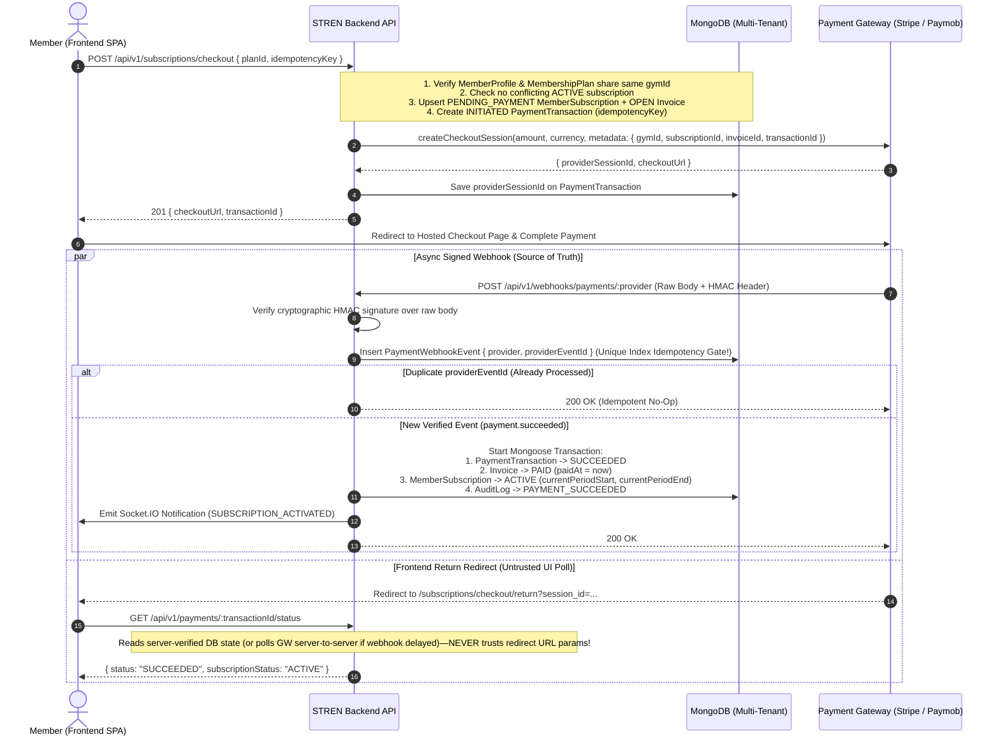

# 06 — Online Checkout, Subscriptions, Webhooks & Financial Isolation

**Classification:** `[APPROVED DECISION]` (Online Checkout Commercial Direction) + `[ARCHITECTURAL PROPOSAL]` (Payment Gateway Adapter, Webhook Pipeline, State Machines & Schemas) + `[OPEN DECISION]` (Launch Market Payment Provider Selection)

---

## 1. Payment Provider Evaluation Matrix (`[OPEN DECISION]` + `[ARCHITECTURAL PROPOSAL]`)

Per the approved direction (**"Do not choose a provider without evaluating the intended launch market, provider availability, fees, and integration requirements. Keep payment secrets server-side"**), we evaluate the primary payment gateways based on STREN's potential launch markets (MENA/Egypt vs. GCC vs. North America/Europe) and design a **Provider-Agnostic `PaymentGatewayAdapter` Interface** so the domain logic (`MemberSubscription`, `Invoice`, `PaymentTransaction`) never hardcodes a single gateway's SDK.

| Provider | Supported Launch Markets | Local Payment Methods | Typical Fees | Multi-Tenant / Sub-Merchant Payout Support | Webhook & Security Mechanism |
| :--- | :--- | :--- | :--- | :--- | :--- |
| **1. Stripe (`Stripe Billing` + `Stripe Connect`)** | US, UK, EU, UAE, Saudi Arabia *(Not natively available for Egyptian EGP merchant accounts)* | Visa/Mastercard, Apple Pay, Google Pay, SEPA, ACH | ~2.9% + $0.30 (US/EU); ~2.9% + 1 AED (UAE) | **Best-in-Class (`Stripe Connect Express/Standard`):** Automatically splits platform fee vs. Gym Owner payout. | `Stripe-Signature` header (`HMAC-SHA256` over raw timestamped body). Built-in `Idempotency-Key` header. |
| **2. Paymob (Accept)** | **Egypt (EGP)**, UAE, Saudi Arabia, Oman, Pakistan | Visa/Mastercard, **Meeza**, **Mobile Wallets (Vodafone Cash, InstaPay/Wallet)**, **Fawry Reference Kiosk**, Apple Pay | ~2.25%–2.75% + 3 EGP (Egypt local cards/wallets) | Requires Paymob Split Payments / Sub-Merchant configuration or platform settlement ledger. | `hmac` query/header (`SHA-512` over sorted concatenated fields from webhook payload). |
| **3. Tap Payments / Moyasar** | GCC (Saudi Arabia, UAE, Kuwait, Bahrain, Qatar, Oman) | **mada**, KNET, Benefit, Visa/Mastercard, Apple Pay | ~1.75% (mada) to 2.75% (Intl cards) | Supports `Destination` / Marketplace split charges across GCC sub-merchants. | `hashstring` (`HMAC-SHA256`) webhook verification. |
| **4. Kashier / Fawry Pay** | Egypt (EGP) | Cards, Meeza, Mobile Wallets, Fawry Reference Code | ~2.5% + fixed fee | Manual or batch payout settlement per merchant account. | `Signature` HMAC header verification. |

### Architectural Recommendation for Provider Selection
1. **If Launching in Egypt / MENA (`EGP` / `SAR` / `AED`):** Implement `PaymobGatewayAdapter` (for Egypt cards, mobile wallets, and Fawry kiosk codes) alongside `StripeGatewayAdapter` (for international/UAE/GCC gyms).
2. **If Launching in US / Europe / UAE:** Implement `StripeGatewayAdapter` with **Stripe Checkout + Stripe Connect**.
3. **Core Rule:** All domain services interact exclusively with `IPaymentGatewayAdapter`:
   ```ts
   export interface IPaymentGatewayAdapter {
     readonly providerName: "STRIPE" | "PAYMOB" | "TAP" | "MANUAL";
     createCheckoutSession(input: CreateCheckoutInput): Promise<CheckoutSessionResult>;
     verifyWebhookSignature(rawBody: Buffer, headers: Record<string, string | string[] | undefined>): VerifiedWebhookPayload;
     fetchTransactionStatus(externalTransactionId: string): Promise<ProviderTransactionStatus>;
   }
   ```
   All API keys (`STRIPE_SECRET_KEY`, `STRIPE_WEBHOOK_SECRET`, `PAYMOB_API_KEY`, `PAYMOB_HMAC_SECRET`) reside **strictly in backend environment variables (`backend/src/config/env.ts`)** and are never exposed to the frontend (`VITE_*`).

---

## 2. Subscription & Payment Lifecycle (Mermaid Diagram 6)



---

## 3. Financial & Subscription Data Models (`[ARCHITECTURAL PROPOSAL]`)

All five financial collections enforce **strict `gymId` tenant isolation**:

### 3.1 `MembershipPlan` (`backend/src/models/MembershipPlan.model.ts` — NEW)
- `gymId`: `ObjectId` (`ref: "Gym"`, required, indexed)
- `name`: `String` (required, e.g., `"Gold Monthly Coaching + Gym Access"`)
- `description`: `String`
- `billingInterval`: `String` (`enum: ["ONE_TIME", "MONTHLY", "QUARTERLY", "YEARLY"]`, required)
- `durationDays`: `Number` (required, `min: 1` — e.g., `30`, `90`, `365`)
- `priceMinorUnits`: `Number` (required, integer in cents/piastres to avoid floating-point rounding errors! E.g., `150000` = `1,500.00 EGP` or `$1,500.00`)
- `currency`: `String` (required, ISO-4217 uppercase, e.g., `"USD"`, `"EGP"`, `"AED"`, `"SAR"`)
- `includesPersonalCoach`: `Boolean` (default `false`)
- `maxCoachSessionsPerCycle`: `Number` (default `null`)
- `isActive`: `Boolean` (default `true`)
- **Indexes:** `{ gymId: 1, isActive: 1 }`, `{ gymId: 1, name: 1 }` (`unique: true, partialFilterExpression: { isActive: true }`).

### 3.2 `MemberSubscription` (`backend/src/models/MemberSubscription.model.ts` — NEW)
- `gymId`: `ObjectId` (`ref: "Gym"`, required, indexed)
- `memberProfile`: `ObjectId` (`ref: "UserProfile"`, required)
- `plan`: `ObjectId` (`ref: "MembershipPlan"`, required)
- `status`: `String` (`enum: ["PENDING_PAYMENT", "ACTIVE", "PAST_DUE", "PAUSED", "EXPIRED", "CANCELLED"]`, required)
- `currentPeriodStart`: `Date`
- `currentPeriodEnd`: `Date`
- `cancelAtPeriodEnd`: `Boolean` (default `false`)
- `cancelledAt`: `Date` (default `null`)
- `externalSubscriptionId`: `String` (default `null` — if recurring provider subscription is used)
- **Indexes:**
  - `{ gymId: 1, memberProfile: 1, status: 1 }` (with partial unique index preventing multiple concurrent `ACTIVE` subscriptions to the same plan type in the same gym).
  - `{ status: 1, currentPeriodEnd: 1 }` (for daily expiration cron job).

### 3.3 `Invoice` (`backend/src/models/Invoice.model.ts` — NEW)
- `gymId`: `ObjectId` (`ref: "Gym"`, required, indexed)
- `invoiceNumber`: `String` (required — tenant-scoped sequential or structured code, e.g., `"INV-GYM1-2026-000042"`)
- `memberProfile`: `ObjectId` (`ref: "UserProfile"`, required)
- `accountId`: `ObjectId` (`ref: "UserAccount"`, required — billing human identity)
- `subscription`: `ObjectId` (`ref: "MemberSubscription"`, required)
- `planSnapshot`: `{ name: String, durationDays: Number, priceMinorUnits: Number, currency: String }` (immutable snapshot at billing time so future plan price edits never alter historical invoices!)
- `subtotalMinorUnits`: `Number`, `taxMinorUnits`: `Number`, `totalMinorUnits`: `Number`, `currency`: `String`
- `status`: `String` (`enum: ["DRAFT", "OPEN", "PAID", "VOID", "UNCOLLECTIBLE", "REFUNDED"]`, required)
- `issuedAt`: `Date`, `dueAt`: `Date`, `paidAt`: `Date` (default `null`)
- **Indexes:** `{ gymId: 1, invoiceNumber: 1 }` (`unique: true`), `{ gymId: 1, memberProfile: 1, issuedAt: -1 }`.

### 3.4 `PaymentTransaction` (`backend/src/models/PaymentTransaction.model.ts` — NEW)
- `gymId`: `ObjectId` (`ref: "Gym"`, required, indexed)
- `invoice`: `ObjectId` (`ref: "Invoice"`, required)
- `subscription`: `ObjectId` (`ref: "MemberSubscription"`, required)
- `memberProfile`: `ObjectId` (`ref: "UserProfile"`, required)
- `provider`: `String` (`enum: ["STRIPE", "PAYMOB", "TAP", "MANUAL_POS"]`, required)
- `amountMinorUnits`: `Number` (required), `currency`: `String` (required)
- `status`: `String` (`enum: ["INITIATED", "PROCESSING", "SUCCEEDED", "FAILED", "CANCELLED", "REFUNDED"]`, required)
- `idempotencyKey`: `String` (required — client/server idempotency token preventing double checkout creation)
- `providerSessionId`: `String` (indexed), `providerTransactionId`: `String` (indexed, sparse unique)
- `failureCode`: `String`, `failureMessage`: `String`
- `completedAt`: `Date`
- **Indexes:** `{ gymId: 1, idempotencyKey: 1 }` (`unique: true`), `{ provider: 1, providerTransactionId: 1 }` (`unique: true, sparse: true`).

### 3.5 `PaymentWebhookEvent` (`backend/src/models/PaymentWebhookEvent.model.ts` — NEW)
Guarantees **100% webhook idempotency** against provider retries:
- `provider`: `String` (`enum: ["STRIPE", "PAYMOB", "TAP"]`, required)
- `providerEventId`: `String` (required — e.g., Stripe `evt_...` or Paymob `obj.id`)
- `eventType`: `String` (required)
- `gymId`: `ObjectId` (`ref: "Gym"`, default `null`)
- `processingStatus`: `String` (`enum: ["RECEIVED", "PROCESSED", "IGNORED", "FAILED"]`, required)
- `payloadHash`: `String` (SHA-256 hash of raw body)
- `processedAt`: `Date`, `errorMessage`: `String`
- **Index:** `{ provider: 1, providerEventId: 1 }` (`unique: true`).

---

## 4. Critical Financial Security & Integrity Guarantees (`[ARCHITECTURAL PROPOSAL]`)

1. **Zero Client-Side Price or Status Trust:**
   - `POST /api/v1/subscriptions/checkout` accepts **only** `{ planId, idempotencyKey }`. The backend reads `priceMinorUnits` and `currency` from `MembershipPlan` in MongoDB (`gymId: ctx.gymId, isActive: true`).
   - Redirect return URLs (`/subscriptions/checkout/return?success=true`) **never** activate a subscription; only a cryptographically verified webhook or a server-to-server `providerAdapter.fetchTransactionStatus()` call can transition `PaymentTransaction.status` to `SUCCEEDED` and `MemberSubscription.status` to `ACTIVE`.
2. **Double-Layer Idempotency:**
   - **Outbound (Checkout Creation):** `{ gymId, idempotencyKey }` unique index on `PaymentTransaction` ensures that if a Member double-clicks `"Pay Now"` on slow mobile internet, the backend returns the existing `INITIATED` checkout session instead of creating duplicate invoices.
   - **Inbound (Webhook Processing):** `{ provider, providerEventId }` unique index on `PaymentWebhookEvent` ensures that if Stripe or Paymob delivers the same `payment_intent.succeeded` webhook 5 times, attempts 2–5 immediately catch `E11000` and return `200 OK` without extending `currentPeriodEnd` multiple times.
3. **Immutable Financial Records:**
   - Once an `Invoice` is `PAID` or a `PaymentTransaction` is `SUCCEEDED`, no endpoint (`DELETE` or `PATCH`) may delete or mutate its amount, currency, or `gymId`. Corrections must be recorded via explicit `REFUNDED` state transitions and credit/refund transaction entries.
