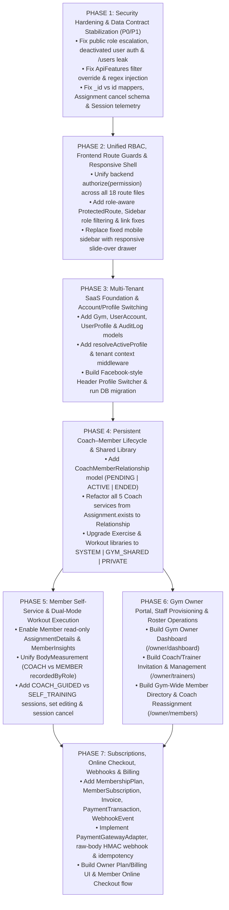

# 08 — Phased Implementation Roadmap, Testing & Rollback Plan

**Classification:** `[ARCHITECTURAL PROPOSAL]` (Dependency-Ordered Execution Plan)

---

## 1. Dependency-Ordered Implementation Stages (Mermaid Diagram 7)

The roadmap is structured into **7 sequential phases** so that security vulnerabilities and data contract bugs are fixed first, the multi-tenant & profile identity foundation is laid once, and domain modules are built without rework:

---

## 2. Phase-by-Phase Execution Plan & File Modification Manifest

### Phase 1 — Security Hardening & Data Contract Stabilization (`P0` / `P1` Foundation)
- **Objective:** Eliminate critical security holes (`SEC-01` to `SEC-05`) and fix broken data contracts (`RISK-04`, `RISK-05`, `RISK-06`, `RISK-11`, `RISK-13`, `RISK-15`, `RISK-21`) so existing features work reliably before schema expansion.
- **Backend Files to Modify:**
  - `backend/src/validators/auth.validator.ts` (remove `role` from `registerSchema`)
  - `backend/src/services/auth.service.ts` (enforce `role: Roles.MEMBER` on public registration)
  - `backend/src/middleware/auth.middleware.ts` (enforce `currentUser.isActive === true`)
  - `backend/src/socket/index.ts` (enforce `currentUser.isActive === true` on socket connect)
  - `backend/src/routes/user.routes.ts` & `backend/src/services/user.service.ts` (restrict `GET /users` to `ADMIN`/`TRAINER`)
  - `backend/src/utils/ApiFeatures.ts` (enforce allowlisted filter fields, escape `$regex`, prevent overriding security filters)
  - `backend/src/validators/assignment.validator.ts` (add `cancelReason` to `updateAssignmentSchema`)
  - `backend/src/validators/exercise.validator.ts` (remove `.default([])` overwrite on partial update of `secondaryMuscles`)
  - `backend/src/routes/coach-profile.routes.ts` & `backend/src/validators/coach-profile.validator.ts` (add Zod validation to `PATCH /coach-profile`)
  - `backend/src/mappers/assignment.mapper.ts` & `backend/src/services/assignment.service.ts` (populate `create`/`update`, map nested `workout.exercises[].exercise`)
  - `backend/src/mappers/workout-session.mapper.ts` & `backend/src/services/workout-session.service.ts` (return full telemetry fields; populate `assignment.trainer` in `getCurrent`)
  - `backend/src/mappers/body-measurement.mapper.ts` (fix `doc.trainer.toString()` bug)
  - `backend/src/controllers/auth.controller.ts` (map `getMe` via `mapUser`)
  - `backend/src/services/workout.service.ts` & `backend/src/mappers/workout.mapper.ts` (map `getById` and enforce ownership check)
  - `backend/src/services/exercise.service.ts` (map `getAll` and `getById` via `mapExercise`)
- **Frontend Files to Modify:**
  - `frontend/src/features/assignments/utils/assignment.mapper.ts` (accept `id ?? _id` without corrupting `member.id`)
  - `frontend/src/features/assignments/components/AssignmentForm.tsx` (add conditional `cancelReason` input)
  - `frontend/src/features/workout-sessions/components/ExerciseTimeline.tsx` (render `exercise.sets` table)
  - `frontend/src/features/workout-sessions/hooks/useMyAssignments.ts` (rename colliding query key `["my-assignments"]` → `["active-workout-assignments"]`)

---

### Phase 2 — Unified RBAC, Frontend Route Guards & Responsive Shell
- **Objective:** Unify backend permission middleware (`RISK-23`), enforce role-aware frontend routing and navigation (`RISK-09`), fix all broken internal links/notification URLs (`RISK-16` to `RISK-18`), and fix the mobile layout (`RISK-10`).
- **Backend Files to Modify:**
  - `backend/src/constants/roles.ts`, `backend/src/constants/permissions.ts`, `backend/src/constants/role-permissions.ts`
  - `backend/src/middleware/authorize.middleware.ts` & `backend/src/routes/*.ts` (replace hardcoded `restrictTo` calls with unified `authorize(Permission)`)
  - `backend/src/services/workout-session.service.ts` & `backend/src/services/body-measurement.service.ts` (fix notification `actionUrl` paths)
- **Frontend Files to Modify:**
  - `frontend/src/routes/ProtectedRoute.tsx` & `frontend/src/routes/AppRouter.tsx` (add `allowedRoles` per route group; remove dead/duplicate stray directories `frontend/coach/`, `frontend/hooks/`, `features/homelayout`, `features/overview`)
  - `frontend/src/components/shared/layouts/AppLayout.tsx`, `frontend/src/components/shared/sidebar/Sidebar.tsx`, `frontend/src/components/shared/header/Header.tsx` (role-filtered navigation, accessible `/profile` link, mobile slide-over drawer, fix quick-action links)
  - `frontend/src/features/workout-sessions/pages/ActiveWorkoutPage.tsx` & `frontend/src/features/assignments/pages/AssignmentDetailsPage.tsx` (fix broken back/detail links)

---

### Phase 3 — Multi-Tenant SaaS Foundation & Account/Profile Switching
- **Objective:** Introduce `Gym`, `UserAccount`, `UserProfile`, and `AuditLog`, implement the tenant context middleware, migrate existing single-tenant records to the Default Founding Gym, and add the Facebook-style Profile Switcher in `Header.tsx`.
- **New Backend Files to Create:**
  - `backend/src/models/Gym.model.ts`
  - `backend/src/models/UserAccount.model.ts` (or evolved `User.model.ts`)
  - `backend/src/models/UserProfile.model.ts`
  - `backend/src/models/AuditLog.model.ts`
  - `backend/src/middleware/tenantContext.middleware.ts` (`resolveActiveProfile`)
  - `backend/src/scripts/migrate-v2-multitenant.ts`
- **Existing Backend & Frontend Files to Modify:**
  - `backend/src/services/auth.service.ts`, `backend/src/controllers/auth.controller.ts`, `backend/src/routes/auth.routes.ts` (add `POST /auth/switch-profile` and return `{ account, activeProfile, availableProfiles }`)
  - All domain models in `backend/src/models/*.ts` (add `gymId` and tenant-scoped partial unique indexes)
  - `frontend/src/store/auth.store.ts`, `frontend/src/components/shared/header/Header.tsx` (Profile Switcher UI + `queryClient.clear()` on switch)

---

### Phase 4 — Persistent Coach–Member Lifecycle & Shared Library Model
- **Objective:** Decouple Coach–Member relationships from individual `Assignment`s (`RISK-07`) and implement the 3-tier Shared Exercise & Workout Library (`SYSTEM | GYM_SHARED | PRIVATE`).
- **New Backend Files to Create:**
  - `backend/src/models/CoachMemberRelationship.model.ts`
  - `backend/src/services/relationship.service.ts`, `backend/src/controllers/relationship.controller.ts`, `backend/src/routes/relationship.routes.ts`, `backend/src/validators/relationship.validator.ts`
- **Existing Backend & Frontend Files to Modify:**
  - `backend/src/services/body-measurement.service.ts`, `member-profile.service.ts`, `member-insights.service.ts`, `members-management.service.ts`, `coach-dashboard.service.ts`, `assignment.service.ts` (replace `Assignment.exists` with `CoachMemberRelationshipService.assertActiveAccess`, and scope `$lookup` pipelines by `gymId` and `coachProfile`)
  - `backend/src/models/Exercise.model.ts`, `backend/src/models/Workout.model.ts`, `backend/src/services/exercise.service.ts`, `backend/src/services/workout.service.ts` (implement `SYSTEM | GYM_SHARED | PRIVATE` permissions and `POST /workouts/:id/clone`)
  - `frontend/src/features/profile/` & `frontend/src/features/member-profile/` (consolidate duplicated member profile code; add `"End Coaching Relationship"` self-service button for Members)

---

### Phase 5 — Member Self-Service & Dual-Mode Workout Execution
- **Objective:** Enable Member read-only Assignment Details & Insights, unify Coach + Member `BodyMeasurement` recording, and support `COACH_GUIDED` vs. `SELF_TRAINING` workout sessions (including editing in-progress sets and cancelling sessions).
- **Backend Files to Modify:**
  - `backend/src/routes/assignment.routes.ts` & `backend/src/services/assignment.service.ts` (allow Member `GET /assignments/:id` for own assignments)
  - `backend/src/routes/member-insights.routes.ts` & `backend/src/services/member-insights.service.ts` (allow Member `GET /member-insights/:memberId` for own profile)
  - `backend/src/models/BodyMeasurement.model.ts`, `backend/src/routes/body-measurement.routes.ts`, `backend/src/services/body-measurement.service.ts` (add `recordedByProfile`, `recordedByRole: "COACH" | "MEMBER"`, optional `trainer`, and source-based edit/delete guards)
  - `backend/src/models/WorkoutSession.model.ts`, `backend/src/routes/workout-session.routes.ts`, `backend/src/services/workout-session.service.ts` (add `sessionMode: "COACH_GUIDED" | "SELF_TRAINING"`, optional `assignment`, direct `workout` ref, and `PATCH /workout-sessions/:id/cancel`)
  - `backend/src/app.ts` / `backend/src/routes/index.ts`, `backend/src/routes/workout-set.routes.ts`, `backend/src/services/workout-set.service.ts` (allow `PATCH /workout-set-logs/:id` on completed sets while `IN_PROGRESS`; mount `POST /workout-set-logs` gated on `sessionMode === "SELF_TRAINING"`)
- **Frontend Files to Modify:**
  - `frontend/src/features/assignments/pages/AssignmentDetailsPage.tsx` (read-only view for Member + `"Start Workout"` button)
  - `frontend/src/features/body-measurements/` (add `recordedByRole` badge; enable Member self-measurement route `/my-measurements`)
  - `frontend/src/features/workout-sessions/components/SetRow.tsx`, `ExerciseCard.tsx`, `ActiveWorkoutPage.tsx` (allow editing completed sets while `IN_PROGRESS`, show `"Add Extra Set"` only in `SELF_TRAINING` mode, add `"Cancel Session"` button)
  - `frontend/src/features/workouts/` (enable Member self-training workout builder `/my-workouts`)

---

### Phase 6 — Gym Owner Portal, Staff Provisioning & Roster Operations
- **Objective:** Build the dedicated `GYM_OWNER` experience for managing gym settings, inviting/managing Coaches, viewing the gym-wide Member roster, and assigning/reassigning Coach–Member relationships.
- **New Backend & Frontend Modules:**
  - `backend/src/routes/gym-owner.routes.ts`, `backend/src/controllers/gym-owner.controller.ts`, `backend/src/services/gym-owner.service.ts`
  - `frontend/src/features/owner-dashboard/`, `frontend/src/features/owner-staff/`, `frontend/src/features/owner-members/`

---

### Phase 7 — Subscriptions, Online Checkout, Webhooks & Financial Isolation
- **Objective:** Implement commercial membership plans, online checkout integration, signed webhook handling with idempotency, invoices, and subscription lifecycle management.
- **New Backend & Frontend Modules:**
  - `backend/src/models/MembershipPlan.model.ts`, `MemberSubscription.model.ts`, `Invoice.model.ts`, `PaymentTransaction.model.ts`, `PaymentWebhookEvent.model.ts`
  - `backend/src/services/payments/payment-gateway.interface.ts`, `stripe.adapter.ts` / `paymob.adapter.ts`, `subscription.service.ts`, `webhook.controller.ts`
  - `frontend/src/features/subscriptions/`, `frontend/src/features/billing/`

---

## 3. Comprehensive Testing & Verification Strategy (`[ARCHITECTURAL PROPOSAL]`)

Because neither `backend/package.json` nor `frontend/package.json` currently includes a configured test runner (`[VERIFIED SOURCE]`), Phase 1 introduces automated verification:

1. **Backend Integration & Security Suite (`Vitest` + `Supertest` + `mongodb-memory-server`):**
   - ** Cross-Tenant Isolation Tests:** Seed Gym A and Gym B; assert that every endpoint (`GET /workouts`, `GET /assignments`, `GET /members-management`, `GET /coach-dashboard`, `GET /body-measurements`) called with Gym A credentials returns `0` records from Gym B, even when Gym B IDs or query parameters (`?gymId=...`, `?trainer=...`) are explicitly passed.
   - **Coach–Member Relationship Revocation Tests:** Verify that the instant a Member calls `POST /relationships/:id/end`, the former Coach's active assignments transition to `CANCELLED`, the Coach receives `403` on `/member-profile/:id`, `/member-insights/:id`, and `/body-measurements/member/:id`, and all historical `WorkoutSession` and `BodyMeasurement` documents remain intact in MongoDB for the Member.
   - **Dual-Mode Workout Session Tests:** Verify that `POST /workout-set-logs` returns `403` on a `COACH_GUIDED` session and `201` on a `SELF_TRAINING` session; verify `PATCH /workout-set-logs/:id` succeeds on completed sets while `IN_PROGRESS` and returns `400` once `COMPLETED` or `CANCELLED`.
   - **Webhook Security & Idempotency Tests:** Replay the exact same signed webhook payload 3 times concurrently; assert `PaymentWebhookEvent` processes once, `MemberSubscription` extends once, and invalid HMAC signatures return `400`.
2. **Frontend Component & E2E Flow Verification (`Vitest` + `Playwright`):**
   - Role guard and Profile Switcher tests verifying cache purge (`queryClient.clear()`) and navigation transitions.
   - Mobile viewport (`375x812`) layout assertions verifying zero horizontal overflow and accessible slide-over navigation.

---

## 4. Rollback Considerations Across Phases

- **Phase 1 & 2 (Code-Only Fixes):** Stateless bug fixes and middleware changes; can be rolled back cleanly via `git revert` with zero database impact.
- **Phase 3 & 4 (Schema & Multi-Tenant Migration):**
  - All schema additions (`gymId`, `UserProfile`, `CoachMemberRelationship`) are **non-destructive and additive**.
  - A full `mongodump` backup is taken prior to running `migrate-v2-multitenant.ts`, and a companion `migrate-v2-rollback.ts` script restores the two legacy indexes if a rollback is triggered.
- **Phase 7 (Online Checkout & Webhooks):**
  - Feature-flagged per `Gym` (`gym.settings.onlinePaymentsEnabled`). Can be disabled per tenant or globally via environment configuration without affecting coaching or workout tracking.
