# 03 — Frontend Architecture & Responsive Design Audit

**Verification Status:** `VERIFIED` (All 290+ files under `frontend/` inspected)

---

## 1. Frontend Architecture Diagram (Diagram 2)

```mermaid
flowchart TD
  subgraph Entry["Entry & Providers (frontend/src/)"]
    Main["main.tsx<br/>StrictMode + QueryClientProvider + Toaster"]
    App["App.tsx"]
    Router["routes/AppRouter.tsx<br/>createBrowserRouter"]
    Main --> App --> Router
  end

  subgraph Core["Core Infrastructure (src/lib, services, store)"]
    QC["lib/query-client.ts<br/>staleTime: 5m, retry: 1"]
    Axios["lib/axios.ts<br/>Bearer Interceptor + 401 Redirect"]
    TokenSvc["services/token.service.ts<br/>localStorage: access_token"]
    AuthStore["store/auth.store.ts<br/>Zustand (WRITTEN ONLY, NEVER READ)"]
    Axios --> TokenSvc
  end

  subgraph GuardsLayouts["Route Guards & Layouts"]
    PublicRoot["/ -> features/homelayout/pages/HomePage.tsx"]
    AuthLayout["features/auth/components/layouts/AuthLayout.tsx<br/>(/login, /register)"]
    ProtRoute["routes/ProtectedRoute.tsx<br/>(Checks token existence ONLY - NO Role Check!)"]
    AppLayout["components/shared/layouts/AppLayout.tsx"]
    Sidebar["components/shared/sidebar/Sidebar.tsx"]
    Header["components/shared/Header/Header.tsx"]
    NotFound["* -> features/auth/pages/NotFoundPage.tsx<br/>(Empty div stub!)"]

    Router --> PublicRoot
    Router --> AuthLayout
    Router --> ProtRoute
    Router --> NotFound
    ProtRoute --> AppLayout
    AppLayout --> Sidebar
    AppLayout --> Header
  end

  subgraph PublicPages["Public & Marketing Pages"]
    OverviewPage["features/overview/pages/OverviewPage.tsx"]
    LoginPage["features/auth/pages/LoginPage.tsx"]
    RegisterPage["features/auth/pages/RegisterPage.tsx"]
    PublicRoot --> OverviewPage
    AuthLayout --> LoginPage
    AuthLayout --> RegisterPage
  end

  subgraph ProtectedPages["Protected Feature Routes (Inside AppLayout)"]
    LandingInApp["/home -> features/landing/pages/LandingPage.tsx<br/>(Marketing page inside AppLayout!)"]
    MemberDash["/dashboard -> features/dashboard/pages/DashboardPage.tsx<br/>(Redirects TRAINER/ADMIN to /coach-dashboard)"]
    CoachDash["/coach-dashboard -> features/coach-dashboard/pages/CoachDashboardPage.tsx"]
    MembersRoutes["/members/* -> MembersManagementPage<br/>MemberProfilePage, MemberInsightsPage, BodyMeasurementsPage"]
    WorkoutRoutes["/workout-builder/* & /workout-library/workouts/*<br/>WorkoutsPage, Create, Details, Edit"]
    ExerciseRoutes["/workout-library/exercises/*<br/>ExercisesPage, Create, Details (stub), Edit (stub)"]
    AssignRoutes["/assignments/*<br/>AssignmentsPage, Create, Details, Edit"]
    SessionRoutes["/sessions/*<br/>WorkoutSessionsPage, ActiveWorkoutPage, WorkoutSessionPage"]
    SharedRoutes["/notifications -> NotificationsPage<br/>/profile -> ProfilePage (Coach vs Member)"]

    AppLayout --> LandingInApp
    AppLayout --> MemberDash
    AppLayout --> CoachDash
    AppLayout --> MembersRoutes
    AppLayout --> WorkoutRoutes
    AppLayout --> ExerciseRoutes
    AppLayout --> AssignRoutes
    AppLayout --> SessionRoutes
    AppLayout --> SharedRoutes
  end

  subgraph Orphaned["Orphaned / Unmounted Modules"]
    DeadHome["features/home/pages/HomePage.tsx (UNMOUNTED)"]
    DeadDeleteAssign["features/assignments/pages/DeleteAssignmentPage.tsx (UNMOUNTED)"]
    StrayCoach["frontend/coach/* (18 empty 0-byte files outside src/)"]
  end

  LoginPage -.->|"Writes on login"| AuthStore
  Sidebar -->|"Reads user via useCurrentUser()"| QC
  Header -->|"Reads user & notifications"| QC
```



---

## 2. Initialization, State Management & Data Fetching

### 2.1 Application Bootstrap (`frontend/src/main.tsx` & `App.tsx`)
- `main.tsx:11-22` mounts:
  - `<QueryClientProvider client={queryClient}>` (`frontend/src/lib/query-client.ts`)
  - `<App />` (`frontend/src/App.tsx:4`, which renders `<AppRouter />`)
  - `<Toaster position="top-right" richColors closeButton />` (`sonner`)
  - `<ReactQueryDevtools initialIsOpen={false} />`

### 2.2 HTTP Client & Interceptors (`frontend/src/lib/axios.ts:1-34`)
- Base URL is read from `import.meta.env.VITE_API_BASE_URL` (`frontend/src/constants/api.ts:1`) with no fallback default.
- **Request Interceptor (`axios.ts:13-21`):** Reads JWT from `tokenService.getToken()` (`localStorage.getItem("access_token")`, `frontend/src/services/token.service.ts:5-7`) and attaches `Authorization: Bearer ${token}`. Note: `withCredentials: true` is **not** set on the Axios instance, so the frontend relies exclusively on the `Authorization` header rather than the backend's `jwt` cookie.
- **Response Interceptor (`axios.ts:23-33`):** If `error.response?.status === 401` and `error.config?.url !== "/auth/me"`, removes `"access_token"` from `localStorage` and forces a hard browser navigation to `window.location.href = "/login"`.

### 2.3 React Query vs. Zustand Split-Brain (`VERIFIED`)
- **React Query (`frontend/src/lib/query-client.ts:1-15`):**
  - Configured with `queries.staleTime = 5 * 60 * 1000` (5 minutes), `queries.retry = 1`, `queries.refetchOnWindowFocus = false`, and `mutations.retry = 1`.
  - **Architectural Risk:** Setting `mutations.retry: 1` globally causes failed non-idempotent `POST`/`PATCH` mutations (such as workout creation or assignment creation) to automatically retry once on network/5xx errors.
- **Zustand (`frontend/src/store/auth.store.ts:1-25`):**
  - Defines `useAuthStore` with `{ user, setUser, clearUser }`.
  - **Dead Store Finding:** `setUser(response.data.user)` is called in `frontend/src/features/auth/hooks/useLogin.ts:24`, but **`useAuthStore` is never read or cleared anywhere else in the application**. Instead, every component (`Sidebar.tsx:186`, `Header.tsx:403`, `HomePage.tsx:7`, `OverviewPage.tsx:12`, `DashboardPage.tsx:10`, `ProfilePage.tsx:9`) calls `useCurrentUser()` (`queryKey: ["current-user"]`, `frontend/src/features/auth/hooks/useCurrentUser.ts:6-14`).
- **Empty Store (`frontend/src/store/theme.store.ts`):** 0-byte empty file.

---

## 3. Routing, Layouts & Navigation Analysis

### 3.1 Route Protection (`frontend/src/routes/ProtectedRoute.tsx:1-16`)
```tsx
export default function ProtectedRoute() {
  const token = tokenService.getToken();
  if (!token) {
    return <Navigate to="/login" replace />;
  }
  return <Outlet />;
}
```
- **Missing Role Guards (`VERIFIED`):** `ProtectedRoute` only checks whether `"access_token"` is present in `localStorage`. It does **not** check `useCurrentUser()` or validate `user.role`. Consequently:
  - A logged-in `MEMBER` can navigate directly to `/coach-dashboard`, `/members/all`, `/members/:memberId`, `/workout-builder/new`, `/assignments/new`, etc.
  - Only `DashboardPage.tsx:17-24` performs an in-page role redirect: if `role === "TRAINER" || role === "ADMIN"`, it redirects `/dashboard` to `/coach-dashboard`.

### 3.2 Complete Frontend Routing Table (`frontend/src/routes/AppRouter.tsx:57-270`)

| Route Path | Component | File Path | Intended Persona | Actual Guard | Status & Issues |
| :--- | :--- | :--- | :--- | :--- | :--- |
| `/` | `HomePage` | `features/homelayout/pages/HomePage.tsx` | Public / Entry | Public | Redirects to `/home` if `useCurrentUser()` returns a user; otherwise renders `OverviewPage`. |
| `/login` | `LoginPage` | `features/auth/pages/LoginPage.tsx` | Public | None | Wrapped in `features/auth/components/layouts/AuthLayout.tsx`. No guest redirect if already logged in. |
| `/register` | `RegisterPage` | `features/auth/pages/RegisterPage.tsx` | Public | None | Wrapped in `AuthLayout.tsx`. Creates account and redirects to `/login`. |
| `/home` | `LandingPage` | `features/landing/pages/LandingPage.tsx` | Authenticated | Token only | **Misrouted:** Renders public marketing page ("Start Free Trial", `/login`, `/register`) inside `AppLayout` after login! Meanwhile, the real member home page (`features/home/pages/HomePage.tsx`) is unmounted. |
| `/dashboard` | `DashboardPage` | `features/dashboard/pages/DashboardPage.tsx` | Member (auto-redirects Coach) | Token + in-page redirect | Redirects `TRAINER`/`ADMIN` to `/coach-dashboard`; renders `MemberDashboard` for `MEMBER`. |
| `/coach-dashboard` | `CoachDashboardPage` | `features/coach-dashboard/pages/CoachDashboardPage.tsx` | Coach / Admin | Token only | Backend `GET /coach-dashboard` returns 403 if a Member visits this URL. |
| `/members` | `<Navigate to="all" />` | `routes/AppRouter.tsx:104` | Coach / Admin | Token only | Redirects to `/members/all`. |
| `/members/all` | `MembersManagementPage` | `features/members-management/pages/MembersManagementPage.tsx` | Coach / Admin | Token only | Exposed to Members in `Sidebar.tsx:66-76` (`members-group` has no `roles` restriction!). |
| `/members/:memberId` | `MemberProfilePage` | `features/member-profile/pages/MemberProfilePage.tsx` | Coach / Admin (or self Member) | Token only | Coach view of member profile; buttons link to `:memberId/insights` and `:memberId/measurements`. |
| `/members/:memberId/insights` | `MemberInsightsPage` | `features/member-insights/pages/MemberInsightsPage.tsx` | Coach / Admin | Token only | Backend returns 403 for `MEMBER`. |
| `/members/:memberId/measurements` | `BodyMeasurementsPage` | `features/body-measurements/pages/BodyMeasurementsPage.tsx` | Coach / Admin | Token only | Includes Create/Edit/Delete measurement dialogs (which fail with 403 if a Member invokes them). |
| `/workout-builder/all`<br>`/workout-library/workouts` | `WorkoutsPage` | `features/workouts/pages/WorkoutsPage.tsx` | Coach / Admin | Token only | Mounted at **two** route trees in `AppRouter.tsx:127-150` and `161-180`. |
| `/workout-builder/new`<br>`/workout-library/workouts/new` | `CreateWorkoutPage` | `features/workouts/pages/CreateWorkoutPage.tsx` | Coach / Admin | Token only | Mounted twice. |
| `/workout-builder/:workoutId`<br>`/workout-library/workouts/:workoutId` | `WorkoutDetailsPage` | `features/workouts/pages/WorkoutDetailsPage.tsx` | Coach / Admin | Token only | Mounted twice. "Start Session" button (`WorkoutDetailsPage.tsx:145`) has no `onClick`. |
| `/workout-builder/:workoutId/edit`<br>`/workout-library/workouts/:workoutId/edit` | `EditWorkoutPage` | `features/workouts/pages/EditWorkoutPage.tsx` | Coach / Admin | Token only | Mounted twice. |
| `/workout-library/exercises` | `ExercisesPage` | `features/exercises/pages/ExercisesPage.tsx` | Coach / Member | Token only | Uses modal dialogs (`CreateExerciseDialog`, `ViewExerciseDialog`, `EditExerciseDialog`, `DeleteExerciseDialog`). |
| `/workout-library/exercises/new` | `CreateExercisePage` | `features/exercises/pages/CreateExercisePage.tsx` | Coach / Admin | Token only | Standalone 699-line create page duplicating `CreateExerciseDialog`. |
| `/workout-library/exercises/:exerciseId` | `ExerciseDetailsPage` | `features/exercises/pages/ExerciseDetailsPage.tsx` | Any | Token only | **Empty stub (`return <div></div>`)!** |
| `/workout-library/exercises/:exerciseId/edit` | `EditExercisePage` | `features/exercises/pages/EditExercisePage.tsx` | Coach / Admin | Token only | **Empty stub (`return <div></div>`)!** |
| `/assignments/all` | `AssignmentsPage` | `features/assignments/pages/AssignmentsPage.tsx` | Coach / Admin | Token only | Exposed to Members in `Sidebar.tsx:102-115`, but backend `GET /assignments` returns 403 for Members! |
| `/assignments/new` | `CreateAssignmentPage` | `features/assignments/pages/CreateAssignmentPage.tsx` | Coach / Admin | Token only | Uses `AssignmentForm.tsx`. |
| `/assignments/:assignmentId` | `AssignmentDetailsPage` | `features/assignments/pages/AssignmentDetailsPage.tsx` | Coach / Admin | Token only | Broken by double `mapAssignment` call in `assignments.api.ts:24`. |
| `/assignments/:assignmentId/edit` | `EditAssignmentPage` | `features/assignments/pages/EditAssignmentPage.tsx` | Coach / Admin | Token only | Broken by double `mapAssignment` call in `assignments.api.ts:24`. |
| `/sessions` | `WorkoutSessionsPage` | `features/workout-sessions/pages/WorkoutSessionsPage.tsx` | Member / Coach | Token only | Lists workout sessions; "Start Workout" button calls `POST /workout-sessions/start` (Member-only on backend). |
| `/sessions/active` | `ActiveWorkoutPage` | `features/workout-sessions/pages/ActiveWorkoutPage.tsx` | Member | Token only | Active workout execution screen. |
| `/sessions/:sessionId` | `WorkoutSessionPage` | `features/workout-sessions/pages/WorkoutSessionPage.tsx` | Member / Coach | Token only | Session details screen. |
| `/notifications` | `NotificationsPage` | `features/notifications/pages/NotificationsPage.tsx` | All Roles | Token only | Lists notifications with All/Unread filter. |
| `/profile` | `ProfilePage` | `features/profile/pages/ProfilePage.tsx` | All Roles | Token only | Renders `MemberProfileContainer` for `MEMBER` and `CoachProfileContainer` for `TRAINER`/`ADMIN`. |
| `*` | `NotFoundPage` | `features/auth/pages/NotFoundPage.tsx` | Public | None | **Empty stub (`return <div></div>`)!** |

---

## 4. Shared Components & UI Primitives (`frontend/src/components/`)

1. **UI Primitives (`src/components/ui/*`):**
   - Built on `@base-ui/react` (`alert-dialog`, `badge`, `button`, `card`, `checkbox`, `command`, `dialog`, `dropdown-menu`, `input`, `input-group`, `label`, `popover`, `select`, `table`, `textarea`).
2. **Form Wrappers (`src/components/form/*`):**
   - `FormInput`, `FormNumberInput`, `FormSelect`, `FormTextarea`, `FormCheckbox`, `FormCombobox` wrap `@base-ui/react` primitives in `react-hook-form` `<Controller>`.
3. **`EntityCombobox.tsx` (`src/components/shared/EntityCombobox.tsx:1-124`):**
   - **Bug #1 (Nested `<button>` DOM violation, Lines 69–84):** `<PopoverTrigger>` from `@base-ui/react/popover` renders a `<button>` by default, and wraps `<Button type="button">` inside it without using `render={<Button ... />}`.
   - **Bug #2 (Undefined Radix CSS Variable, Line 88):** Uses `w-[--radix-popover-trigger-width]` on a `@base-ui/react` popover (which uses `--anchor-width`).

---

## 5. Comprehensive Responsive Design Audit (Source-Level Verification)

All findings below are classified as **`VERIFIED` source-level responsive defects/risks** based on direct inspection of Tailwind CSS classes and layout structure.

| Area / Component | File Path & Lines | Responsive Issue Description | Severity |
| :--- | :--- | :--- | :--- |
| **AppLayout & Sidebar (Global Mobile Blocker)** | `components/shared/layouts/AppLayout.tsx:18-27`<br>`components/shared/sidebar/Sidebar.tsx:207-215` | `Sidebar` is a permanent flex child (`sticky top-0 flex h-screen flex-col shrink-0 ${isOpen ? "w-[280px]" : "w-20"}`) with no `hidden md:flex` or mobile drawer/sheet. On a `375px` screen, collapsed mode (`w-20` = `80px`) leaves `295px` for `<main>`; when tapped/hovered (`onMouseEnter` sets `isHovered = true`), it expands to `280px` in-flow and crushes `<main>` to **`95px` total width (`47px` inner content width after `px-6`)**! | `P1 — Foundation` |
| **Sidebar Collapsed Accordion Trap** | `components/shared/sidebar/Sidebar.tsx:192-198` | `toggleSection` returns early if `!isOpen`. If a touch user taps an expandable nav group before hover triggers, nothing happens. | `P2 — Product Completion` |
| **Header Breadcrumb & Dropdowns** | `components/shared/Header/Header.tsx:71-99, 209, 359` | Breadcrumb trail has no `truncate` or `hidden sm:flex`, colliding with right-side icons on deep paths (`/workout-library/exercises/...`). Notification menu (`w-80` = `320px`) and Quick Actions menu (`w-72` = `288px`) use `absolute right-0` and can overflow narrow `320px–360px` viewports. | `P2 — Product Completion` |
| **Active Workout Set Logging Grid** | `features/workout-sessions/components/ExerciseCard.tsx:48`<br>`features/workout-sessions/components/SetRow.tsx:29, 56-80` | Uses a rigid 4-column grid (`grid grid-cols-4 gap-4 px-4`) where column 4 packs both the `actualReps` `<input className="w-full">` and a `w-10 h-10` completion button inside `flex gap-2`. On mobile screens (especially inside `AppLayout`), the reps input is compressed to an unusable width. | `P1 — Foundation` |
| **Notifications Touch Action Visibility** | `features/notifications/components/NotificationItem.tsx:126` | "Mark as read" and "Delete" action buttons are wrapped in `opacity-0 transition-opacity group-hover:opacity-100`. Touch devices have no hover state, making notification actions invisible on mobile. | `P2 — Product Completion` |
| **Body Measurements Form Grid** | `features/body-measurements/components/form/BasicMeasurementsFields.tsx:8, 51` | Uses `grid grid-cols-2 gap-4` without a single-column mobile breakpoint (`grid-cols-1 sm:grid-cols-2`), crowding `datetime-local` and numeric inputs on small screens. | `P2 — Product Completion` |
| **Members Management Search Bar** | `features/members-management/components/toolbar/MembersToolbar.tsx:24`<br>`MembersSearch.tsx:14` | Uses `min-w-[240px]` without `w-full sm:w-auto` when stacked vertically on `<640px` screens. | `P2 — Product Completion` |
| **Coach Dashboard Desktop Padding Regression** | `features/coach-dashboard/pages/CoachDashboardPage.tsx:45` | Uses `p-4 md:p-6 lg:p-2`, which unexpectedly reduces padding from `24px` (`md:p-6`) down to `8px` (`lg:p-2`) on large viewports. | `P2 — Product Completion` |
| **Member & Profile Timelines** | `features/member-insights/components/timeline/MemberTimeline.tsx:82`<br>`features/member-profile/components/timeline/MemberTimeline.tsx:78`<br>`features/profile/components/member/MemberTimeline.tsx:58` | Header row uses `flex items-center justify-between` without `flex-wrap` or `gap-2`, causing long event titles and timestamps to collide on narrow screens. | `P2 — Product Completion` |
| **Landing & Overview Sticky/Absolute Layouts** | `features/overview/components/OverviewFeatures.tsx:46`<br>`features/landing/components/notifications/NotificationStory.tsx:29-70`<br>`features/landing/components/ecosystem/EcosystemGraph.tsx:15-48` | `OverviewFeatures` uses `sticky top-0 min-h-screen` with 7 cards that overflow `100vh` on mobile and get covered by the next sticky section (`OverviewCTA`). `NotificationStory` uses hardcoded `left-8`/`right-8` `w-[200px]`/`w-[240px]` cards that overlap on `<640px`. | `P2 — Product Completion` |
