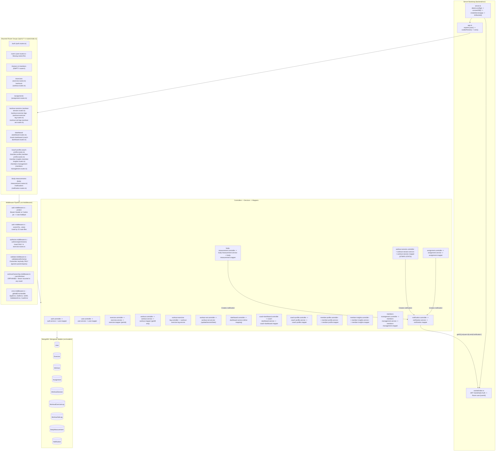

# 04 — Backend Architecture & Request Lifecycle Audit

**Verification Status:** `VERIFIED` (All 124 files in `backend/src/` and 4 files in `Deleted files but maybe we need it/` inspected)

---

## 1. Backend Architecture Diagram (Diagram 3)

---

## 2. Request Lifecycle Trace

The standard request lifecycle across the backend follows:

`HTTP Request → Express Global Middleware (app.ts) → Router (routes/*.ts) → Auth/RBAC Middleware (protect + restrictTo/authorize) → Zod Validation Middleware (validate) → Controller (catchAsync wrapper) → Service → Mongoose Model / Aggregation → Mapper (optional/inconsistent) → JSON Response`

### 2.1 Global Middleware Pipeline (`backend/src/app.ts:19-56`)
1. `express.json()` (`app.ts:19`): Parses JSON payloads (no size limit configured).
2. `cookieParser()` (`app.ts:20`): Parses `req.cookies.jwt`.
3. `cors(...)` (`app.ts:21-36`): Allows `"http://localhost:5173"`, two hardcoded Vercel URLs, and any origin ending with `".vercel.app"`, with `credentials: true`.
4. `/api/v1` router (`app.ts:39` → `backend/src/routes/index.ts`).
5. `/api-docs` Swagger UI (`app.ts:42` → `backend/src/config/swagger.ts`).
6. `notFound` (`app.ts:53` → `backend/src/middleware/notFound.middleware.ts:3-7`): Forwards `new AppError("Can't find ... on this server!", 404)`.
7. `globalErrorHandler` (`app.ts:56` → `backend/src/middleware/error.middleware.ts:5-56`):
   - `AppError` → `err.statusCode` (`{ status, message }`)
   - `ZodError` → `400` (`{ status: "fail", errors: [{ field, message }] }`)
   - `err.code === 11000` → `409` (`{ status: "fail", message: "Duplicate field value." }`)
   - `err.name === "ValidationError"` → `400`
   - `err.name === "CastError"` → `400` (`"Invalid ID format."`)
   - Unhandled errors (including `JsonWebTokenError`, `TokenExpiredError`, and `BSONError` from manual `new mongoose.Types.ObjectId(...)`) fall through to `500` (`{ status: "error", message: "Something went wrong." }`).

---

## 3. Complete Route Registration & Middleware Inventory

All routes below are mounted under `/api/v1` in `backend/src/routes/index.ts`:

| Full Endpoint Path | HTTP | Route File & Line | Middleware Chain | Controller → Service Method | Mapper Used |
| :--- | :--- | :--- | :--- | :--- | :--- |
| `/api/v1/auth/admin` | `GET` | `auth.routes.ts:23` & `:197` | `protect`, `restrictTo(ADMIN)` | Inline handler (**defined twice in same file!**) | None |
| `/api/v1/auth/register` | `POST` | `auth.routes.ts:67` | `validate(registerSchema)` | `authController.register` → `authService.register` | `mapUser` |
| `/api/v1/auth/login` | `POST` | `auth.routes.ts:102` | `validate(loginSchema)` | `authController.login` → `authService.login` | `mapUser` |
| `/api/v1/auth/logout` | `POST` | `auth.routes.ts:116` | *(none)* | `authController.logout` *(does not call `authService.logout`)* | None |
| `/api/v1/auth/update-password` | `PATCH` | `auth.routes.ts:154` | `protect`, `validate(updatePasswordSchema)` | `authController.updatePassword` → `authService.updatePassword` | `mapUser` |
| `/api/v1/auth/me` | `GET` | `auth.routes.ts:177` | `protect` | `authController.getMe` *(returns raw `req.user` without `mapUser`!)* | **None (`_id`)** |
| `/api/v1/users` | `GET` | `user.routes.ts:20` | `protect` *(Missing `restrictTo`!)* | `userController.getAllUsers` → `userService.getAllUsers` | `mapUser` |
| `/api/v1/trainers` | — | `trainer.routes.ts:1-6` | *(none)* | **Empty router (0 endpoints)** | — |
| `/api/v1/members` | — | `member.routes.ts:1-6` | *(none)* | **Empty router (0 endpoints)** | — |
| `/api/v1/exercises` | `GET` | `exercise.routes.ts:30` | *(Public — before `protect` at L56)* | `exerciseController.getAll` → `exerciseService.getAll` | `mapExercise` (`id`) |
| `/api/v1/exercises/:id` | `GET` | `exercise.routes.ts:53` | *(Public — before `protect` at L56)* | `exerciseController.getById` → `exerciseService.getById` | **None (`_id`)** |
| `/api/v1/exercises` | `POST` | `exercise.routes.ts:84` | `protect`, `authorize(Exercise.CREATE)`, `validate(createExerciseSchema)` | `exerciseController.create` → `exerciseService.create` | `mapExercise` (`id`) |
| `/api/v1/exercises/:id` | `PATCH` | `exercise.routes.ts:122` | `protect`, `authorize(Exercise.UPDATE)`, `validate(updateExerciseSchema)` | `exerciseController.update` → `exerciseService.update` | **None (`_id`)** |
| `/api/v1/exercises/:id` | `DELETE` | `exercise.routes.ts:156` | `protect`, `authorize(Exercise.DELETE)` | `exerciseController.remove` → `exerciseService.delete` | None (`204`) |
| `/api/v1/workouts` | `GET` | `workout.routes.ts:31` | `protect` | `workoutController.getAll` → `workoutService.getAll` | `mapWorkout` (`id`) |
| `/api/v1/workouts/:id` | `GET` | `workout.routes.ts:33` | `protect` *(No ownership check!)* | `workoutController.getById` → `workoutService.getById` | **None (`_id`)** |
| `/api/v1/workouts` | `POST` | `workout.routes.ts:41` | `protect`, `restrictTo(ADMIN, TRAINER)`, `validate(createWorkoutSchema)` | `workoutController.create` → `workoutService.create` | **None (`_id`)** |
| `/api/v1/workouts/:id` | `PATCH` | `workout.routes.ts:54` | `protect`, `restrictTo(ADMIN, TRAINER)`, `validate(updateWorkoutSchema)` | `workoutController.update` → `workoutService.update` | **None (`_id`)** |
| `/api/v1/workouts/:id` | `DELETE` | `workout.routes.ts:67` | `protect`, `restrictTo(ADMIN, TRAINER)` | `workoutController.remove` → `workoutService.delete` | None (`204`) |
| `/api/v1/assignments/me` | `GET` | `assignment.routes.ts:21` | `protect`, `restrictTo(MEMBER)` | `assignmentController.getMyAssignments` → `assignmentService.getMyAssignments` | **None (`_id`)** |
| `/api/v1/assignments` | `GET` | `assignment.routes.ts:28` | `protect`, `restrictTo(ADMIN, TRAINER)` | `assignmentController.getAll` → `assignmentService.getAll` | `mapAssignment` (`id`) |
| `/api/v1/assignments/:id` | `GET` | `assignment.routes.ts:34` | `protect`, `restrictTo(ADMIN, TRAINER)` | `assignmentController.getById` → `assignmentService.getById` | `mapAssignment` (`id`) |
| `/api/v1/assignments` | `POST` | `assignment.routes.ts:40` | `protect`, `restrictTo(ADMIN, TRAINER)`, `validate(createAssignmentSchema)` | `assignmentController.create` → `assignmentService.create` | `mapAssignment` *(on unpopulated doc!)* |
| `/api/v1/assignments/:id` | `PATCH` | `assignment.routes.ts:47` | `protect`, `restrictTo(ADMIN, TRAINER)`, `validate(updateAssignmentSchema)` | `assignmentController.update` → `assignmentService.update` | `mapAssignment` *(on unpopulated doc!)* |
| `/api/v1/assignments/:id` | `DELETE` | `assignment.routes.ts:54` | `protect`, `restrictTo(ADMIN, TRAINER)` | `assignmentController.remove` → `assignmentService.delete` | None (`204`) |
| `/api/v1/workout-sessions/start` | `POST` | `workout-session.routes.ts:20` | `protect`, `restrictTo(MEMBER)`, `validate(startWorkoutSessionSchema)` | `workoutSessionController.start` → `workoutSessionService.start` | `mapWorkoutSession` |
| `/api/v1/workout-sessions/:id/finish` | `PATCH` | `workout-session.routes.ts:28` | `protect`, `restrictTo(MEMBER)`, `validate(finishWorkoutSessionSchema)` | `workoutSessionController.finish` → `workoutSessionService.finish` | `mapWorkoutSession` |
| `/api/v1/workout-sessions/current` | `GET` | `workout-session.routes.ts:36` | `protect`, `restrictTo(MEMBER)` | `workoutSessionController.getCurrent` → `workoutSessionService.getCurrent` | `mapWorkoutSession` + raw `exerciseLogs` |
| `/api/v1/workout-sessions` | `GET` | `workout-session.routes.ts:46` | `protect`, `restrictTo(ADMIN, TRAINER, MEMBER)` | `workoutSessionController.getAll` → `workoutSessionService.getAll` | **None (`_id`)** |
| `/api/v1/workout-sessions/:id` | `GET` | `workout-session.routes.ts:56` | `protect`, `restrictTo(ADMIN, TRAINER, MEMBER)` | `workoutSessionController.getById` → `workoutSessionService.getById` | `mapWorkoutSession` + raw `exerciseLogs` |
| `/api/v1/workout-exercise-logs/session/:sessionId` | `GET` | `workout-exercise-log.routes.ts:10` | `protect`, `restrictTo(MEMBER)` | `workoutExerciseLogController.getBySession` → `workoutExerciseLogService.getBySession` | **None (`_id`)** |
| `/api/v1/workout-set-logs/:id` | `PATCH` | `workout-set.routes.ts:17` | `protect`, `restrictTo(MEMBER)`, `validate(updateWorkoutSetSchema)` | `workoutSetController.updateWorkoutSet` → `workoutSetService.update` | **None (`_id`)** |
| `/api/v1/notifications` | `GET` | `notification.routes.ts:14` | `protect` | `notificationController.getMyNotifications` → `notificationService.getMyNotifications` | `mapNotification` (`id`) |
| `/api/v1/notifications/read-all` | `PATCH` | `notification.routes.ts:16` | `protect` | `notificationController.markAllAsRead` → `notificationService.markAllAsRead` | None |
| `/api/v1/notifications/:id/read` | `PATCH` | `notification.routes.ts:18` | `protect`, `validate(markAsReadSchema)` | `notificationController.markAsRead` → `notificationService.markAsRead` | `mapNotification` (`id`) |
| `/api/v1/notifications/:id` | `DELETE` | `notification.routes.ts:24` | `protect`, `validate(markAsReadSchema)` | `notificationController.deleteNotification` → `notificationService.deleteNotification` | None (`204`) |
| `/api/v1/dashboard/trainer` | `GET` | `dashboard.routes.ts:31` | `protect`, `restrictTo(ADMIN, TRAINER)` | `dashboardController.getTrainerDashboard` → `dashboardService.getTrainerDashboard` | Inline |
| `/api/v1/dashboard/member` | `GET` | `dashboard.routes.ts:55` | `protect`, `restrictTo(MEMBER)` | `dashboardController.getMemberDashboard` → `dashboardService.getMemberDashboard` | Inline (raw `_id` on nested docs) |
| `/api/v1/coach-dashboard` | `GET` | `coach-dashboard.routes.ts:15` | `protect`, `restrictTo(ADMIN, TRAINER)` | `coachDashboardController.getDashboard` → `coachDashboardService.getDashboard` | `mapCoachDashboard` (`todaysPriorities` unmapped!) |
| `/api/v1/coach-profile` | `GET` | `coach-profile.routes.ts:13` | `protect`, `restrictTo(ADMIN, TRAINER)` | `coachProfileController.getProfile` → `coachProfileService.getProfile` | `mapCoachProfile` |
| `/api/v1/coach-profile` | `PATCH` | `coach-profile.routes.ts:17` | `protect`, `restrictTo(ADMIN, TRAINER)` *(No `validate`!)* | `coachProfileController.updateProfile` → `coachProfileService.updateProfile` | Inline |
| `/api/v1/member-profile/:memberId` | `GET` | `member-profile.routes.ts:12` | `protect` | `memberProfileController.getMemberProfile` → `memberProfileService.getMemberProfile` | `mapMemberProfile` |
| `/api/v1/member-insights/:memberId` | `GET` | `member-insights.routes.ts:15` | `protect`, `restrictTo(ADMIN, TRAINER)` | `memberInsightsController.getMemberInsights` → `memberInsightsService.getMemberInsights` | `mapMemberInsights` |
| `/api/v1/members-management` | `GET` | `members-management.routes.ts:14` | `protect`, `restrictTo(ADMIN, TRAINER)` | `membersManagementController.getAllMembers` → `membersManagementService.getAllMembers` | `mapMemberManagementCard` |
| `/api/v1/body-measurements` | `POST` | `body-measurement.routes.ts:19` | `protect`, debug `console.log`, `restrictTo(ADMIN, TRAINER)`, `validate(createBodyMeasurementSchema)` | `bodyMeasurementController.createBodyMeasurement` → `bodyMeasurementService.createBodyMeasurement` | `mapBodyMeasurement` |
| `/api/v1/body-measurements/member/:memberId` | `GET` | `body-measurement.routes.ts:30` | `protect` | `bodyMeasurementController.getMemberMeasurements` → `bodyMeasurementService.getMemberMeasurements` | `mapBodyMeasurement` *(corrupts `trainer`!)* |
| `/api/v1/body-measurements/member/:memberId/latest` | `GET` | `body-measurement.routes.ts:35` | `protect` | `bodyMeasurementController.getLatestMemberMeasurement` → `bodyMeasurementService.getLatestMemberMeasurement` | `mapBodyMeasurement` *(corrupts `trainer`!)* |
| `/api/v1/body-measurements/:id` | `GET` | `body-measurement.routes.ts:40` | `protect` | `bodyMeasurementController.getBodyMeasurementById` → `bodyMeasurementService.getBodyMeasurementById` | `mapBodyMeasurement` *(corrupts `trainer`!)* |
| `/api/v1/body-measurements/:id` | `PATCH` | `body-measurement.routes.ts:42` | `protect`, `restrictTo(ADMIN, TRAINER)`, `validate(updateBodyMeasurementSchema)` | `bodyMeasurementController.updateBodyMeasurement` → `bodyMeasurementService.updateBodyMeasurement` | `mapBodyMeasurement` |
| `/api/v1/body-measurements/:id` | `DELETE` | `body-measurement.routes.ts:49` | `protect`, `restrictTo(ADMIN, TRAINER)` | `bodyMeasurementController.deleteBodyMeasurement` → `bodyMeasurementService.deleteBodyMeasurement` | None (`204`) |

---

## 4. Key Backend Architectural Inconsistencies (`VERIFIED`)

1. **Dual Authorization Systems (`restrictTo` vs `authorize`):**
   - `backend/src/constants/permissions.ts` and `role-permissions.ts` define 20 granular permissions and `authorize.middleware.ts` checks them, but **`authorize()` is only used in `exercise.routes.ts`**. All other 15 active route files use `restrictTo(...roles)` (`auth.middleware.ts:47`), leaving 17 permissions completely dead.
2. **Inconsistent `_id` vs `id` Mapping Within the Same Service:**
   - **`ExerciseService`:** `create` and `getAll` apply `mapExercise` (`id`, omits `instructions`, `tips`, `alternatives`), whereas `getById` and `update` return raw Mongoose documents (`_id`, includes `instructions`, `tips`, `alternatives`).
   - **`WorkoutService`:** `getAll` applies `mapWorkout` (`id`, summary fields + `exerciseCount`), whereas `create`, `getById`, and `update` return raw Mongoose documents (`_id`, full `exercises` array).
   - **`AssignmentService`:** `getAll` and `getById` apply `mapAssignment` on populated docs; `create` and `update` apply `mapAssignment` on **unpopulated** docs (resulting in `member.id: undefined`, `trainer.id: undefined`, `workout.id: undefined`); `getMyAssignments` does **not** apply `mapAssignment` at all (returns raw `_id`).
   - **`WorkoutSessionService`:** `start`, `finish`, `getCurrent`, and `getById` apply `mapWorkoutSession` (which strips `progress`, `totalVolume`, `totalRestTime`, `activeTrainingTime`, `exercisesCompleted`, `setsCompleted`, `notes`), whereas `getAll` returns raw Mongoose documents (`_id`, with all fields intact)!
   - **`AuthController`:** `login`, `register`, and `updatePassword` return `mapUser(user)` (`id`), whereas `getMe` (`auth.controller.ts:40-47`) returns raw `req.user` (`_id`).
3. **Query Parameter Filter Injection via `ApiFeatures.filter()` (`backend/src/utils/ApiFeatures.ts:9-19`):**
   - `ApiFeatures.filter()` strips only `["page", "sort", "limit", "search"]` from `req.query` and passes the remaining query object directly into `this.query.find(queryObj)`.
   - In services that pass a base ownership/active filter to `Model.find(filter)` and then chain `new ApiFeatures(..., query).filter()` (`assignment.service.ts:124-130`, `workout.service.ts:74-78`, `workout-session.service.ts:245-266`, `user.service.ts:8-11`), a client can pass `?isActive=false` or `?trainer=otherTrainerId` or `?createdBy=otherTrainerId` in the query string to override the initial `.find(filter)` condition in Mongoose!
4. **Validation Middleware Overwrites `req.body` Only (`backend/src/middleware/validate.middleware.ts:16`):**
   - `req.body = result.data.body;` overwrites `req.body` with `undefined` when a schema only validates `params` (e.g., `markAsReadSchema` in `notification.validator.ts:21-25`), and ignores transformed/defaulted `params` and `query`.
   - Worse, in `exercise.validator.ts:20,30-32`, `createExerciseSchema` defines `secondaryMuscles: z.array(z.string()).default([])`, and `updateExerciseSchema` uses `createExerciseSchema.shape.body.partial()`. In Zod, `.partial()` preserves `.default([])`, so any `PATCH /api/v1/exercises/:id` request that omits `secondaryMuscles` has `secondaryMuscles: []` injected by `validate.middleware.ts`, wiping out the exercise's existing `secondaryMuscles` in MongoDB!
5. **Debug `console.log` Left in Production Route (`backend/src/routes/body-measurement.routes.ts:21-24`):**
   - `POST /api/v1/body-measurements` contains an inline middleware `(req, res, next) => { console.log("BODY RECEIVED:", req.body); next(); }`.
