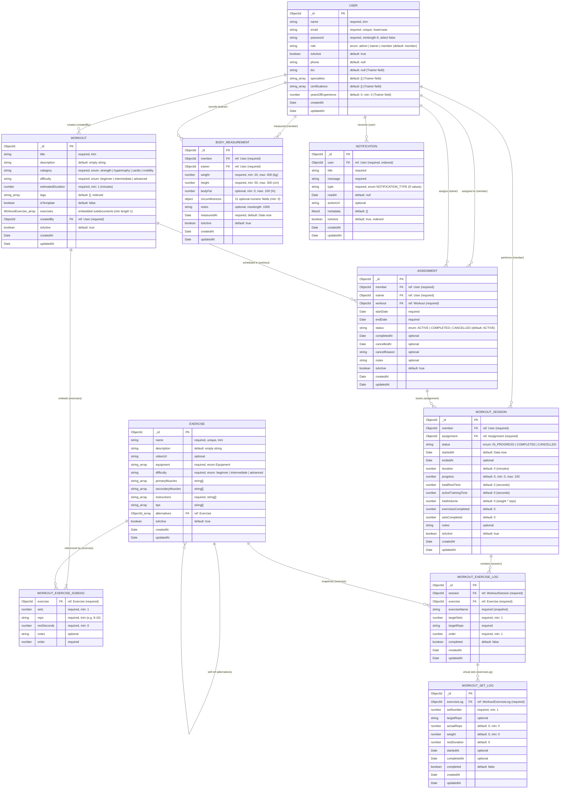

# 05 — Database Models & Entity-Relationship Diagram (ERD)

**Verification Status:** `VERIFIED` (All 8 active model files in `backend/src/models/` and 1 archived model in `Deleted files but maybe we need it/WorkoutLog.model.ts` inspected)

---

## 1. Database Entity-Relationship Diagram (Diagram 4)

---

## 2. Detailed Model Catalog & Cross-Layer Dependencies

### 2.1 `User` (`backend/src/models/User.model.ts:1-129`)
- **Purpose:** Single-table user model storing Admins, Trainers (Coaches), and Members.
- **Key Fields & Constraints:**
  - `name` (`String`, required), `email` (`String`, required, `unique: true`, lowercase), `password` (`String`, required, `minlength: 8`, `select: false`).
  - `role` (`String`, enum `["admin", "trainer", "member"]`, default `"member"`).
  - `isActive` (`Boolean`, default `true`), `phone` (`String`, default `null`).
  - Trainer-specific fields stored on the same collection: `bio` (`String`, default `null`), `specialties` (`[String]`, default `[]`), `certifications` (`[String]`, default `[]`), `yearsOfExperience` (`Number`, default `0`, `min: 0`).
- **Hooks & Methods:** `pre("save")` hashes modified passwords with `bcrypt.hash(password, 12)` (`L106-110`). Instance method `correctPassword()` compares candidate password (`L112-117`).
- **Indexes:** `{ email: 1 }` (unique), `{ role: 1, isActive: 1 }` (`L121-124`).
- **Services Reading/Writing:**
  - Written by: `auth.service.ts` (`register`, `updatePassword`), `coach-profile.service.ts` (`updateProfile`).
  - Read by: `auth.middleware.ts`, `auth.service.ts`, `user.service.ts`, `assignment.service.ts`, `body-measurement.service.ts`, `coach-dashboard.service.ts`, `coach-profile.service.ts`, `dashboard.service.ts`, `member-profile.service.ts`, `members-management.service.ts`.
- **Integrity & Architecture Notes:**
  - **No Coach-Member Foreign Key on `User`:** There is no `assignedTrainer` or `gymId` field on `User`. A Coach's relationship to a Member is **inferred solely from the existence of an `Assignment` document** (`{ trainer, member, status: "ACTIVE", isActive: true }`).

---

### 2.2 `Exercise` (`backend/src/models/Exercise.model.ts:1-99`)
- **Purpose:** Global catalog of exercises available across the platform.
- **Key Fields & Constraints:**
  - `name` (`String`, required, `unique: true`), `description` (`String`, default `""`), `videoUrl` (`String`).
  - `equipment` (`[String]`, required, enum `Equipment`: `barbell`, `dumbbell`, `machine`, `cable`, `bodyweight`, `kettlebell`, `resistance_band`, `medicine_ball`, `other` — `constants/exercise.ts:9-19`).
  - `difficulty` (`String`, required, enum `Difficulty`: `beginner`, `intermediate`, `advanced` — `constants/exercise.ts:1-5`).
  - `primaryMuscles` (`[String]`), `secondaryMuscles` (`[String]`), `instructions` (`[String]`, elements required), `tips` (`[String]`).
  - `alternatives` (`[ObjectId]`, `ref: "Exercise"`), `isActive` (`Boolean`, default `true`).
- **Indexes:** `{ name: 1 }` (unique), `{ equipment: 1 }`, `{ difficulty: 1 }`, `{ primaryMuscles: 1 }`, `{ isActive: 1 }`.
- **Data Ownership:** Global (no `createdBy` field). Any `TRAINER` or `ADMIN` can create, edit, or soft-delete any exercise in the global library.
- **Integrity Issue (`VERIFIED`):** `name` has a hard MongoDB `unique: true` index (`L9`), while deletion is a soft-delete (`isActive: false`, `exercise.service.ts:141`). Re-creating an exercise with the same `name` as a soft-deleted exercise bypasses `Exercise.findOne({ name, isActive: true })` (`exercise.service.ts:14`) and triggers a MongoDB `E11000` duplicate key error (`409 Duplicate field value`).

---

### 2.3 `Workout` (`backend/src/models/Workout.model.ts:1-139`)
- **Purpose:** Structured workout routine/template created by a Trainer or Admin, containing an ordered list of embedded exercise prescriptions (`workoutExerciseSchema`).
- **Key Fields & Constraints:**
  - `title` (`String`, required), `description` (`String`, default `""`).
  - `category` (`String`, required, enum `Category`: `strength`, `hypertrophy`, `cardio`, `mobility` — `constants/workout.ts:1-6`).
  - `difficulty` (`String`, required, enum `Difficulty`: `beginner`, `intermediate`, `advanced`).
  - `estimatedDuration` (`Number`, required, `min: 1`), `tags` (`[String]`, indexed), `isTemplate` (`Boolean`, default `false`).
  - `exercises` (`[workoutExerciseSchema]`, `{ _id: false }`, custom validator `length > 0`): each subdocument has `exercise` (`ObjectId` ref `Exercise`), `sets` (`Number`, `min: 1`), `reps` (`String`), `restSeconds` (`Number`, `min: 0`), `notes` (`String`), `order` (`Number`).
  - `createdBy` (`ObjectId`, `ref: "User"`, required), `isActive` (`Boolean`, default `true`).
- **Indexes:** `{ tags: 1 }`, `{ createdBy: 1, isActive: 1 }`, `{ category: 1 }`, `{ difficulty: 1 }`, `{ isTemplate: 1 }`.
- **Data Ownership:** Owned by `createdBy` (`User`). Enforced on `update` and `delete` in `workout.service.ts:115-119, 189-193`, **not** enforced on `getById` (`workout.service.ts:86-92`), and **not** scoped per-trainer for `title` uniqueness (`workout.service.ts:20-27`).

---

### 2.4 `Assignment` (`backend/src/models/Assignment.model.ts:1-102`)
- **Purpose:** Assigns a `Workout` to a `Member` under a supervising `Trainer` for a date range (`startDate` to `endDate`). Also serves as the **implicit link defining whether a Member belongs to a Trainer**.
- **Key Fields & Constraints:**
  - `member` (`ObjectId`, `ref: "User"`, required), `trainer` (`ObjectId`, `ref: "User"`, required), `workout` (`ObjectId`, `ref: "Workout"`, required).
  - `startDate` (`Date`, required), `endDate` (`Date`, required).
  - `status` (`String`, enum `["ACTIVE", "COMPLETED", "CANCELLED"]`, default `"ACTIVE"`).
  - `completedAt` (`Date`), `cancelledAt` (`Date`), `cancelReason` (`String`), `notes` (`String`), `isActive` (`Boolean`, default `true`).
- **Indexes:**
  - `{ trainer: 1, isActive: 1 }`, `{ member: 1, isActive: 1 }`, `{ member: 1, status: 1, isActive: 1 }`, `{ status: 1 }`, `{ createdAt: -1 }`.
  - Partial unique index: `{ member: 1, workout: 1, status: 1 }` with `unique: true, partialFilterExpression: { status: "ACTIVE" }` (`L88-100`).
- **Integrity Issues (`VERIFIED`):**
  1. **Partial Unique Index vs Soft Delete:** The partial unique index `{ member: 1, workout: 1, status: 1 }` (`where status === "ACTIVE"`) does **not** include `isActive: true` in `partialFilterExpression`! If an `ACTIVE` assignment is soft-deleted (`isActive: false`, keeping `status: "ACTIVE"`), the Trainer can never re-assign that same workout to that member because MongoDB's unique index will reject it with `E11000`!
  2. **Transient Coach-Member Relationship:** Because `body-measurement.service.ts`, `member-profile.service.ts`, `member-insights.service.ts`, `members-management.service.ts`, and `coach-dashboard.service.ts` check `Assignment.exists({ trainer, member, status: "ACTIVE", isActive: true })`, as soon as a Member's assignment is marked `COMPLETED` or `CANCELLED` (and before a new `ACTIVE` assignment is created), **the Member disappears from the Coach's Members Management roster and the Coach gets `403 Forbidden` when viewing the Member's Profile, Insights, or Body Measurements!**

---

### 2.5 `WorkoutSession` (`backend/src/models/WorkoutSession.model.ts:1-122`)
- **Purpose:** Tracks a single execution instance of an `Assignment` by a `Member`.
- **Key Fields & Constraints:**
  - `member` (`ObjectId`, `ref: "User"`, required), `assignment` (`ObjectId`, `ref: "Assignment"`, required).
  - `status` (`String`, enum `["IN_PROGRESS", "COMPLETED", "CANCELLED"]`, default `"IN_PROGRESS"`).
  - `startedAt` (`Date`, default `Date.now`), `endedAt` (`Date`).
  - Telemetry fields: `duration` (`Number`, minutes, default `0`), `progress` (`Number`, `0–100`, default `0`), `totalRestTime` (`Number`, seconds, default `0`), `activeTrainingTime` (`Number`, seconds, default `0`), `totalVolume` (`Number`, default `0`), `exercisesCompleted` (`Number`, default `0`), `setsCompleted` (`Number`, default `0`).
  - `notes` (`String`), `isActive` (`Boolean`, default `true`).
- **Indexes:** `{ member: 1 }`, `{ assignment: 1 }`, `{ status: 1 }`, `{ startedAt: -1 }`, `{ member: 1, startedAt: -1 }`, `{ assignment: 1, status: 1 }`.
- **Integrity Issues:**
  - No partial unique index enforcing at most one `IN_PROGRESS` session per `member` (only checked in application code at `workout-session.service.ts:47-55`, susceptible to race conditions).
  - `WORKOUT_SESSION_STATUS.CANCELLED` exists in the enum (`constants/workout-session.ts:4`), but no backend service method or endpoint exists to cancel/abandon an `IN_PROGRESS` session! If a member starts a session and wants to cancel it without marking it `COMPLETED`, they are stuck.

---

### 2.6 `WorkoutExerciseLog` (`backend/src/models/WorkoutExerciseLog.model.ts:1-88`)
- **Purpose:** Snapshot of a prescribed exercise within a `WorkoutSession`, linking the session to its child `WorkoutSetLog` documents via a Mongoose virtual (`sets`).
- **Key Fields & Constraints:**
  - `session` (`ObjectId`, `ref: "WorkoutSession"`, required), `exercise` (`ObjectId`, `ref: "Exercise"`, required).
  - `exerciseName` (`String`, required — snapshot of exercise name at session start), `targetSets` (`Number`, required, `min: 1`), `targetReps` (`String`, required), `order` (`Number`, required, `min: 1`), `completed` (`Boolean`, default `false`).
- **Virtuals:** `sets` (`ref: "WorkoutSetLog"`, `localField: "_id"`, `foreignField: "exerciseLog"`, `L61-65`).
- **Indexes:** `{ session: 1, order: 1 }` (unique, `L67-75`), `{ session: 1, completed: 1 }`.

---

### 2.7 `WorkoutSetLog` (`backend/src/models/WorkoutSetLog.model.ts:1-88`)
- **Purpose:** Tracks an individual set within a `WorkoutExerciseLog`. Pre-populated when `workoutSessionService.start()` runs (`workout-session.service.ts:87-95`).
- **Key Fields & Constraints:**
  - `exerciseLog` (`ObjectId`, `ref: "WorkoutExerciseLog"`, required), `setNumber` (`Number`, required, `min: 1`).
  - `targetReps` (`String`), `actualReps` (`Number`, default `0`, `min: 0`), `weight` (`Number`, default `0`, `min: 0`), `restDuration` (`Number`, default `0`).
  - `startedAt` (`Date`), `completedAt` (`Date`), `completed` (`Boolean`, default `false`).
- **Indexes:** `{ exerciseLog: 1, setNumber: 1 }` (unique, `L64`), `{ exerciseLog: 1, completed: 1 }`, `{ exerciseLog: 1 }`, `{ completedAt: -1 }`.

---

### 2.8 `BodyMeasurement` (`backend/src/models/BodyMeasurement.model.ts:1-96`)
- **Purpose:** Historical anthropometric measurements recorded by a Trainer for a Member.
- **Key Fields & Constraints:**
  - `member` (`ObjectId`, `ref: "User"`, required), `trainer` (`ObjectId`, `ref: "User"`, required).
  - `weight` (`Number`, required, `20–400`), `height` (`Number`, required, `50–300`), `bodyFat` (`Number`, optional, `0–100`).
  - `circumferences` (nested object with 11 optional `Number` fields `min: 0`: `chest`, `waist`, `hips`, `shoulders`, `neck`, `leftArm`, `rightArm`, `leftThigh`, `rightThigh`, `leftCalf`, `rightCalf`).
  - `notes` (`String`, `maxlength: 1000`), `measuredAt` (`Date`, required, default `Date.now`), `isActive` (`Boolean`, default `true`).
- **Indexes:** `{ member: 1, isActive: 1, measuredAt: -1 }`, `{ trainer: 1, measuredAt: -1 }`, `{ member: 1, trainer: 1 }`.

---

### 2.9 `Notification` (`backend/src/models/Notification.model.ts:1-68`)
- **Purpose:** In-app notification records for Users (Members and Trainers).
- **Key Fields & Constraints:**
  - `user` (`ObjectId`, `ref: "User"`, required, indexed), `title` (`String`, required), `message` (`String`, required).
  - `type` (`String`, required, indexed, enum `NOTIFICATION_TYPE`: `ASSIGNMENT_CREATED`, `ASSIGNMENT_UPDATED`, `ASSIGNMENT_CANCELLED`, `WORKOUT_COMPLETED`, `WORKOUT_STARTED`, `BODY_MEASUREMENT_CREATED`, `BODY_MEASUREMENT_UPDATED`, `BODY_MEASUREMENT_DELETED`, `SYSTEM`).
  - `readAt` (`Date`, default `null`), `actionUrl` (`String`), `metadata` (`Mixed`, default `{}`), `isActive` (`Boolean`, default `true`, indexed).
- **Indexes:** `{ user: 1 }`, `{ type: 1 }`, `{ isActive: 1 }`, `{ user: 1, createdAt: -1 }`.

---

### 2.10 Archived Model: `WorkoutLog` (`Deleted files but maybe we need it/WorkoutLog.model.ts`)
- **Status:** Replaced by `WorkoutExerciseLog` + `WorkoutSetLog`. Not imported by any active code in `backend/src/` (though `workout-log.mapper.ts`, `workout-log.validator.ts`, `workout-log.types.ts`, and `scripts/data/workoutLogs.ts` remain as unused orphans in `backend/src/`).
