# 06 — Full-Stack API Integration Map

**Verification Status:** `VERIFIED` (Every frontend API client function in `frontend/src/features/*/api/*.ts` cross-referenced with `backend/src/routes/*.ts`, controllers, services, mappers, and models)

---

## 1. API Integration Map Diagram (Diagram 5)

```mermaid
flowchart LR
  subgraph FE_Hooks["Frontend Hooks & API Clients"]
    FE_Auth["auth.api.ts<br/>useLogin, useRegister, useLogout, useCurrentUser"]
    FE_Users["users.api.ts<br/>useUsers"]
    FE_Ex["exercises.api.ts<br/>useExercises, useExercise, useCreate/Update/DeleteExercise"]
    FE_Wo["workouts.api.ts<br/>useWorkouts, useWorkout, useCreate/Update/DeleteWorkout"]
    FE_Asg["assignments.api.ts<br/>useAssignments, useAssignment, useMyAssignments, CRUD"]
    FE_Sess["workout-sessions.api.ts<br/>useWorkoutSessions, useCurrentWorkoutSession, start/finish/updateSet"]
    FE_BM["body-measurements.api.ts<br/>useMemberMeasurements, useLatestMeasurement, CRUD"]
    FE_CDash["coach-dashboard.api.ts<br/>useCoachDashboard"]
    FE_MDash["dashboard.api.ts<br/>useMemberDashboard"]
    FE_Mgt["members-management.api.ts<br/>useMembersManagement"]
    FE_MProf["member-profile.api.ts & profile/member-profile.api.ts<br/>useMemberProfile"]
    FE_MIns["member-insights.api.ts<br/>useMemberInsights"]
    FE_CProf["profile/coach-profile.api.ts<br/>useCoachProfile"]
    FE_Notif["notifications.api.ts<br/>useNotifications, markRead, markAllRead, delete"]
  end

  subgraph BE_Routes["Backend Endpoints (/api/v1/*)"]
    BE_Auth["POST /auth/login, /register, /logout<br/>GET /auth/me<br/>PATCH /auth/update-password (NO FE CONSUMER)<br/>GET /auth/admin (NO FE CONSUMER)"]
    BE_Users["GET /users (MISSING restrictTo!)"]
    BE_Ex["GET, POST /exercises<br/>GET, PATCH, DELETE /exercises/:id"]
    BE_Wo["GET, POST /workouts<br/>GET, PATCH, DELETE /workouts/:id"]
    BE_Asg["GET /assignments, GET /assignments/me<br/>GET, PATCH, DELETE /assignments/:id<br/>POST /assignments"]
    BE_Asg_Missing["PATCH /assignments/:id/archive<br/>(CALLED BY FE, MISSING ON BACKEND -> 404!)"]
    BE_Sess["POST /workout-sessions/start<br/>PATCH /workout-sessions/:id/finish<br/>GET /workout-sessions/current<br/>GET /workout-sessions, GET /workout-sessions/:id"]
    BE_Set["PATCH /workout-set-logs/:id"]
    BE_Set_Missing["POST /workout-set-logs<br/>(CALLED BY FE createWorkoutSet, MISSING ROUTE -> 404!)"]
    BE_ExLog["GET /workout-exercise-logs/session/:sessionId<br/>(NO FE CONSUMER)"]
    BE_BM["POST /body-measurements<br/>GET /body-measurements/member/:memberId<br/>GET /body-measurements/member/:memberId/latest<br/>GET, PATCH, DELETE /body-measurements/:id"]
    BE_CDash["GET /coach-dashboard"]
    BE_Dash["GET /dashboard/member<br/>GET /dashboard/trainer (NO FE CONSUMER)"]
    BE_Mgt["GET /members-management"]
    BE_MProf["GET /member-profile/:memberId"]
    BE_MIns["GET /member-insights/:memberId"]
    BE_CProf["GET /coach-profile<br/>PATCH /coach-profile (NO FE CONSUMER)"]
    BE_Notif["GET /notifications<br/>PATCH /notifications/read-all<br/>PATCH /notifications/:id/read<br/>DELETE /notifications/:id"]
  end

  FE_Auth --> BE_Auth
  FE_Users --> BE_Users
  FE_Ex --> BE_Ex
  FE_Wo --> BE_Wo
  FE_Asg -->|"getAssignment DOUBLE-MAPS _id -> undefined!"| BE_Asg
  FE_Asg -.->|"404 NOT IMPLEMENTED"| BE_Asg_Missing
  FE_Sess -->|"Backend mapper STRIPS volume/progress/notes!"| BE_Sess
  FE_Sess --> BE_Set
  FE_Sess -.->|"404 NOT IMPLEMENTED"| BE_Set_Missing
  FE_BM -->|"Backend mapper corrupts populated trainer.toString()!"| BE_BM
  FE_CDash --> BE_CDash
  FE_MDash --> BE_Dash
  FE_Mgt --> BE_Mgt
  FE_MProf --> BE_MProf
  FE_MIns --> BE_MIns
  FE_CProf --> BE_CProf
  FE_Notif --> BE_Notif
```

---

## 2. Complete Endpoint-to-Consumer Integration Catalog

### 2.1 Authentication (`auth`)

| Frontend Function & Hook | HTTP & Path | Backend Route & Handler | Backend Service & Models | Contract / Integration Verification |
| :--- | :--- | :--- | :--- | :--- |
| `login()` (`auth.api.ts:6`) `useLogin` (`useLogin.ts:10`) | `POST /auth/login` | `auth.routes.ts:102` `authController.login` | `authService.login` (`User`) | `VERIFIED` — Sends `{ email, password }`, receives `{ status, token, data: { user } }` (`mapUser` shape with `id`). Redirects to `/home`. |
| `register()` (`auth.api.ts:12`) `useRegister` (`useRegister.ts:8`) | `POST /auth/register` | `auth.routes.ts:67` `authController.register` | `authService.register` (`User`) | `VERIFIED` — Sends `{ name, email, password }`, redirects to `/login`. Backend `registerSchema` dangerously allows optional `role: "admin"`. |
| `getCurrentUser()` (`auth.api.ts:17`) `useCurrentUser` (`useCurrentUser.ts:6`) | `GET /auth/me` | `auth.routes.ts:177` `authController.getMe` | Inline `req.user` (`User`) | `PARTIALLY VERIFIED` (Shape Mismatch) — `authController.getMe` returns raw `req.user` (`_id`, `phone`, `isActive`) without calling `mapUser` (`id`), whereas `login` caches `mapUser` (`id`) under the same `["current-user"]` query key! |
| `logout()` (`auth.api.ts:31`) `useLogout` (`useLogout.ts:5`) | `POST /auth/logout` | `auth.routes.ts:116` `authController.logout` | Inline cookie clear | `PARTIALLY VERIFIED` — Clears `jwt` cookie on backend and removes `access_token` in `onSuccess`. If API fails, `onError` is missing so `localStorage` token is not cleared. |
| *(No frontend consumer)* | `PATCH /auth/update-password` | `auth.routes.ts:154` `authController.updatePassword` | `authService.updatePassword` (`User`) | **Backend-Only** — No password change UI or API client exists on the frontend. |
| *(No frontend consumer)* | `GET /auth/admin` | `auth.routes.ts:23,197` | Inline test route | **Backend-Only** — Defined twice in `auth.routes.ts`. |

---

### 2.2 Users (`users`)

| Frontend Function & Hook | HTTP & Path | Backend Route & Handler | Backend Service & Models | Contract / Integration Verification |
| :--- | :--- | :--- | :--- | :--- |
| `getUsers(role)` (`users.api.ts:12`) `useUsers(role)` (`useUsers.ts:4`) | `GET /users?role=...` | `user.routes.ts:20` `userController.getAllUsers` | `userService.getAllUsers` (`User`) | `VERIFIED` — Used by `AssignmentForm.tsx:44,47` (`useUsers("member")`, `useUsers("trainer")`). Backend returns `{ status, results, data: users }` (`mapUser` with `id`, no `_id`). **Note:** `AssignmentForm.tsx:100,141` uses `m._id || m.id`, which works via the `.id` fallback, but `user.routes.ts` has no `restrictTo` middleware! |

---

### 2.3 Exercises (`exercises`)

| Frontend Function & Hook | HTTP & Path | Backend Route & Handler | Backend Service & Models | Contract / Integration Verification |
| :--- | :--- | :--- | :--- | :--- |
| `getExercises(page, limit)` (`exercises.api.ts:9`) `useExercises`, `useAllExercises` | `GET /exercises?page=&limit=` | `exercise.routes.ts:30` `exerciseController.getAll` | `exerciseService.getAll` (`Exercise`) | `PARTIALLY VERIFIED` — Backend `mapExercise` returns `id`, `name`, `description`, `videoUrl`, `equipment`, `difficulty`, `primaryMuscles`, `secondaryMuscles` (omitting `instructions`, `tips`, `alternatives`). Backend `results` count ignores search/filter! |
| `getExerciseById(id)` (`exercises.api.ts:24`) `useExercise(id, open)` | `GET /exercises/:id` | `exercise.routes.ts:53` `exerciseController.getById` | `exerciseService.getById` (`Exercise`) | `PARTIALLY VERIFIED` — Backend does **not** call `mapExercise`, returning raw Mongoose doc (`_id`, plus `instructions`, `tips`, `alternatives`). |
| `createExercise(data)` (`exercises.api.ts:19`) `useCreateExercise` | `POST /exercises` | `exercise.routes.ts:84` `exerciseController.create` | `exerciseService.create` (`Exercise`) | `PARTIALLY VERIFIED` — Backend returns `{ status, data: { exercise } }`, but `exercises.api.ts:21` returns `data.data as Exercise` (wrapping object `{ exercise }` instead of `data.data.exercise`). |
| `updateExercise(id, data)` (`exercises.api.ts:30`) `useUpdateExercise` | `PATCH /exercises/:id` | `exercise.routes.ts:122` `exerciseController.update` | `exerciseService.update` (`Exercise`) | `PARTIALLY VERIFIED` — `useUpdateExercise.ts:11` invalidates `["exercises"]` but **not** `["exercise", id]`, leaving `ViewExerciseDialog` and `EditExerciseDialog` with stale cached data. Also `updateExerciseSchema` overwrites omitted `secondaryMuscles` to `[]`. |
| `deleteExercise(id)` (`exercises.api.ts:38`) `useDeleteExercise` | `DELETE /exercises/:id` | `exercise.routes.ts:156` `exerciseController.remove` | `exerciseService.delete` (`Exercise`, `Workout`) | `VERIFIED` — Soft-deletes (`isActive: false`) if not used in an active workout (`409` if in use). |

---

### 2.4 Workouts (`workouts`)

| Frontend Function & Hook | HTTP & Path | Backend Route & Handler | Backend Service & Models | Contract / Integration Verification |
| :--- | :--- | :--- | :--- | :--- |
| `getWorkouts()` (`workouts.api.ts:10`) `useWorkouts` | `GET /workouts` | `workout.routes.ts:31` `workoutController.getAll` | `workoutService.getAll` (`Workout`) | `PARTIALLY VERIFIED` — Backend `ApiFeatures.paginate()` defaults to `limit = 10` (`ApiFeatures.ts:52`), and `getWorkouts()` passes no `limit`, so `WorkoutsPage` and `AssignmentForm` only ever fetch the first **10** workouts! Also `WorkoutsPage.tsx:138-144` filter chips include `"powerlifting"` and `"functional"` which do not exist in backend `Category` enum (`strength`, `hypertrophy`, `cardio`, `mobility`). |
| `getWorkout(id)` (`workouts.api.ts:16`) `useWorkout(id)` | `GET /workouts/:id` | `workout.routes.ts:33` `workoutController.getById` | `workoutService.getById` (`Workout`) | `PARTIALLY VERIFIED` — Backend returns raw Mongoose document (`_id`, populated `createdBy` and `exercises.exercise`). In `EditWorkoutPage.tsx:120` (`navigate(\`/workout-builder/\${workout.id}\`)`), `workout.id` is `undefined` because `getById` returns `_id`! |
| `createWorkout(data)` (`workouts.api.ts:22`) `useCreateWorkout` | `POST /workouts` | `workout.routes.ts:41` `workoutController.create` | `workoutService.create` (`Workout`, `Exercise`) | `VERIFIED` — Creates workout. Note: Backend checks title uniqueness globally across all trainers (`workout.service.ts:20-27`). |
| `updateWorkout(id, data)` (`workouts.api.ts:30`) `useUpdateWorkout` | `PATCH /workouts/:id` | `workout.routes.ts:54` `workoutController.update` | `workoutService.update` (`Workout`, `Exercise`) | `VERIFIED` — Updates workout and invalidates `["workouts"]` and `["workout", id]`. |
| `deleteWorkout(id)` (`workouts.api.ts:39`) `useDeleteWorkout` | `DELETE /workouts/:id` | `workout.routes.ts:67` `workoutController.remove` | `workoutService.delete` (`Workout`, `Assignment`) | `VERIFIED` — Soft-deletes if no `ACTIVE` assignment references the workout. |

---

### 2.5 Assignments (`assignments`)

| Frontend Function & Hook | HTTP & Path | Backend Route & Handler | Backend Service & Models | Contract / Integration Verification |
| :--- | :--- | :--- | :--- | :--- |
| `getAssignments(page, limit)` (`assignments.api.ts:10`) `useAssignments` | `GET /assignments?page=&limit=` | `assignment.routes.ts:28` `assignmentController.getAll` | `assignmentService.getAll` (`Assignment`) | `VERIFIED` — Backend runs `mapAssignment` (`_id` → `id`) and returns `{ status, results, stats, data: { assignments } }`. Frontend `getAssignments` does not re-map, so `item.id` is valid here. |
| `getAssignment(id)` (`assignments.api.ts:21`) `useAssignment` | `GET /assignments/:id` | `assignment.routes.ts:34` `assignmentController.getById` | `assignmentService.getById` (`Assignment`) | **BROKEN (`VERIFIED`)** — Backend `getById` runs `mapAssignment` (converting `_id` → `id` and stripping `_id`). Then frontend `getAssignment` runs `mapAssignment` (`frontend/src/features/assignments/utils/assignment.mapper.ts:3-32`) which reads `assignment._id` (`undefined`), `trainer._id` (`undefined`), `workout._id` (`undefined`), and `member._id ?? member` (corrupting `member.id` into the `{ id, name, email }` object)! |
| `getMyAssignments()` (`assignments.api.ts:27` & `workout-sessions.api.ts:86`) `useMyAssignments` | `GET /assignments/me` | `assignment.routes.ts:21` `assignmentController.getMyAssignments` | `assignmentService.getMyAssignments` (`Assignment`) | **CACHE COLLISION (`VERIFIED`)** — Backend returns raw Mongoose docs (`_id`). `assignments/hooks/useMyAssignments.ts` maps `_id` → `id`, while `workout-sessions/hooks/useMyAssignments.ts` keeps raw `_id` (`WorkoutSessionsPage.tsx:114` reads `activeAssignment._id`), yet both share `queryKey: ["my-assignments"]`! |
| `createAssignment(data)` (`assignments.api.ts:33`) `useCreateAssignment` | `POST /assignments` | `assignment.routes.ts:40` `assignmentController.create` | `assignmentService.create` (`Assignment`, `User`, `Workout`, `Notification`) | `PARTIALLY VERIFIED` — Creates assignment and notifies member. Backend calls `mapAssignment` on unpopulated doc (`assignment.service.ts:111`), returning `{ id: undefined, name: undefined }` for `member`, `trainer`, `workout`. |
| `updateAssignment(id, data)` (`assignments.api.ts:39`) `useUpdateAssignment` | `PATCH /assignments/:id` | `assignment.routes.ts:47` `assignmentController.update` | `assignmentService.update` (`Assignment`, `Notification`) | **BROKEN FOR CANCELLATION (`VERIFIED`)** — `updateAssignmentSchema` (`assignment.validator.ts:41-77`) omits `cancelReason`, so `validate.middleware.ts` strips it, and `assignment.service.ts:311` throws `400 "Cancel reason is required when cancelling an assignment."` |
| `deleteAssignment(id)` (`assignments.api.ts:48`) `useDeleteAssignment` | `DELETE /assignments/:id` | `assignment.routes.ts:54` `assignmentController.remove` | `assignmentService.delete` (`Assignment`, `WorkoutSession`) | `VERIFIED` — Soft-deletes if no `WorkoutSession` exists for the assignment. |
| `archiveAssignment(id)` (`assignments.api.ts:52`) `useArchiveAssignment` | `PATCH /assignments/:id/archive` | **NONE (`404`)** | **NONE** | **MISSING BACKEND ENDPOINT (`VERIFIED`)** — `PATCH /assignments/:id/archive` does not exist in `assignment.routes.ts` (hook is also unused in UI). |

---

### 2.6 Workout Sessions, Exercise Logs & Set Logs (`workout-sessions`)

| Frontend Function & Hook | HTTP & Path | Backend Route & Handler | Backend Service & Models | Contract / Integration Verification |
| :--- | :--- | :--- | :--- | :--- |
| `startWorkoutSession(payload)` (`workout-sessions.api.ts:60`) `useStartWorkoutSession` | `POST /workout-sessions/start` | `workout-session.routes.ts:20` `workoutSessionController.start` | `workoutSessionService.start` (`WorkoutSession`, `WorkoutExerciseLog`, `WorkoutSetLog`, `Notification`) | `VERIFIED` — Creates session, exercise logs, and pre-populated set logs, and sends notification to Trainer (though notification `actionUrl` is `/workout-sessions/${id}` which is a 404 route on frontend). |
| `getCurrentWorkoutSession()` (`workout-sessions.api.ts:51`) `useCurrentWorkoutSession` | `GET /workout-sessions/current` | `workout-session.routes.ts:36` `workoutSessionController.getCurrent` | `workoutSessionService.getCurrent` (`WorkoutSession`, `WorkoutExerciseLog`) | **DATA LOSS BUG (`VERIFIED`)** — Backend `getCurrent` does **not** populate `assignment.trainer` (`workout-session.service.ts:124-129`), and `backend/src/mappers/workout-session.mapper.ts:1-8` strips `progress`, `totalVolume`, `totalRestTime`, `activeTrainingTime`, `exercisesCompleted`, `setsCompleted`, and `notes`! |
| `updateWorkoutSet(id, payload)` (`workout-sessions.api.ts:31`) `useUpdateWorkoutSet` | `PATCH /workout-set-logs/:id` | `workout-set.routes.ts:17` `workoutSetController.updateWorkoutSet` | `workoutSetService.update` (`WorkoutSetLog`, `WorkoutExerciseLog`, `WorkoutSession`) | `VERIFIED` — Updates `weight` and `actualReps`, marks set `completed: true`, auto-completes exercise if `completedSets >= targetSets`, and updates session stats in DB. |
| `createWorkoutSet(payload)` (`workout-sessions.api.ts:80`) `useCreateWorkoutSet` | `POST /workout-set-logs` | **NONE (`404`)** | `workoutSetService.create` exists (`workout-set.service.ts:88`), but **no route or controller handler exists!** | **MISSING BACKEND ROUTE (`VERIFIED`)** — `workout-set.routes.ts` imports `createWorkoutSetSchema` (L11) but only mounts `PATCH /:id` (L17). Hook is also unused in UI. |
| `finishWorkoutSession(id, payload)` (`workout-sessions.api.ts:70`) `useFinishWorkoutSession` | `PATCH /workout-sessions/:id/finish` | `workout-session.routes.ts:28` `workoutSessionController.finish` | `workoutSessionService.finish` (`WorkoutSession`, `Assignment`, `Notification`) | `VERIFIED` — Completes session, saves `duration`, `activeTrainingTime`, `notes`, and notifies Trainer & Member. |
| `getWorkoutSessions(page, limit)` (`workout-sessions.api.ts:17`) `useWorkoutSessions` | `GET /workout-sessions?page=&limit=` | `workout-session.routes.ts:46` `workoutSessionController.getAll` | `workoutSessionService.getAll` (`WorkoutSession`) | `PARTIALLY VERIFIED` — Backend returns raw Mongoose docs (so `totalVolume`, `progress`, etc. ARE present in the list!), but `results` in `workout-session.controller.ts:55` is `sessions.length` (the page slice, max 10) instead of the total database count, breaking pagination beyond page 1! |
| `getWorkoutSession(id)` (`workout-sessions.api.ts:43`) `useWorkoutSession` | `GET /workout-sessions/:id` | `workout-session.routes.ts:56` `workoutSessionController.getById` | `workoutSessionService.getById` (`WorkoutSession`, `WorkoutExerciseLog`) | **DATA LOSS BUG (`VERIFIED`)** — Backend `mapWorkoutSession` strips all stats and `notes`, so `SessionStatistics.tsx` and `SessionNotes.tsx` on `WorkoutSessionPage` always show `0` / empty! Furthermore, `ExerciseTimeline.tsx` never renders `exercise.sets`. |
| *(No frontend consumer)* | `GET /workout-exercise-logs/session/:sessionId` | `workout-exercise-log.routes.ts:10` | `workoutExerciseLogService.getBySession` | **Backend-Only** — Never called by frontend. |

---

### 2.7 Dashboards, Profiles, Insights, Members Management, Measurements & Notifications

| Frontend Function & Hook | HTTP & Path | Backend Route & Handler | Backend Service & Models | Contract / Integration Verification |
| :--- | :--- | :--- | :--- | :--- |
| `getCoachDashboard()` (`coach-dashboard.api.ts:5`) `useCoachDashboard` | `GET /coach-dashboard` | `coach-dashboard.routes.ts:15` `coachDashboardController.getDashboard` | `coachDashboardService.getDashboard` | `PARTIALLY VERIFIED` — `coach-dashboard.mapper.ts:32` forgets to map `_id` → `id` on `todaysPriorities[].member`, while `PriorityCard.tsx:106` reads `priority.member._id` (which accidentally works!), whereas `RecentActivity.tsx:56` and `RecentMeasurements.tsx:68` read `item.member?.id`. |
| `getMemberDashboard()` (`dashboard.api.ts:8`) `useMemberDashboard` | `GET /dashboard/member` | `dashboard.routes.ts:55` `dashboardController.getMemberDashboard` | `dashboardService.getMemberDashboard` | `VERIFIED` — Powers `/dashboard` (`MemberDashboard.tsx`). Backend hardcodes `bestStreak: currentStreak` (`dashboard.service.ts:843`). |
| *(No frontend consumer)* | `GET /dashboard/trainer` | `dashboard.routes.ts:31` `dashboardController.getTrainerDashboard` | `dashboardService.getTrainerDashboard` | **Backend-Only** — Legacy 440-line aggregation superseded by `/coach-dashboard`. |
| `getMembersManagement(params)` (`members-management.api.ts:12`) `useMembersManagement` | `GET /members-management` | `members-management.routes.ts:14` `membersManagementController.getAllMembers` | `membersManagementService.getAllMembers` | `VERIFIED` — Powers `/members/all`. |
| `getMemberProfile(memberId)` (`member-profile.api.ts:8` & `profile/api/member-profile.api.ts:9`) `useMemberProfile` | `GET /member-profile/:memberId` | `member-profile.routes.ts:12` `memberProfileController.getMemberProfile` | `memberProfileService.getMemberProfile` | `VERIFIED` — Powers both `/members/:memberId` (Coach view) and `/profile` (when logged in as Member). Duplicate API client & hook files exist in `features/member-profile/` and `features/profile/`. |
| `getMemberInsights(memberId)` (`member-insights.api.ts:9`) `useMemberInsights` | `GET /member-insights/:memberId` | `member-insights.routes.ts:15` `memberInsightsController.getMemberInsights` | `memberInsightsService.getMemberInsights` | `VERIFIED` — Powers `/members/:memberId/insights`. |
| `getCoachProfile()` (`profile/api/coach-profile.api.ts:9`) `useCoachProfile` | `GET /coach-profile` | `coach-profile.routes.ts:13` `coachProfileController.getProfile` | `coachProfileService.getProfile` | `VERIFIED` — Powers `/profile` (when logged in as Trainer/Admin). |
| *(No frontend consumer)* | `PATCH /coach-profile` | `coach-profile.routes.ts:17` `coachProfileController.updateProfile` | `coachProfileService.updateProfile` | **Backend-Only** — "Edit Profile" button in `CoachProfileView.tsx:45` has no `onClick` handler. |
| `getMemberMeasurements(memberId)` (`body-measurements.api.ts:12`) `useMemberMeasurements` | `GET /body-measurements/member/:memberId` | `body-measurement.routes.ts:30` `bodyMeasurementController.getMemberMeasurements` | `bodyMeasurementService.getMemberMeasurements` | `PARTIALLY VERIFIED` — `mapBodyMeasurement` calls `doc.trainer.toString()` on populated `trainer`, corrupting `measurement.trainer` string. |
| `getLatestMeasurement(memberId)` (`body-measurements.api.ts:21`) `useLatestMeasurement` | `GET /body-measurements/member/:memberId/latest` | `body-measurement.routes.ts:35` `bodyMeasurementController.getLatestMemberMeasurement` | `bodyMeasurementService.getLatestMemberMeasurement` | `VERIFIED` — Catches 404 on frontend and returns `null`. |
| `getMeasurementById(id)` (`body-measurements.api.ts:37`) | `GET /body-measurements/:id` | `body-measurement.routes.ts:40` `bodyMeasurementController.getBodyMeasurementById` | `bodyMeasurementService.getBodyMeasurementById` | **Unused Frontend API Function** — Never called by any hook or component. |
| `createBodyMeasurement`, `updateBodyMeasurement`, `deleteBodyMeasurement` | `POST /body-measurements` `PATCH /body-measurements/:id` `DELETE /body-measurements/:id` | `body-measurement.routes.ts:19,42,49` | `bodyMeasurementService` | `VERIFIED` — Works end-to-end from `BodyMeasurementsPage` dialogs. |
| `getNotifications`, `markAllNotificationsAsRead`, `markNotificationAsRead`, `deleteNotification` | `GET /notifications` `PATCH /notifications/read-all` `PATCH /notifications/:id/read` `DELETE /notifications/:id` | `notification.routes.ts:14,16,18,24` | `notificationService` | `VERIFIED` — Works via REST; real-time Socket.IO listener is missing on frontend. |
