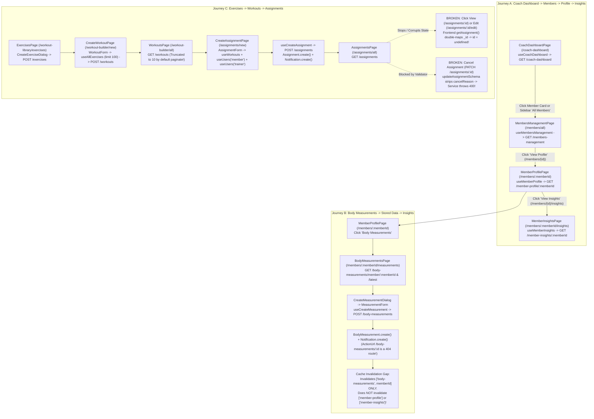
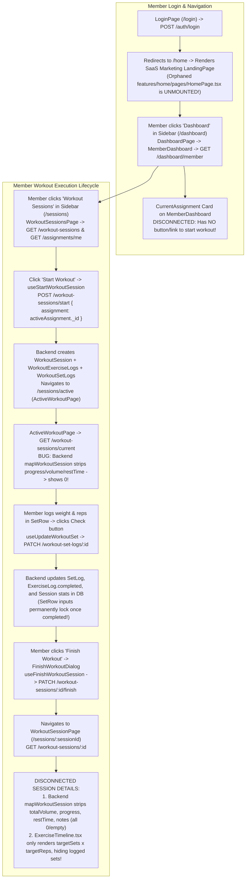

# 07 — End-to-End User Journeys & Data Flows

**Verification Status:** `VERIFIED` (All 12 core user journeys traced from UI event handlers through hooks, Axios calls, Express routes, controllers, services, mappers, and Mongoose models)

---

## 1. Coach User Journeys Diagram (Diagram 6)

---

## 2. Member User Journey Diagram (Diagram 7)

---

## 3. Detailed Trace of All 12 User Journeys

### Journey 1: Login, Authentication, and Application Initialization
- **Starting Screen:** `/` (`features/homelayout/pages/HomePage.tsx`) or `/login` (`features/auth/pages/LoginPage.tsx`).
- **User Action:** User enters email and password on `/login` and submits.
- **Frontend Components & Hooks:** `LoginPage.tsx` → `useLogin()` (`features/auth/hooks/useLogin.ts:10-39`) → `login()` (`features/auth/api/auth.api.ts:6-10`).
- **API Request:** `POST /api/v1/auth/login` with `{ email, password }`.
- **Backend Processing:** `validate(loginSchema)` → `authController.login` → `authService.login` (`User.findOne({ email, isActive: true }).select("+password")`, `user.correctPassword()`, `generateToken(user.id)`, `mapUser(user)`) → `sendToken()`.
- **Database Reads/Writes:** Reads `User` collection.
- **Final User-Visible Result:** Saves `"access_token"` in `localStorage`, sets `["current-user"]` in React Query cache, shows `"Welcome back!"` toast, and navigates to `/home`.
- **Where It Breaks / Disconnects (`VERIFIED`):**
  1. Navigating to `/home` renders `features/landing/pages/LandingPage.tsx` (the public SaaS marketing landing page with "Start Free Trial" `/register` buttons) inside `AppLayout`, while the actual authenticated home page (`features/home/pages/HomePage.tsx`) is unmounted!
  2. When the app reloads and calls `GET /api/v1/auth/me` (`useCurrentUser`), `authController.getMe` (`auth.controller.ts:40-47`) returns raw `req.user` (`_id`) without running `mapUser` (`id`).

---

### Journey 2: Coach Dashboard to Member Management
- **Starting Screen:** `/coach-dashboard` (`features/coach-dashboard/pages/CoachDashboardPage.tsx`).
- **Frontend Components & Hooks:** `CoachDashboardPage` → `useCoachDashboard()` → `GET /api/v1/coach-dashboard`. Renders `OverviewCards`, `TodaysPriorities`, `MembersNeedingAttention`, `QuickActions`, `PerformanceTelemetry`, `UpcomingAssignments`, `RecentMeasurements`, `RecentActivity`.
- **Backend Processing:** `protect` → `restrictTo(ADMIN, TRAINER)` → `coachDashboardController.getDashboard` → `coachDashboardService.getDashboard` → `mapCoachDashboard`.
- **Database Reads:** Parallel aggregations/queries on `Assignment`, `User`, `Workout`, `WorkoutSession`, `BodyMeasurement`.
- **Transition to Member Management:** Coach clicks "All Members" in `Sidebar` (`/members/all`) or clicks a member card in `TodaysPriorities` / `MembersNeedingAttention` (`/members/:memberId`).
- **On `/members/all` (`MembersManagementPage.tsx`):** Calls `useMembersManagement(queryParams)` → `GET /api/v1/members-management` → `membersManagementService.getAllMembers` (`User.aggregate` with `$lookup` and `$facet`).
- **Where It Breaks / Disconnects (`VERIFIED`):**
  1. Only members with an **currently `ACTIVE`** assignment with the Coach appear in `CoachDashboard` and `MembersManagementPage` (`members-management.service.ts:49-53`). If a member's assignment just finished (`COMPLETED`), the member vanishes from the Coach's roster!
  2. In `MembersManagementPage`, typing in `MembersSearch` fires an un-debounced API call on every keystroke and flashes `MembersLoading` because `placeholderData` is not set in `useMembersManagement`.

---

### Journey 3: Member Management to Member Profile and Member Insights
- **Starting Screen:** `/members/all` (`MembersManagementPage.tsx`).
- **User Action:** Coach clicks "View Profile" on a `MemberCard` (`MemberCard.tsx:152` → `/members/${member.id}`).
- **Step A — Member Profile (`/members/:memberId`):**
  - Renders `MemberProfilePage.tsx` → `useMemberProfile(memberId)` → `GET /api/v1/member-profile/:memberId`.
  - Backend `memberProfileService.getMemberProfile` checks `checkTrainerAccess(userId, memberId)` (requires active assignment), fetches `User`, `currentAssignment`, `assignmentHistory`, `measurements`, `recentSessions`, and `workoutStats`, builds timeline, and maps via `mapMemberProfile`.
- **Step B — Member Insights (`/members/:memberId/insights`):**
  - Coach clicks "View Insights" in `MemberProfileHeader.tsx:64` → navigates to `/members/${member.id}/insights`.
  - Renders `MemberInsightsPage.tsx` → `useMemberInsights(memberId)` → `GET /api/v1/member-insights/:memberId`.
  - Backend `memberInsightsService.getMemberInsights` checks `checkTrainerAccess`, queries `WorkoutSession`, `BodyMeasurement`, and `Assignment`, calculates KPIs, streaks, body deltas, charts, and timeline, and maps via `mapMemberInsights`.
- **Where It Breaks / Disconnects (`VERIFIED`):**
  1. In `member-insights.service.ts:151-191` (`buildBodyInsights`), if a member has only 1 recorded measurement (`previousMeasurement === null`) or an optional circumference field was omitted in the previous measurement, `(latest || 0) - (previous || 0)` treats the previous value as `0` and displays the entire raw circumference (e.g. `+100 cm` chest) as the change!
  2. In `member-insights.service.ts:101-123` (`calculateStreaksAndAverages`), the nested loop over `uniqueDates` adds the same rest gap multiple times to `totalRestDays`, skewing `averageRestDays`.
  3. On `MemberProfilePage`, items in `AssignmentHistory.tsx` and `RecentSessions.tsx` are static cards with no click links to `/assignments/:id` or `/sessions/:id`.

---

### Journey 4: Body Measurements to Stored Measurements and Resulting Insights
- **Starting Screen:** `/members/:memberId` (`MemberProfilePage`) → click "Body Measurements" (`MemberProfileHeader.tsx:74`) → `/members/:memberId/measurements` (`BodyMeasurementsPage.tsx`).
- **Frontend Components & Hooks:** `BodyMeasurementsPage` calls `useMemberMeasurements(memberId)` (`GET /body-measurements/member/:memberId`) and `useLatestMeasurement(memberId)` (`GET /body-measurements/member/:memberId/latest`).
- **User Action:** Coach clicks "Add Measurement" → opens `CreateMeasurementDialog.tsx` → fills `MeasurementForm.tsx` (`weight`, `height`, `bodyFat`, `measuredAt`, 11 optional `circumferences`, `notes`) → submits.
- **API Request:** `POST /api/v1/body-measurements` via `useCreateMeasurement()`.
- **Backend Processing:** `protect` → `restrictTo(ADMIN, TRAINER)` → `validate(createBodyMeasurementSchema)` → `bodyMeasurementService.createBodyMeasurement` (checks `checkTrainerAccess`, creates `BodyMeasurement`, sends `BODY_MEASUREMENT_CREATED` notification to member).
- **Where It Breaks / Disconnects (`VERIFIED`):**
  1. **Mapper Bug (`body-measurement.mapper.ts:12`):** On `GET /body-measurements/member/:memberId` and `/latest`, the service populates `.populate("trainer", "name")` and the mapper calls `doc.trainer.toString()`, turning `trainer` into `"{ _id: new ObjectId('...'), name: '...' }"`.
  2. **Broken Notification Link (`body-measurement.service.ts:64`):** The notification created for the member has `actionUrl: "/body-measurements/${measurement.id}"`, which does **not** exist in `AppRouter.tsx` (lands on blank `NotFoundPage`).
  3. **Stale Insights & Profile Caches:** `useCreateMeasurement`, `useUpdateMeasurement`, and `useDeleteMeasurement` only invalidate `["body-measurements", memberId]` and `["body-measurements", "latest", memberId]`. When the Coach navigates back to `/members/:memberId` or `/members/:memberId/insights`, React Query serves stale cached data for up to 5 minutes (`staleTime: 5m`)!

---

### Journey 5: Exercise Creation and Management
- **Starting Screen:** `/workout-library/exercises` (`features/exercises/pages/ExercisesPage.tsx`).
- **Frontend Components & Hooks:** `ExercisesPage` → `useExercises(page, 10)` → `GET /api/v1/exercises?page=&limit=10`. Renders `ExerciseTable.tsx` with `CreateExerciseDialog`, `ViewExerciseDialog`, `EditExerciseDialog`, and `DeleteExerciseDialog`.
- **Backend Processing:**
  - `GET /exercises` and `GET /exercises/:id` are public.
  - `POST /exercises`, `PATCH /exercises/:id`, `DELETE /exercises/:id` require `protect` and `authorize(Permissions.Exercise.*)`.
- **Where It Breaks / Disconnects (`VERIFIED`):**
  1. **Search Input Completely Unwired (`ExerciseFilters.tsx:5-15`):** The search bar on `/workout-library/exercises` has no state, props, or `onChange` handler.
  2. **Mounted Stub Pages (`AppRouter.tsx:194,198`):** Navigating to `/workout-library/exercises/:exerciseId` (`ExerciseDetailsPage.tsx`) or `/workout-library/exercises/:exerciseId/edit` (`EditExercisePage.tsx`) renders an empty `

`!
  3. **Edit Exercise Wipes `secondaryMuscles` (`exercise.validator.ts:20,30`):** `createExerciseSchema` has `secondaryMuscles: z.array(z.string()).default([])`, so `updateExerciseSchema` (`.partial()`) defaults omitted `secondaryMuscles` to `[]`.
  4. **Stale View/Edit Modal After Update (`useUpdateExercise.ts:11`):** Invalidates `["exercises"]` (plural) but not `["exercise", id]` (singular), so reopening `ViewExerciseDialog` or `EditExerciseDialog` shows old data.

---

### Journey 6: Workout Creation and Editing
- **Starting Screen:** `/workout-builder/all` or `/workout-library/workouts` (`features/workouts/pages/WorkoutsPage.tsx`).
- **User Action:** Coach clicks "New Workout" → `/workout-builder/new` (`CreateWorkoutPage.tsx` → `WorkoutForm.tsx`).
- **Frontend Components & Hooks:** `WorkoutForm.tsx` loads exercises via `useAllExercises()` (`GET /exercises?page=1&limit=100`), manages ordered exercise rows (`WorkoutExerciseItem.tsx`), validates with `workoutSchema` (`workouts/schemas/workout.schema.ts`), and submits via `useCreateWorkout()` (`POST /api/v1/workouts`) or `useUpdateWorkout()` (`PATCH /api/v1/workouts/:id`).
- **Backend Processing:** `protect` → `restrictTo(ADMIN, TRAINER)` → `validate` → `workoutService.create` / `update` (validates no duplicate exercises, sequential `order` starting at 1, active exercises exist, global title uniqueness).
- **Where It Breaks / Disconnects (`VERIFIED`):**
  1. **Edit Workout Redirects to `/workout-builder/undefined` (`EditWorkoutPage.tsx:120`):** After saving edits, `EditWorkoutPage.tsx:120` calls `navigate(\`/workout-builder/\${workout.id}\`)`. Because `GET /api/v1/workouts/:id` (`workout.service.ts:86-104`) returns a raw Mongoose document with `_id` (no `mapWorkout`), `workout.id` is `undefined`, redirecting the Coach to `/workout-builder/undefined`!
  2. **Header Quick Action "Create Workout" -> 404 (`Header.tsx:336`):** Links to `/workouts/create` instead of `/workout-builder/new`.
  3. **Workouts List Truncated to 10 (`workout.service.ts:74-80`):** `getWorkouts()` passes no `limit` param, and `ApiFeatures.paginate()` defaults to `limit = 10`, silently hiding all workouts beyond the 10th!
  4. **Mismatched Category Filter Chips (`WorkoutsPage.tsx:138-144`):** Filter buttons include `"powerlifting"` and `"functional"` (which cannot be created because backend `Category` enum only allows `strength`, `hypertrophy`, `cardio`, `mobility`) and omit `"mobility"`.
  5. **Dead "Start Session" Button (`WorkoutDetailsPage.tsx:145-151`):** Has no `onClick` handler.

---

### Journey 7: Workout Assignment Creation and Assignment to a Member
- **Starting Screen:** `/assignments/all` (`AssignmentsPage.tsx`) → click "Create Assignment" → `/assignments/new` (`CreateAssignmentPage.tsx` → `AssignmentForm.tsx`).
  - *(Note: Clicking "Create Assignment" from the top `Header.tsx:330` Quick Actions menu navigates to `/assignments/create`, which matches `/assignments/:assignmentId` with `assignmentId = "create"` and fails!)*
- **Frontend Components & Hooks:** `AssignmentForm.tsx` calls `useWorkouts()`, `useUsers("member")`, and `useUsers("trainer")`. Submits via `useCreateAssignment()` (`POST /api/v1/assignments`).
- **Backend Processing:** `protect` → `restrictTo(ADMIN, TRAINER)` → `validate(createAssignmentSchema)` → `assignmentService.create` (forces `trainer = req.user.id` if Trainer, verifies member & trainer & workout ownership, checks no duplicate active assignment for same `(member, workout)`, checks `startDate < endDate`, creates `Assignment`, sends `ASSIGNMENT_CREATED` notification to Member).
- **Where It Breaks / Disconnects (`VERIFIED`):**
  1. **Viewing or Editing an Assignment Fails (`assignments.api.ts:24`):** Clicking "View Details" (`/assignments/:assignmentId`) or "Edit" (`/assignments/:assignmentId/edit`) calls `getAssignment(id)`, which runs `mapAssignment` on a response that was **already** mapped by the backend (`assignment.service.ts:195`), setting `id`, `trainer.id`, and `workout.id` to `undefined` and `member.id` to an object!
  2. **Cancelling an Assignment Fails (`assignment.validator.ts:41-77` vs `assignment.service.ts:311`):** Setting status to `CANCELLED` fails with `400 "Cancel reason is required when cancelling an assignment"` because `updateAssignmentSchema` strips `cancelReason` (and `AssignmentForm.tsx` doesn't even have a `cancelReason` input field!).

---

### Journey 8: Member Access to Assigned Workouts
- **Starting Screen:** Member logs in and visits `/dashboard` (`MemberDashboard.tsx`) or `/sessions` (`WorkoutSessionsPage.tsx`).
- **How Member Sees Assigned Workouts:**
  1. On `/dashboard` (`MemberDashboard.tsx` → `CurrentAssignment.tsx:35-82`), `GET /api/v1/dashboard/member` returns `overview.activeAssignment` and `overview.currentWorkout`. However, `CurrentAssignment.tsx` is a static display card with **no button or link** to start or view the workout.
  2. If the Member clicks the `ASSIGNMENT_CREATED` notification (`actionUrl: "/assignments/${assignment.id}"`), `AppRouter` mounts `AssignmentDetailsPage`, which calls `GET /api/v1/assignments/:id`. Because `assignment.routes.ts:34` has `restrictTo(Roles.ADMIN, Roles.TRAINER)`, the backend rejects the Member with **`403 Forbidden`**!
  3. If the Member clicks "Assignments" in `Sidebar.tsx:102-115` (`/assignments/all`), `AssignmentsPage` calls `GET /api/v1/assignments`, which also rejects the Member with **`403 Forbidden`**!
  4. Only on `/sessions` (`WorkoutSessionsPage.tsx:27`) does the frontend call `useMyAssignments()` (`GET /api/v1/assignments/me`), find the first `ACTIVE` assignment (`activeAssignment`), and enable the "Start Workout" button.

---

### Journey 9: Workout Execution, Set Logging, and Session Completion
- **Starting Screen:** `/sessions` (`WorkoutSessionsPage.tsx`).
- **Step 1 — Start Session:** Member clicks "Start Workout" (`WorkoutSessionsPage.tsx:109-115`) → `useStartWorkoutSession()` → `POST /api/v1/workout-sessions/start` with `{ assignment: activeAssignment._id }`.
  - Backend `workoutSessionService.start` verifies assignment ownership & `ACTIVE` status, checks no `IN_PROGRESS` session exists, creates `WorkoutSession`, creates `WorkoutExerciseLog` for each workout exercise, pre-creates `WorkoutSetLog` documents (`1..sets`), notifies Trainer, and returns `mapWorkoutSession(session)`.
  - Frontend navigates to `/sessions/active` (`ActiveWorkoutPage.tsx`).
- **Step 2 — Active Workout & Set Logging (`/sessions/active`):**
  - `ActiveWorkoutPage.tsx` calls `useCurrentWorkoutSession()` → `GET /api/v1/workout-sessions/current`.
  - Renders `WorkoutHeader`, `ExerciseCard`s, and `SetRow`s.
  - Member enters `weight` and `actualReps` in `SetRow.tsx` and clicks the check button → `useUpdateWorkoutSet()` → `PATCH /api/v1/workout-set-logs/:id` with `{ weight, actualReps }`.
  - Backend `workoutSetService.update` updates the set (`completed: true`, `completedAt`), marks `WorkoutExerciseLog.completed = true` if all target sets are completed, and calls `updateSessionStats()` to recalculate `totalVolume`, `progress`, `exercisesCompleted`, `setsCompleted`, and `totalRestTime` on `WorkoutSession`.
- **Step 3 — Finish Workout:**
  - Member clicks "Finish Workout" → opens `FinishWorkoutDialog.tsx` → enters optional `notes` → calls `useFinishWorkoutSession()` → `PATCH /api/v1/workout-sessions/:id/finish`.
  - Backend `workoutSessionService.finish` sets `endedAt`, `duration`, `activeTrainingTime`, `status = COMPLETED`, `notes`, and sends `WORKOUT_COMPLETED` notifications to both Trainer and Member.
  - Frontend navigates to `/sessions/${session.id}` (`WorkoutSessionPage.tsx`).
- **Where It Breaks / Disconnects (`VERIFIED`):**
  1. **Backend Mapper Strips All Telemetry (`backend/src/mappers/workout-session.mapper.ts:1-8`):** `getCurrent` and `getById` pass `session` through `mapWorkoutSession`, which only returns `{ id, assignment, status, startedAt, endedAt, duration }`. All calculated telemetry (`progress`, `totalVolume`, `totalRestTime`, `activeTrainingTime`, `exercisesCompleted`, `setsCompleted`, `notes`) is stripped before reaching the frontend!
  2. **Completed Sets Cannot Be Edited (`SetRow.tsx:51,62,67`):** Inputs and button have `disabled={isCompleted}`, so a typo in weight/reps cannot be corrected.
  3. **Cannot Add Extra Sets:** `useCreateWorkoutSet` (`POST /workout-set-logs`) is unused in UI and has no route on the backend.
  4. **Cannot Cancel/Abandon Session:** No endpoint or button exists to set `status = CANCELLED` on an `IN_PROGRESS` session.
  5. **Broken Empty State Link (`ActiveWorkoutPage.tsx:46`):** When no session is active, "Return to Workouts" links to `/workouts` (404).

---

### Journey 10: Workout History and Progress Tracking
- **Starting Screen:** `/sessions` (`WorkoutSessionsPage.tsx`) and `/sessions/:sessionId` (`WorkoutSessionPage.tsx`).
- **What Works:** `GET /api/v1/workout-sessions` returns the list of sessions (`getAll` does NOT call `mapWorkoutSession`, so the table on `/sessions` actually receives `duration`, `progress`, etc.).
- **Where It Breaks / Disconnects (`VERIFIED`):**
  1. **Session Detail Page Hides Logged Sets (`ExerciseTimeline.tsx:16-52`):** When viewing a completed session at `/sessions/:sessionId`, `ExerciseTimeline` only renders `{exercise.exerciseName}` and `{exercise.targetSets} Sets × {exercise.targetReps}` — it **never renders `exercise.sets` (the actual weights and reps logged)**!
  2. **Session Detail Page Statistics & Notes Are Always Zero/Empty:** Because `getById` (`workout-session.service.ts:322`) uses `backend/src/mappers/workout-session.mapper.ts`, `SessionStatistics.tsx` always displays `0` for Volume, Progress, Exercises Completed, Sets Completed, Active Time, and Rest Time, and `SessionNotes.tsx` is never rendered because `session.notes` is stripped!
  3. **Broken Pagination Count (`workout-session.controller.ts:55`):** `results: sessions.length` returns the current page length (`<= 10`) instead of total matching documents, so `totalPages = Math.ceil(totalResults / limit)` in `WorkoutSessionsPage.tsx:31` is always `1`!

---

### Journey 11: Notifications and Real-Time Updates
- **Starting Screen:** `Header.tsx` bell dropdown or `/notifications` (`NotificationsPage.tsx`).
- **What Works:** `useNotifications()` (`GET /api/v1/notifications`), `useMarkNotificationRead()` (`PATCH /notifications/:id/read`), `useMarkAllNotificationsRead()` (`PATCH /notifications/read-all`), and `useDeleteNotification()` (`DELETE /notifications/:id`).
- **Where It Breaks / Disconnects (`VERIFIED`):**
  1. **No Frontend Socket.IO Client:** Backend emits `"notification"` over Socket.IO (`notification.service.ts:22-27`), but `socket.io-client` is not installed on the frontend; notifications only refresh on mount or after local mutations (`staleTime: 5m`).
  2. **Broken `actionUrl` Deep Links across Backend Services:**
     - `workout-session.service.ts:109,204,216` sets `actionUrl: "/workout-sessions/${session.id}"` (Frontend route is `/sessions/${session.id}` → clicking notification lands on blank 404 page!).
     - `body-measurement.service.ts:64` sets `actionUrl: "/body-measurements/${measurement.id}"` (Frontend route is `/members/${memberId}/measurements` → clicking notification lands on blank 404 page!).
     - `assignment.service.ts:103,356,370` sets `actionUrl: "/assignments/${assignment.id}"` (Member gets `403 Forbidden` on `GET /assignments/:id`, and Coach hits the double-mapper bug!).
  3. **Mobile Touch Bug (`NotificationItem.tsx:126`):** Mark-as-read and delete buttons use `opacity-0 group-hover:opacity-100`, making them invisible on touch screens.

---

### Journey 12: Profile and Settings Updates
- **Starting Screen:** `/profile` (`features/profile/pages/ProfilePage.tsx`).
- **What Works:** Reads `useCurrentUser()`. If `MEMBER`, renders `MemberProfileContainer` (`GET /api/v1/member-profile/:memberId`). If `TRAINER`/`ADMIN`, renders `CoachProfileContainer` (`GET /api/v1/coach-profile`).
- **Where It Breaks / Disconnects (`VERIFIED`):**
  1. **"Edit Profile" Buttons Are Dead (`CoachProfileView.tsx:45-50`, `MemberProfileView.tsx:53-58`):** Both buttons have no `onClick` handler, no modal, and no form.
  2. **Backend `PATCH /api/v1/coach-profile` Is Unwired:** Exists in `coach-profile.routes.ts:17` but has no frontend API function or hook.
  3. **No Member Profile Update Endpoint Exists:** There is no `PATCH /api/v1/member-profile` or `PATCH /api/v1/users/me` endpoint on the backend for members to update their name or phone.
  4. **Password Update Endpoint Is Unwired:** `PATCH /api/v1/auth/update-password` exists in `auth.routes.ts:154`, but no Settings or Change Password UI exists on the frontend (`Header.tsx:484` "Settings" menu item has no `onClick`).
