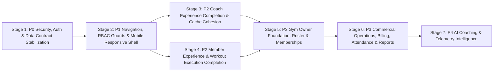

# 11 — V2 Development Roadmap Proposal

**Purpose:** Dependency-ordered engineering roadmap to stabilize the existing Coach & Member perspectives and expand STREN into a complete Gym Owner & Commercial platform without rework.  
**Note:** This is a **proposed roadmap** based on verified code dependencies. No implementation should begin until reviewed and approved.

---

## 1. Roadmap Overview & Dependency Flow

---

## 2. Stage-by-Stage Engineering Plan

### Stage 1 — Foundation: Security, Data Contracts & Core Blockers (`P0 — Critical`)
*Why first:* Fixes critical security holes and backend/frontend data contract bugs that currently break existing screens (`AssignmentDetailsPage`, `EditAssignmentPage`, `EditWorkoutPage`, `ActiveWorkoutPage`, `WorkoutSessionPage`).

1. **Lock Down Authentication & User Endpoints:**
   - Remove `role` from public `registerSchema` (`backend/src/validators/auth.validator.ts:13`) and force `role: Roles.MEMBER` on public self-registration.
   - Check `if (!currentUser || !currentUser.isActive)` in `protect` middleware (`backend/src/middleware/auth.middleware.ts:35`).
   - Add `restrictTo(Roles.ADMIN, Roles.TRAINER)` to `GET /api/v1/users` (`backend/src/routes/user.routes.ts:20`).
   - Sanitize `ApiFeatures.filter()` (`backend/src/utils/ApiFeatures.ts:9-19`) so query parameters cannot overwrite security/ownership filters (`isActive`, `trainer`, `member`, `createdBy`).
2. **Unify `_id` vs `id` Mappers & Fix Double-Mapping:**
   - Fix `backend/src/mappers/workout-session.mapper.ts:1-8` to include `progress`, `totalRestTime`, `activeTrainingTime`, `totalVolume`, `exercisesCompleted`, `setsCompleted`, and `notes`, and populate `assignment.trainer` in `workoutSessionService.getCurrent`.
   - Make `frontend/src/features/assignments/utils/assignment.mapper.ts` idempotent (`id: assignment.id ?? assignment._id`) so `getAssignment(id)` no longer wipes out `id`, `trainer.id`, and `workout.id`.
   - Populate `member`, `trainer`, and `workout` before calling `mapAssignment` in `AssignmentService.create` and `AssignmentService.update`.
   - Fix `backend/src/mappers/body-measurement.mapper.ts:12` to properly format populated `trainer` objects instead of calling `.toString()` on a Mongoose subdocument.
   - Call `mapUser(req.user)` in `authController.getMe` (`backend/src/controllers/auth.controller.ts:40-47`).
3. **Fix Validator & Index Blockers:**
   - Add `cancelReason: z.string().trim().optional()` to `updateAssignmentSchema` (`backend/src/validators/assignment.validator.ts:41-77`).
   - Fix `updateExerciseSchema` (`backend/src/validators/exercise.validator.ts:20,30`) so omitting `secondaryMuscles` on `PATCH /exercises/:id` does not overwrite existing values with `[]`.
   - Update unique partial indexes in `Assignment.model.ts:88-100` and `Exercise.model.ts:9` to include `isActive: true`.

---

### Stage 2 — Routing, Frontend RBAC & Responsive Shell (`P1 — Foundation`)
*Why second:* Establishes role-aware routing and a mobile-friendly layout shell before polishing feature screens.

1. **Role-Aware Routing & Navigation:**
   - Enhance `ProtectedRoute.tsx` to accept `allowedRoles?: Role[]` and verify the authenticated user's role via `useCurrentUser()`.
   - Update `Sidebar.tsx` so Coach-only sections (`Members Management`, `Workout Builder`, `Workout Library`, `Assignments`) require `roles: ["TRAINER", "ADMIN"]`, and expose `Profile` (`/profile`) and Member-specific links (`My Workouts / Sessions`, `My Progress`) to `MEMBER`.
   - Fix `/home` routing in `AppRouter.tsx:87-89`: stop rendering the public SaaS marketing `LandingPage` inside `AppLayout`; either route authenticated users directly to `/dashboard` (which already dispatches Coach vs. Member) or wire up `features/home/pages/HomePage.tsx`.
   - Fix all broken links (`Header.tsx:330,336`, `ActiveWorkoutPage.tsx:46`, `AssignmentDetailsPage.tsx:319`) and backend notification `actionUrl` templates (`workout-session.service.ts:109,204,216`, `body-measurement.service.ts:64`).
   - Implement a real `NotFoundPage.tsx`.
2. **Mobile-Responsive `AppLayout`, `Sidebar`, and `Header`:**
   - Convert `Sidebar.tsx` on viewports `<768px` (`md`) from an in-flow flex item into an off-canvas slide-over drawer (`fixed inset-y-0 left-0 z-50`) with a backdrop overlay.
   - Make `NotificationItem.tsx:126` action buttons visible on mobile (`opacity-100 md:opacity-0 md:group-hover:opacity-100`).
3. **Cleanup Dead/Stray Files:**
   - Remove the 19 empty 0-byte files outside `src/` (`frontend/coach/**/*`, `frontend/hooks/use-dashboard.ts`), unused 0-byte placeholders, and `Deleted files but maybe we need it/` leftovers once verified.

---

### Stage 3 — Completing the Coach Experience (`P2 — Product Completion`)
*Why third:* With contracts and routing stable, complete the remaining gaps in the Coach workflows.

1. **Decouple Coach-Member Access from Active-Only Assignment Status:**
   - Allow Coaches to view Member Profile, Insights, and Body Measurements for any member assigned to them (either via a dedicated `assignedTrainer` field on `User` or by checking `Assignment.exists({ trainer, member, isActive: true })` regardless of whether the latest assignment status is `ACTIVE` or `COMPLETED`).
2. **Complete Exercise & Workout Libraries:**
   - Wire `ExerciseFilters.tsx` search and equipment/difficulty filters to `useExercises` query params, and fix `exerciseService.getAll` `totalResults` count.
   - Either implement `ExerciseDetailsPage.tsx` and `EditExercisePage.tsx` or remove their dead routes in favor of the existing modal dialogs (`ViewExerciseDialog`, `EditExerciseDialog`).
   - Align `WorkoutsPage.tsx:138-144` category filter chips with backend `Category` enum (`strength`, `hypertrophy`, `cardio`, `mobility`) and support pagination/limit on `getWorkouts()`.
   - Scope workout title uniqueness per creator (`{ title, createdBy, isActive: true }`) in `workout.service.ts:20,157`.
3. **Complete Assignments & Coach Profile:**
   - Add `cancelReason` field to `AssignmentForm.tsx` when status is set to `CANCELLED`.
   - Compute real assignment progress from completed sessions rather than hardcoding `65%` / `15%`.
   - Wire the "Edit Profile" button on `CoachProfileView.tsx:45` to `PATCH /api/v1/coach-profile` (and add Zod validation middleware to `coach-profile.routes.ts:17`).
4. **Cross-Feature Cache Invalidations & Analytics Fixes:**
   - Invalidate `["coach-dashboard"]`, `["member-profile"]`, `["member-insights"]`, and `["members-management"]` on assignment and measurement mutations.
   - Fix `buildBodyInsights` (`member-insights.service.ts:151-191`), `calculateStreaksAndAverages` (`L101-123`), and `coach-profile.service.ts:266-267`.

---

### Stage 4 — Completing the Member Experience & Workout Execution (`P2 — Product Completion`)
*Why fourth:* Delivers a complete, mobile-usable workout tracking and progress experience for athletes/members.

1. **Workout Execution & Session History Polish:**
   - Render logged sets (`setNumber`, `weight`, `actualReps`, `completed`) inside `ExerciseTimeline.tsx` on `WorkoutSessionPage` (`/sessions/:sessionId`).
   - Allow editing completed sets during an `IN_PROGRESS` session in `SetRow.tsx` (or toggling completion state) and redesign the `SetRow` grid for mobile screens.
   - Mount `POST /api/v1/workout-set-logs` in `workout-set.routes.ts` and wire `useCreateWorkoutSet` so members can add extra sets during a workout.
   - Add a `PATCH /api/v1/workout-sessions/:id/cancel` endpoint and UI button so members can abandon an accidentally started session.
   - Fix `workout-session.controller.ts:55` to return total count for pagination.
2. **Member Dashboard, Assigned Workouts & Self-Progress:**
   - Add a "Start Workout" / "Continue Workout" CTA button directly on `MemberDashboard`'s `CurrentAssignment.tsx` card.
   - Allow Members to view their own assignment details (`GET /api/v1/assignments/:id` when `assignment.member === req.user.id`) so clicking an assignment notification works.
   - Give Members a dedicated view for their own Body Measurements & Progress Charts (reusing `useMemberMeasurements` and allowing self-access on `GET /api/v1/member-insights/:memberId`).
   - Add Member profile editing (`PATCH /api/v1/users/me` + `PATCH /api/v1/auth/update-password` UI).
3. **Real-Time Notifications:**
   - Install `socket.io-client` on the frontend, connect using `tokenService.getToken()`, and listen for `"notification"` events to update `["notifications"]` in React Query and trigger a toast.

---

### Stage 5 — Gym Owner Perspective & Multi-Role Administration (`P3 — Product Expansion`)
*Why fifth:* Builds on top of stable Coach and Member modules to introduce the 3rd core persona (`GYM_OWNER`).

1. **Role & Data Model Foundation:**
   - Add `GYM_OWNER` (or unify with `ADMIN` based on product decision) in `roles.ts` and `role-permissions.ts`.
   - Introduce the `Gym` model (or organization profile) and explicit `Coach-Member` assignment (`assignedTrainer` on `User` or `MemberProfile` model).
2. **Owner Workflows & Screens:**
   - **Owner Dashboard (`/owner-dashboard`):** Gym-wide KPIs (total active members, active coaches, session volume, retention/at-risk members, coach utilization).
   - **Coaches / Staff Management (`/coaches` — replacing empty `trainer.routes.ts`):** Invite/create coach accounts, view coach performance metrics, assign members to coaches, deactivate coaches.
   - **Gym-Wide Member Directory (`/members`):** Onboard members, assign/reassign primary coach, manage account status (`isActive`).

---

### Stage 6 — Commercial Operations: Memberships, Billing, Attendance & Reports (`P3 — Product Expansion`)
*Why sixth:* Transforms STREN from a workout/coaching tracker into a full commercial Gym Management SaaS.

1. **Membership Plans & Subscriptions:**
   - Models: `MembershipPlan` (name, durationDays, price, currency, features) and `MemberSubscription` (member, plan, startDate, endDate, status: `ACTIVE | EXPIRED | PAUSED | CANCELLED`, autoRenew).
2. **Payments & Billing:**
   - Models: `Payment` / `Invoice` (member, subscription, amount, status, paymentMethod, paidAt, recordedBy).
   - Support manual cash/card recording at the front desk first, followed by online payment gateway webhooks (Stripe / Paymob).
3. **Attendance & Check-In:**
   - Model: `Attendance` (member, checkInAt, checkOutAt, method: `MANUAL | QR_CODE`, verifiedBy).
   - Gate check-in validation against active `MemberSubscription` status.
4. **Reports & Exports:**
   - CSV/PDF export for member rosters, revenue/payment history, attendance logs, and member progress summaries.

---

### Stage 7 — AI Coaching & Predictive Insights (`P4 — Advanced`)
*Why last:* Requires clean, reliable historical workout volume, set logs, and body measurement data from Stages 1–6.

1. **Wire Existing AI Schema Placeholders:**
   - Populate `ai.summary` and `ai.recommendations` already present in `CoachDashboard`, `CoachProfile`, and `MemberInsights` mappers using structured LLM prompts over aggregated member telemetry.
2. **Automated Coaching Assistants:**
   - Plateau detection, deload recommendations, and automated weekly check-in summaries for Coaches.
