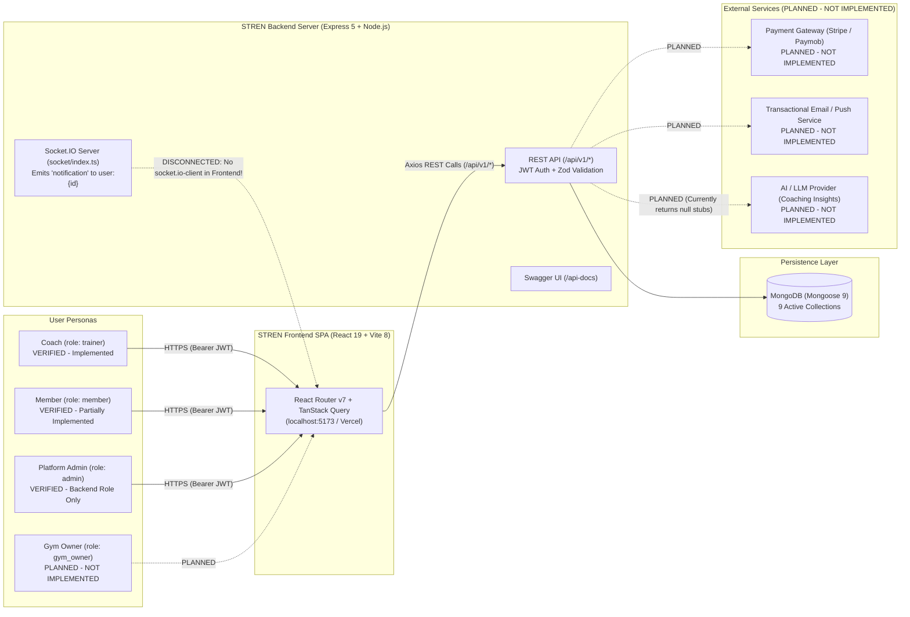

# 12 — Master Architecture Blueprint (Current State & V2 Target)

**Purpose:** Master architectural reference connecting all 9 required system diagrams, cross-module dependencies, and the proposed Gym Owner expansion architecture.

---

## 1. Master Diagram Index

All 9 required Mermaid diagrams are maintained as editable source across the audit documentation:

| Diagram # | Diagram Name | Document Location |
| :--- | :--- | :--- |
| **Diagram 1** | **System Context (Current vs. Planned)** | Included below in **Section 2** (`12-architecture-blueprint.md`) |
| **Diagram 2** | **Frontend Architecture** | [03-frontend-architecture.md](./03-frontend-architecture.md#1-frontend-architecture-diagram-diagram-2) |
| **Diagram 3** | **Backend Architecture** | [04-backend-architecture.md](./04-backend-architecture.md#1-backend-architecture-diagram-diagram-3) |
| **Diagram 4** | **Database ERD** | [05-database-and-erd.md](./05-database-and-erd.md#1-database-entity-relationship-diagram-diagram-4) |
| **Diagram 5** | **API Integration Map** | [06-api-integration-map.md](./06-api-integration-map.md#1-api-integration-map-diagram-diagram-5) |
| **Diagram 6** | **Coach User Journeys** | [07-user-journeys-and-data-flows.md](./07-user-journeys-and-data-flows.md#1-coach-user-journeys-diagram-diagram-6) |
| **Diagram 7** | **Member User Journey** | [07-user-journeys-and-data-flows.md](./07-user-journeys-and-data-flows.md#2-member-user-journey-diagram-diagram-7) |
| **Diagram 8** | **Gym Owner Future Architecture (`PLANNED`)** | Included below in **Section 3** (`12-architecture-blueprint.md`) |
| **Diagram 9** | **Module Dependency Map & Bottlenecks** | Included below in **Section 4** (`12-architecture-blueprint.md`) |

---

## 2. System Context Diagram (Diagram 1)

---

## 3. Gym Owner Future Architecture Diagram (Diagram 8)

All proposed Owner/Commercial modules below are explicitly marked **`PLANNED — NOT IMPLEMENTED`** to distinguish them from the existing verified codebase.

```mermaid
flowchart TD
  subgraph OwnerUI["Owner Frontend Screens (PLANNED — NOT IMPLEMENTED)"]
    ODash["Owner Dashboard (/owner-dashboard)<br/>PLANNED — NOT IMPLEMENTED"]
    OStaff["Coach & Staff Management (/owner/coaches)<br/>PLANNED — NOT IMPLEMENTED"]
    OMembers["Gym Member Roster & Coach Assignment (/owner/members)<br/>PLANNED — NOT IMPLEMENTED"]
    OPlans["Membership Plans & Subscriptions (/owner/memberships)<br/>PLANNED — NOT IMPLEMENTED"]
    OBilling["Payments, Invoices & Revenue (/owner/billing)<br/>PLANNED — NOT IMPLEMENTED"]
    OAttend["Check-In & Attendance Desk (/owner/attendance)<br/>PLANNED — NOT IMPLEMENTED"]
    OReports["Financial & Operational Reports (/owner/reports)<br/>PLANNED — NOT IMPLEMENTED"]
  end

  subgraph OwnerAPI["Proposed Backend Services & Routes (PLANNED — NOT IMPLEMENTED)"]
    S_Gym["GymService (/api/v1/gyms)<br/>PLANNED — NOT IMPLEMENTED"]
    S_Trainer["TrainerManagementService (/api/v1/trainers - currently 0B stub)<br/>PLANNED — NOT IMPLEMENTED"]
    S_Membership["MembershipService (/api/v1/memberships)<br/>PLANNED — NOT IMPLEMENTED"]
    S_Billing["BillingService (/api/v1/payments)<br/>PLANNED — NOT IMPLEMENTED"]
    S_Attendance["AttendanceService (/api/v1/attendance)<br/>PLANNED — NOT IMPLEMENTED"]
    S_OwnerDash["OwnerDashboardService (/api/v1/owner-dashboard)<br/>PLANNED — NOT IMPLEMENTED"]
  end

  subgraph PlannedModels["Proposed Database Models (PLANNED — NOT IMPLEMENTED)"]
    M_Gym[("Gym / Branch<br/>PLANNED — NOT IMPLEMENTED")]
    M_Plan[("MembershipPlan<br/>PLANNED — NOT IMPLEMENTED")]
    M_Sub[("MemberSubscription<br/>PLANNED — NOT IMPLEMENTED")]
    M_Pay[("Payment / Invoice<br/>PLANNED — NOT IMPLEMENTED")]
    M_Att[("AttendanceLog<br/>PLANNED — NOT IMPLEMENTED")]
  end

  subgraph ExistingCore["Existing Verified Core Models & Services (REUSED)"]
    E_User[("User (Extended with gymId & assignedTrainer)")]
    E_Asg[("Assignment")]
    E_Sess[("WorkoutSession")]
    E_BM[("BodyMeasurement")]
    E_Notif["NotificationService"]
  end

  ODash --> S_OwnerDash
  OStaff --> S_Trainer
  OMembers --> S_Gym
  OPlans --> S_Membership
  OBilling --> S_Billing
  OAttend --> S_Attendance
  OReports --> S_OwnerDash

  S_Gym --> M_Gym
  S_Trainer --> E_User
  S_Membership --> M_Plan
  S_Membership --> M_Sub
  S_Billing --> M_Pay
  S_Billing --> M_Sub
  S_Attendance --> M_Att
  S_Attendance --> M_Sub

  S_OwnerDash --> E_User
  S_OwnerDash --> E_Asg
  S_OwnerDash --> E_Sess
  S_OwnerDash --> M_Sub
  S_OwnerDash --> M_Pay
  S_Membership --> E_Notif
  S_Billing --> E_Notif
```

### 3.1 Architectural Requirements for Introducing the Gym Owner Perspective
1. **Existing Infrastructure Reusable Immediately:**
   - Authentication pipeline (`protect`, `restrictTo`, `authorize`, `RolePermissions`), `User` model, `NotificationService`, `MembersManagementService` aggregation patterns, and `CoachDashboardService` KPI/chart aggregation patterns.
   - Empty mounted routers `backend/src/routes/trainer.routes.ts` (`/api/v1/trainers`) and `backend/src/routes/member.routes.ts` (`/api/v1/members`) are already registered in `backend/src/routes/index.ts:27-28`.
2. **Missing Role & Permission Support:**
   - Add `GYM_OWNER: "gym_owner"` to `Roles` (`backend/src/constants/roles.ts` and `frontend/src/constants/roles.ts`) or designate `Roles.ADMIN` as the Gym Owner role if single-tenant.
   - Populate `RolePermissions` (`backend/src/constants/role-permissions.ts`) and unify route guards so Owner permissions (`staff:manage`, `membership:manage`, `billing:read`, `billing:write`, `attendance:manage`, `gym:settings`) are enforced consistently.
3. **Missing Data Models & Relationships:**
   - **Coach-to-Member Assignment (`User.assignedTrainer`):** Currently, a Member is only linked to a Coach when an `ACTIVE` workout `Assignment` exists. A Gym Owner needs to assign a newly registered Member to a Coach *before* any workout is programmed.
   - **Tenant / Facility Boundary (`Gym` model):** If multiple gyms use STREN, `gymId` must be added to `User`, `Workout`, `Assignment`, `MembershipPlan`, `MemberSubscription`, `Payment`, and `Attendance`.
   - **Commercial Entities:** `MembershipPlan`, `MemberSubscription`, `Payment`, and `Attendance`.

---

## 4. Module Dependency Map & Architectural Bottlenecks (Diagram 9)

```mermaid
flowchart TD
  subgraph SharedModels["Core Database Entities"]
    U[("User Model")]
    E[("Exercise Model")]
    W[("Workout Model")]
    A[("Assignment Model<br/>CRITICAL BOTTLENECK")]
    WS[("WorkoutSession Model")]
    WEL[("WorkoutExerciseLog Model")]
    WSL[("WorkoutSetLog Model")]
    BM[("BodyMeasurement Model")]
    N[("Notification Model")]
  end

  subgraph DomainServices["Backend Domain Services"]
    AuthSvc["AuthService"]
    UserSvc["UserService"]
    ExSvc["ExerciseService"]
    WoSvc["WorkoutService"]
    AsgSvc["AssignmentService"]
    SessSvc["WorkoutSessionService"]
    SetSvc["WorkoutSetService"]
    BMSvc["BodyMeasurementService"]
    NotifSvc["NotificationService"]
  end

  subgraph ReadAggregators["Heavy Aggregation Services (Read-Only)"]
    CDashSvc["CoachDashboardService (6 parallel aggregations)"]
    CProfSvc["CoachProfileService (6 parallel aggregations)"]
    MDashSvc["DashboardService (Member & Legacy Trainer)"]
    MProfSvc["MemberProfileService (5 parallel queries)"]
    MInsSvc["MemberInsightsService (4 parallel queries)"]
    MMgtSvc["MembersManagementService (Multi-lookup pipeline)"]
  end

  AuthSvc --> U
  UserSvc --> U
  ExSvc --> E
  ExSvc -->|"Checks active usage before delete"| W
  WoSvc --> W
  WoSvc --> E
  WoSvc -->|"Checks active assignment before delete"| A

  AsgSvc --> A
  AsgSvc --> U
  AsgSvc --> W
  AsgSvc --> WS
  AsgSvc --> NotifSvc

  SessSvc --> WS
  SessSvc --> A
  SessSvc --> W
  SessSvc --> WEL
  SessSvc --> WSL
  SessSvc --> NotifSvc

  SetSvc --> WSL
  SetSvc --> WEL
  SetSvc --> WS

  BMSvc --> BM
  BMSvc -->|"checkTrainerAccess requires ACTIVE Assignment!"| A
  BMSvc --> NotifSvc

  NotifSvc --> N

  CDashSvc --> A
  CDashSvc --> U
  CDashSvc --> W
  CDashSvc --> WS
  CDashSvc --> BM

  CProfSvc --> A
  CProfSvc --> U
  CProfSvc --> W
  CProfSvc --> WS
  CProfSvc --> BM

  MDashSvc --> A
  MDashSvc --> WS
  MDashSvc --> WEL
  MDashSvc --> WSL

  MProfSvc -->|"checkTrainerAccess requires ACTIVE Assignment!"| A
  MProfSvc --> U
  MProfSvc --> WS
  MProfSvc --> BM

  MInsSvc -->|"checkTrainerAccess requires ACTIVE Assignment!"| A
  MInsSvc --> WS
  MInsSvc --> BM

  MMgtSvc -->|"Step 2 Auth Lookup requires ACTIVE Assignment!"| A
  MMgtSvc --> U
  MMgtSvc --> W
  MMgtSvc --> WS
  MMgtSvc --> BM
```

### 4.1 Critical Architectural Bottlenecks Identified in Diagram 9 (`VERIFIED`)

1. **`Assignment` Model as the Single Point of Truth for Authorization & Relationships:**
   - **11 of the 15 backend services** depend directly on `Assignment`.
   - Because `User` has no `assignedTrainer` field and `WorkoutSession` has no `trainer` or `workout` field (it only references `assignment`), **every single coach query** (`CoachDashboardService`, `CoachProfileService`, `MembersManagementService`, `MemberProfileService`, `MemberInsightsService`, `BodyMeasurementService`, `WorkoutSessionService`) must join or query `Assignment` first to determine:
     1. Whether the Coach is authorized to view the Member (`status: "ACTIVE"`), and
     2. Which workout or trainer a `WorkoutSession` belonged to (`$lookup` from `workoutsessions` to `assignments`).
2. **Duplicated Aggregation Logic Across 5 Read Services:**
   - `CoachDashboardService`, `CoachProfileService`, `DashboardService`, `MemberProfileService`, and `MemberInsightsService` each independently implement their own MongoDB `$lookup` pipelines for completion rates, session volumes, 7d/30d date-bucketed charts, and merged activity timelines (`buildTimeline` / `getRecentActivity`).
3. **Duplicated Frontend Profile Implementations (`features/member-profile` vs `features/profile/components/member`):**
   - Two nearly identical sets of Member Profile components, API clients, hooks, and types exist in `frontend/src/features/member-profile/` (used by `/members/:memberId`) and `frontend/src/features/profile/components/member/` (used by `/profile`).
