# STREN — Coach User Journey Guide

This guide explains how a **Coach** (`TRAINER` role) uses the STREN Gym Management Platform to onboard, manage connected Members, build custom exercises and workout templates, assign training splits, and review completed Member workout sessions.

---

## 1. STREN — Coach Journey Flowchart

```mermaid
flowchart TD
    %% Styling Definitions
    classDef coachAction fill:#16291D,stroke:#5BE584,stroke-width:2px,color:#F3F4F6
    classDef pageNode fill:#101418,stroke:#3B82F6,stroke-width:1.5px,color:#F3F4F6
    classDef decisionNode fill:#1E2329,stroke:#F59E0B,stroke-width:2px,color:#FDE68A
    classDef recoveryNode fill:#2A1215,stroke:#EF4444,stroke-width:1.5px,color:#FCA5A5
    classDef successNode fill:#064E3B,stroke:#10B981,stroke-width:2px,color:#ECFDF5

    %% 1. Authentication & Coach Dashboard
    Start(["Open STREN App ( / )"]) --> SignIn["Sign In at /login or Register at /register\n(Complete Coach Onboarding at /onboarding:\nTitle, Experience, Specialties, Certifications, Philosophy)"]
    class SignIn coachAction

    SignIn --> AuthValid{"Authenticated as\nTRAINER / ADMIN?"}
    class AuthValid decisionNode
    AuthValid -- "No" --> AuthError["Show Login Error or Redirect\nMember Accounts to /dashboard"]
    class AuthError recoveryNode
    AuthError --> SignIn

    AuthValid -- "Yes" --> CoachDash["Coach Dashboard ( /coach-dashboard )\nView Overview Metrics, Client Health,\nAction Center & Upcoming Schedules"]
    class CoachDash pageNode

    %% 2. Member Management
    CoachDash --> OpenRoster["Open Member Roster ( /members/all )\nSearch, Filter by Status, Sort & Paginate"]
    class OpenRoster pageNode

    OpenRoster --> HasMembers{"Have connected\nACTIVE members?"}
    class HasMembers decisionNode
    HasMembers -- "No (Empty Roster)" --> InviteMember["Click 'Invite Member' on /members/all\nSend Invite -> Wait for Member to Accept on /dashboard"]
    class InviteMember recoveryNode
    InviteMember --> OpenRoster

    HasMembers -- "Yes" --> SelectMember["Click 'View Profile' on Member Card\nOpens Member Profile ( /members/:memberId )"]
    class SelectMember coachAction

    SelectMember --> AccessCheck{"Authorized for Member\n& History Consent?"}
    class AccessCheck decisionNode
    AccessCheck -- "Not Connected (403)" --> UnauthError["Backend Blocks Access (403 Forbidden)\nReturn to /members/all"]
    class UnauthError recoveryNode
    UnauthError --> OpenRoster

    AccessCheck -- "Connected (Consent Private/Pending)" --> ScopedProfile["View Current Coach Progress Only\n(Pre-Coach History Hidden by Privacy Banner)"]
    class ScopedProfile pageNode
    AccessCheck -- "Connected (Consent Granted)" --> FullProfile["View Current Coach Progress +\nPre-Coach Historical Sessions & Measurements"]
    class FullProfile pageNode

    %% 3. Workout Template & Custom Exercise Management
    ScopedProfile --> ManageTemplates["Open Exercise Library ( /workout-library/exercises )\nor Workout Builder ( /workout-builder/all )"]
    FullProfile --> ManageTemplates
    CoachDash --> ManageTemplates
    class ManageTemplates pageNode

    ManageTemplates --> NeedCustomEx{"Need a new\ncustom exercise?"}
    class NeedCustomEx decisionNode
    NeedCustomEx -- "Yes" --> CreateEx["Create Custom Exercise ( /workout-library/exercises/new )\nSaved as Private to Coach (isCustom = true)"]
    class CreateEx coachAction
    CreateEx --> BuildTemplate
    NeedCustomEx -- "No" --> BuildTemplate["Create / Edit Workout Template\n( /workout-builder/new or /workout-builder/:workoutId/edit )\nConfigure Title, Category, Difficulty, Exercises, Sets, Reps, Rest"]
    class BuildTemplate coachAction

    BuildTemplate --> ValidWorkout{"Form passes\nZod validation?"}
    class ValidWorkout decisionNode
    ValidWorkout -- "No" --> FormValidation["Highlight Missing Title, Category,\nor Exercise Sets/Reps Fields"]
    class FormValidation recoveryNode
    FormValidation --> BuildTemplate

    ValidWorkout -- "Yes" --> TemplateInUse{"Editing template already\nused by a Member?"}
    class TemplateInUse decisionNode
    TemplateInUse -- "No (New or Unused)" --> SaveInPlace["Save Workout Template Directly"]
    class SaveInPlace coachAction
    TemplateInUse -- "Yes (Has Active Assignments/Sessions)" -->CreateNewVersion["Non-Destructive Versioning:\n• Original Prescription Preserved for Active Assignments/History\n• New Template Version (v + 1) Created for Future Assignments"]
    class CreateNewVersion successNode

    %% 4. Assignments
    SaveInPlace --> CreateAssign["Open Assign Workout ( /assignments/new )\nor Member Plan Page ( /members/:memberId/plan )"]
    CreateNewVersion --> CreateAssign
    class CreateAssign pageNode

    CreateAssign --> AssignSubmit["Select Managed Member + Workout Template\nSet Start Date, End Date & Notes -> Submit"]
    class AssignSubmit coachAction

    AssignSubmit --> AssignEffects["Backend Processes Assignment:\n1. Auto-grants Member access to any Custom Exercises in routine\n2. Sends Notification to Member\n3. Appears on Member's Next Workout Card (with Split Tabs if >1)"]
    class AssignEffects successNode

    %% 5. Session Monitoring & Review
    AssignEffects --> CheckSessions{"Has Member completed\nworkout sessions?"}
    ScopedProfile --> CheckSessions
    FullProfile --> CheckSessions
    class CheckSessions decisionNode

    CheckSessions -- "No Completed Sessions Yet" --> WaitSession["No Completed Sessions to Review\nMonitor Upcoming Schedules ( /coach/schedule )"]
    class WaitSession recoveryNode
    WaitSession --> OpenRoster

    CheckSessions -- "Yes" --> OpenSession["Open Completed Session ( /sessions/:sessionId )\nfrom Member Profile 'Recent Sessions' or /sessions"]
    class OpenSession pageNode

    OpenSession --> InspectTelemetry["Review Session Telemetry:\n• Duration, Total Volume, Exercises & Sets Completed\n• Member's Session Exertion (RPE 1-10)\n• Set-by-Set Weight & Reps Breakdown"]
    class InspectTelemetry coachAction

    InspectTelemetry --> WriteReview["In 'Coach Review & Feedback' Card:\nEnter Feedback (up to 1,000 chars) & Click 'Submit Coach Review'"]
    class WriteReview coachAction

    WriteReview --> ReviewSaved{"Review saved?"}
    class ReviewSaved decisionNode
    ReviewSaved -- "No (Network / API Error)" --> ReviewError["Show Error Toast & Retain Draft Text\nRetry Submission"]
    class ReviewError recoveryNode
    ReviewError --> WriteReview

    ReviewSaved -- "Yes" --> NotifyMember["Review Persisted & Real-Time Socket.IO\nNotification Sent to Member"]
    class NotifyMember successNode

    %% 6. Follow-up
    NotifyMember --> FollowUp["Return to Member Profile ( /members/:memberId )\nor Roster ( /members/all ) to Adjust Future Plans"]
    class FollowUp pageNode
```

---

## 2. Step-by-Step Guide to Following the Coach Journey

1. **Authentication & Coach Dashboard (`/login`, `/onboarding`, `/coach-dashboard`)**
   - **Onboarding:** When registering a new account at `/register`, select the **Coach / Trainer** role during `/onboarding`. Fill in your professional title, years of experience, specialties, certifications, languages, and coaching philosophy. Members connected to you will be able to view these credentials from their dashboard.
   - **Coach Dashboard (`/coach-dashboard`):** After login, you land on `/coach-dashboard`. Here you can review high-level metrics (**OverviewCards**), monitor client adherence (**ClientHealthOverview**), check alerts (**CoachActionCenter**), and switch between the **Overview**, **Analytics** (`/coach-dashboard/analytics`), and **Activity** (`/coach-dashboard/activity`) tabs.

2. **Member Roster & Relationship Management (`/members/all`, `/members/:memberId`)**
   - **Member Roster (`/members/all`):** Lists only the Members you actively manage. Use the toolbar to search by name or email, filter by status, sort, and paginate.
   - **Inviting Members:** Click **Invite Member** in the header to send a coaching invitation. Sent invitations appear under **Pending Invitations** until the Member accepts or declines from their dashboard.
   - **Member Cards:** Each card displays the Member's active status, **History Sharing Consent** badge (`History Shared`, `Consent Pending`, or `History Private`), current routine or **`ROUTINE SPLIT (N)`** summary, completion percentage ring, latest body weight, and last logged workout date.
   - **Member Profile (`/members/:memberId`):** Click **View Profile** on any Member card to inspect:
     - **Coaching Relationship Banner:** Shows relationship start date and whether pre-relationship history is shared.
     - **Progress Separation View:** Clearly separates training stats achieved with you from historical pre-coach training (if shared).
     - **Current Assignment Card:** Shows active assigned routines. If you assigned multiple routines (e.g., a 3-day split), interactive routine tabs appear at the top of the card so you can inspect each routine in the split.
     - **Recent Sessions, Assignment History, Measurements & Timeline.**

3. **Exercise Library & Workout Template Management (`/workout-library/exercises`, `/workout-builder/all`)**
   - **Custom Exercises (`/workout-library/exercises/new`):** Any exercise you create is marked as custom (`isCustom: true`) and owned by you. Other coaches cannot edit, delete, or see your custom exercises.
   - **Building Workout Templates (`/workout-builder/new`):** Configure the workout title, description, category, difficulty, estimated duration, tags, **Save as Reusable Template** toggle, and ordered exercise blocks (sets, reps, rest seconds, and notes).
     - *Note on Target Weight & Target RPE:* While the backend API, database schema, and active workout session cards support `targetWeight` and `targetRpe`, the frontend Workout Builder form UI currently exposes **Sets**, **Reps**, **Rest (sec)**, and **Notes**.
   - **Template Versioning When Editing (`/workout-builder/:workoutId/edit`):**
     - If you edit a template that has **never** been assigned or used in a session, it updates in place.
     - If you edit a template that is **already used** by an active assignment, scheduled workout, or logged session, STREN automatically preserves the original workout record so active Members and historical logs are never altered mid-program, and creates a new template version (`version + 1`) for your future assignments.

4. **Assigning Workout Plans (`/assignments/new`, `/assignments/all`, `/members/:memberId/plan`)**
   - Go to `/assignments/new` (or open `/members/:memberId/plan` from a Member's profile).
   - **Member Selection:** The Member dropdown is strictly scoped to Members with an active coaching relationship with you.
   - **Routine & Timeline:** Select the workout template, set the start and end dates, add optional coaching notes, and submit.
   - **What Happens Automatically:**
     1. If the workout contains any of your custom exercises, the Member is automatically granted active access (`MemberExerciseAccess`) to view and log those exercises.
     2. The Member receives a real-time notification linking to `/assignments/:assignmentId`.
     3. If the Member already has another active assignment, both routines appear as selectable split tabs on the Member's **Next Workout Card** (`/dashboard`) and **Current Assignment Card** (`/members/:memberId`).

5. **Monitoring Sessions & Submitting Coach Reviews (`/sessions/:sessionId`)**
   - Open a Member's completed workout from the **Recent Sessions** section on `/members/:memberId` or from `/sessions`.
   - On `/sessions/:sessionId`, review the **Session Statistics** grid (Duration, Volume, Exercises, Sets, and the Member's reported **Exertion (RPE)** out of 10) and the **Exercise Timeline** showing every logged set.
   - In the **Coach Review & Feedback** card:
     - Write constructive feedback, form cues, or load progression targets (up to 1,000 characters).
     - Click **Submit Coach Review** (or **Edit Feedback** if updating an existing review).
   - Saving the review dispatches a high-priority real-time notification (`COACH_ENCOURAGEMENT`) to the Member, who can click it to read your feedback directly on `/sessions/:sessionId`.

---

## 3. Common Issues & Recovery Steps

| Situation / Issue | What You Will See | How to Recover |
|---|---|---|
| **No Connected Members in Roster** | `/members/all` displays the empty state (*"No members found"*) and the assignment member dropdown is empty. | Click **Invite Member** on `/members/all` to invite a Member, then have the Member click **Accept** on the **Needs Attention** card on `/dashboard`. |
| **Member Has No Active Assignments** | The Member Profile **Current Assignment** card shows *"No active assignment"*. | Go to `/assignments/new` or `/members/:memberId/plan` to assign a workout template to the Member. |
| **No Completed Sessions to Review** | **Recent Sessions** on `/members/:memberId` is empty or only shows `IN_PROGRESS` / `CANCELLED` sessions. | Wait for the Member to complete and save a workout session, or check `/coach/schedule` to verify upcoming scheduled sessions. |
| **Pre-Coach History is Hidden** | On `/members/:memberId`, the privacy banner shows **`History Private`** or **`Consent Pending`**. | Only sessions logged since your coaching relationship started are visible. The Member can grant historical sharing consent from their profile settings (`/profile`). |
| **Unauthorized Member / Session URL (`403` / `404`)** | Navigating directly to an unconnected Member's profile or session returns an error state. | Server-side isolation (`CoachAccessService`) blocks access to unconnected members. Return to `/members/all` to select a managed Member. |
| **Workout Form Validation Error** | Clicking save on `/workout-builder/new` highlights fields in red. | Ensure Title (min 3 chars), Category, Difficulty, Duration (≥ 1 min), and at least 1 Exercise with Sets (≥ 1) and Reps are filled in. |
| **Coaching Relationship Terminated** | After ending a relationship, the Member disappears from `/members/all`. | Custom exercise access grants from you to that Member are automatically revoked (`isActive: false`), while their past completed session logs remain intact. |

---

## Related Guides

- [Member User Journey Guide](./member-journey.md)
- [End-to-End Platform Workflow](./platform-workflow.md)
- [Tester Quick-Start Checklist](./tester-quick-start.md)
