# STREN — Member User Journey Guide

This guide explains how a **Member** uses the STREN Gym Management Platform, from creating an account and viewing their dashboard to logging live workouts and reading feedback from their Coach.

---

## 1. STREN — Member Journey Flowchart

```mermaid
flowchart TD
    %% Styling Definitions
    classDef memberAction fill:#16291D,stroke:#5BE584,stroke-width:2px,color:#F3F4F6
    classDef pageNode fill:#101418,stroke:#3B82F6,stroke-width:1.5px,color:#F3F4F6
    classDef decisionNode fill:#1E2329,stroke:#F59E0B,stroke-width:2px,color:#FDE68A
    classDef recoveryNode fill:#2A1215,stroke:#EF4444,stroke-width:1.5px,color:#FCA5A5
    classDef successNode fill:#064E3B,stroke:#10B981,stroke-width:2px,color:#ECFDF5

    %% 1. Authentication
    Start(["Open STREN App ( / )"]) --> HasAccount{"Have an account?"}
    class HasAccount decisionNode

    HasAccount -- "No" --> Register["Register at /register\n(Email + Password or Google)"]
    class Register memberAction
    Register --> VerifyOTP["Verify Email OTP at /verify-email\n(Skipped for Google OAuth)"]
    class VerifyOTP memberAction
    VerifyOTP --> Onboarding["Complete Member Onboarding at /onboarding\n(Select Member Role, Goal & Experience)"]
    class Onboarding memberAction

    HasAccount -- "Yes" --> Login["Sign In at /login\n(Email + Password or Google)"]
    class Login memberAction
    Login --> AuthCheck{"Login valid?"}
    class AuthCheck decisionNode

    AuthCheck -- "No (Invalid / Forgot Password)" --> AuthRecovery["Show Validation Error or\nReset Password via /forgot-password"]
    class AuthRecovery recoveryNode
    AuthRecovery --> Login

    AuthCheck -- "Yes (First time)" --> Onboarding
    AuthCheck -- "Yes (Onboarded Member)" --> Dashboard["Member Dashboard ( /dashboard )"]
    Onboarding --> Dashboard
    class Dashboard pageNode

    %% 2. Member Dashboard
    Dashboard --> CheckInvite{"Pending Coach\nInvitation?"}
    class CheckInvite decisionNode
    CheckInvite -- "Yes (Needs Attention Card)" --> RespondInvite["Accept or Decline Coach Invite\n(Manage History Sharing in /profile)"]
    class RespondInvite memberAction
    RespondInvite --> Dashboard
    CheckInvite -- "No" --> ViewCoach["Optional: Click 'Profile' on Coach Connection Card\nto view Coach Credentials & Philosophy"]
    class ViewCoach memberAction

    Dashboard --> CheckWorkouts{"What workout is\navailable today?"}
    class CheckWorkouts decisionNode

    CheckWorkouts -- "Multiple Active Assignments" --> SwitchSplit["Use 'Assigned Split' Tabs on Next Workout Card\nto switch between assigned routines"]
    class SwitchSplit memberAction
    SwitchSplit --> ClickStart["Click 'Start Workout' / 'Start Session'"]

    CheckWorkouts -- "Single Assignment or Scheduled Workout" --> ClickStart["Click 'Start Workout' / 'Start Session'"]
    class ClickStart memberAction

    CheckWorkouts -- "Past Due Scheduled Workout" --> OverdueRecovery["See 'Past Scheduled Time' Badge\nClick 'Reschedule' -> /calendar or 'Start Session'"]
    class OverdueRecovery recoveryNode
    OverdueRecovery --> ClickStart

    CheckWorkouts -- "No Assigned or Scheduled Workout" --> EmptyWorkoutRecovery["Click 'Browse Workouts' ( /workout-builder/all )\nor 'Training Calendar' ( /calendar )"]
    class EmptyWorkoutRecovery recoveryNode
    EmptyWorkoutRecovery --> ClickStart

    %% 3. Workout Selection & Conflict Resolution
    ClickStart --> ConflictCheck{"Another session\nalready IN_PROGRESS?"}
    class ConflictCheck decisionNode

    ConflictCheck -- "Yes (Same Workout)" --> ActiveSession["Active Workout Session ( /sessions/active )"]
    ConflictCheck -- "Yes (Different Workout - 409)" --> ConflictDialog["Active Workout Conflict Dialog:\nChoose 'Resume Active' or 'Cancel & Start New'"]
    class ConflictDialog recoveryNode
    ConflictDialog --> ActiveSession
    ConflictCheck -- "No" --> ActiveSession
    class ActiveSession pageNode

    %% 4. Active Workout
    ActiveSession --> InspectExercise["View Exercise Card:\n• Target Sets x Reps (plus Target Load/RPE if set)\n• Form Guide Cues & Video Link"]
    class InspectExercise memberAction

    InspectExercise --> HistoryCheck{"Previous completed\nsets exist?"}
    class HistoryCheck decisionNode
    HistoryCheck -- "Yes" --> ShowBestSet["Display 'Best previous set: X kg x Y reps'\nor Last Session Max/Volume"]
    class ShowBestSet memberAction
    HistoryCheck -- "No" --> NoHistory["Display 'No previous performance yet'"]
    class NoHistory recoveryNode

    ShowBestSet --> LogSets["Enter Weight (kg) & Actual Reps per Set\nCheck off Set -> Triggers Floating Rest Timer\n(Optional: Click '+ Add Extra Set')"]
    NoHistory --> LogSets
    class LogSets memberAction

    %% 5. Finish Workout
    LogSets --> ClickFinish["Click 'Finish Workout' in Top Bar\nOpens Complete Session Dialog"]
    class ClickFinish memberAction

    ClickFinish --> IncompleteCheck{"All sets marked\ncompleted?"}
    class IncompleteCheck decisionNode
    IncompleteCheck -- "No" --> IncompleteWarn["Show Amber Advisory:\nUnchecked sets won't count as completed\n(Can continue training or finish anyway)"]
    class IncompleteWarn recoveryNode
    IncompleteCheck -- "Yes" --> CompleteReady["Show Green Confirmation:\nAll scheduled movements logged"]
    class CompleteReady memberAction

    IncompleteWarn --> SelectRPE["Select Session Exertion (RPE 1-10)\n& Add Optional Reflection Notes"]
    CompleteReady --> SelectRPE
    class SelectRPE memberAction

    SelectRPE --> SubmitFinish["Click 'Complete & Save Session'"]
    class SubmitFinish memberAction

    SubmitFinish --> FinishStatus{"Save succeeded?"}
    class FinishStatus decisionNode
    FinishStatus -- "No (API / Network Error)" --> FinishError["Show Error Toast\nSession remains safely IN_PROGRESS to retry"]
    class FinishError recoveryNode
    FinishError --> SubmitFinish

    %% 6. After the Workout
    FinishStatus -- "Yes" --> SummaryPage["Session Summary ( /sessions/:sessionId/summary )\nView Volume, Duration, Sets & Historical Comparison"]
    class SummaryPage successNode

    SummaryPage --> SessionHistory["View All Sessions ( /sessions )\nor Open Session Details ( /sessions/:sessionId )"]
    class SessionHistory pageNode

    SessionHistory --> CoachReviewNotif["Receive Real-Time Notification when Coach Reviews\nClick Notification ( /notifications ) -> /sessions/:sessionId"]
    class CoachReviewNotif memberAction

    CoachReviewNotif --> ReadFeedback["Read 'Coach Review & Feedback' Card\n& Check Next Scheduled Workout on /dashboard"]
    class ReadFeedback successNode
```

---

## 2. Step-by-Step Guide to Following the Member Journey

1. **Authentication (`/login`, `/register`, `/onboarding`)**
   - **New Members:** Go to `/register` to sign up with your name, email, and password (and verify the 6-digit OTP code sent to your email at `/verify-email`), or use **Continue with Google**. First-time users are guided through `/onboarding`, where you choose the **Member** role, your primary fitness goal, and your training experience level.
   - **Returning Members:** Sign in at `/login`. You are automatically redirected to `/dashboard`.

2. **Exploring the Member Dashboard (`/dashboard`)**
   - **Top Metrics (`WelcomeQuickStats`):** Displays your active streak, completed sessions, total volume lifted, and latest body weight.
   - **Needs Attention Card:** Alerts you if a Coach has sent you a coaching invitation (**Accept** or **Decline**) or if you have unread notifications.
   - **Coach Connection Card:** Shows whether you are training with an **Active** Coach or **Independent**, your **Historical Progress Sharing** status (`History Shared`, `Consent Pending`, or `History Private`), and a **Profile** button that opens a modal with your Coach's credentials, specialties, certifications, and coaching philosophy.
   - **Next Workout Card:** Automatically prioritizes your earliest upcoming scheduled workout, followed by your active coach assignment, or your personal routine. If your Coach assigned multiple active routines (such as a Push / Pull / Legs split), use the **Assigned Split** tabs on the card to switch between routines before starting.

3. **Starting a Workout & Resolving Conflicts**
   - Click **Start Workout** on the Next Workout Card (or **Start Session** under **Upcoming Scheduled Workouts**).
   - If you already have another workout session in progress, STREN prevents accidental data loss by opening the **Active Workout Conflict Dialog**, letting you either **Resume Active Workout** or cancel the old session and start the new one.

4. **Logging Your Active Workout (`/sessions/active`)**
   - **Navigation:** Use the movement switcher bar to toggle between **Focus Mode** (one exercise at a time) and **Show All Mode** (full routine list).
   - **Exercise Guidance:** Each exercise card shows target sets and reps, target weight/RPE badges (when present on the prescription), muscle and equipment tags, a collapsible **Form Guide** (cues and tips), and an external **Video** link if available.
   - **Previous Performance Hint:** Look for the badge showing **`Best previous set: X kg × Y reps`** (calculated from your prior completed sessions) or **`No previous performance yet`** if it is your first time performing the movement.
   - **Recording Sets:** Enter your weight (`kg`) and actual repetitions for each set, then click the checkmark button. Completing a set automatically launches the floating **Rest Timer**. You can also click **+ Add Extra Set** if you perform additional working sets.
   - *Note on Exercise Swapping:* Mid-session exercise swapping is **not available in the UI** in the current release; perform or skip sets as needed, or edit personal routines in `/workout-builder/all`.

5. **Finishing Your Session (`/sessions/:sessionId/summary`)**
   - Click **Finish Workout** in the sticky header bar.
   - Review your live tally of movements, sets done, and total volume. If any sets are unchecked, an amber advisory banner lets you know that only completed sets will be recorded.
   - Select your **Session Exertion (RPE 1–10)** (`1: Very Light`, `5: Moderate`, `10: Max Effort`) and optionally write reflection notes.
   - Click **Complete & Save Session**. You will be taken to the celebration summary page (`/sessions/:sessionId/summary`) with exercise-by-exercise volume and max-weight comparisons against your previous session.

6. **Reviewing History & Receiving Coach Feedback (`/sessions/:sessionId`, `/notifications`)**
   - Visit `/sessions` at any time to browse your training log and click any completed workout to open `/sessions/:sessionId`.
   - When your Coach reviews your completed session and submits feedback, you receive a real-time notification in the top bell menu and on `/notifications`.
   - Clicking the notification takes you directly to `/sessions/:sessionId`, where the **Coach Review & Feedback** card displays your Coach's comments and timestamp alongside your session statistics and RPE.

---

## 3. Common Issues & Recovery Steps

| Situation / Issue | What You Will See | How to Recover |
|---|---|---|
| **No Assigned or Scheduled Workout** | Next Workout Card displays *"No Workouts Queued"* with a sparkle icon. | Click **Browse Workouts** (`/workout-builder/all`) to create or start a personal routine, or click **Training Calendar** (`/calendar`) to schedule a session. |
| **Workout Session Already in Progress** | Clicking **Start Workout** on a different routine opens the **Active Workout Conflict Dialog** (HTTP `409`). | Click **Resume Active Session** to finish or cancel your current workout at `/sessions/active`, or confirm starting the new workout from the dialog. |
| **Past-Due / Missed Scheduled Workout** | Under **Upcoming Scheduled Workouts**, the item is highlighted in amber with a **`Past Scheduled Time`** badge. | Click **Reschedule** to open `/calendar` and move the workout to a new date/time, or click **Start Session** to perform it immediately. |
| **No Previous Performance Data** | Exercise card displays **`No previous performance yet`** instead of a best set badge. | Normal for first-time exercises. Complete at least one set with weight > 0 and finish the session; your next session will display your best set. |
| **Incomplete Sets When Finishing** | The Complete Session modal shows an amber warning: *"Some sets or movements haven't been marked completed yet."* | Click **Continue Training** to check off any remaining sets, or click **Complete & Save Session** if you intentionally skipped those sets. |
| **Network Error While Finishing** | A red error toast *"Failed to finish workout."* appears and the dialog stays open. | Your logged sets are saved individually as you check them off. Check your connection and click **Complete & Save Session** again. |
| **403 / Unauthorized Route Access** | Attempting to open a Coach-only URL (e.g., `/coach-dashboard` or `/members/all`) redirects you back to `/dashboard`. | Use the Member sidebar navigation (`/dashboard`, `/workout-builder/all`, `/assignments/all`, `/sessions`, `/calendar`, `/nutrition`, `/measurements`, `/profile`). |

---

## Related Guides

- [Coach User Journey Guide](./coach-journey.md)
- [End-to-End Platform Workflow](./platform-workflow.md)
- [Tester Quick-Start Checklist](./tester-quick-start.md)
