# STREN — End-to-End Platform Workflow

This document illustrates how **Coach** and **Member** actions connect across the **Frontend Application**, **Backend API & Authorization Layer**, **PostgreSQL Database (Prisma)**, and **Socket.IO Real-Time Notification System**.

---

## 1. STREN — End-to-End Platform Workflow Diagram

```mermaid
flowchart LR
    %% Styling Definitions
    classDef coachStyle fill:#16291D,stroke:#5BE584,stroke-width:2px,color:#F3F4F6
    classDef memberStyle fill:#0F2942,stroke:#38BDF8,stroke-width:2px,color:#F3F4F6
    classDef frontendStyle fill:#1E1B4B,stroke:#818CF8,stroke-width:1.5px,color:#E0E7FF
    classDef backendStyle fill:#3B1D0A,stroke:#F59E0B,stroke-width:2px,color:#FEF3C7
    classDef dbStyle fill:#1F2937,stroke:#10B981,stroke-width:2px,color:#ECFDF5
    classDef socketStyle fill:#3B0764,stroke:#C084FC,stroke-width:2px,color:#F3E8FF

    %% Swimlane 1: Coach Actor
    subgraph CoachLane["1. Coach (TRAINER)"]
        C1["Create Custom Exercise &\nBuild Workout Template"]
        C2["Assign Workout Plan\nto Managed Member"]
        C3["Inspect Completed Session\n(Volume, Sets & Session RPE)"]
        C4["Submit Coach Review\n& Feedback"]
        C5["Terminate Coaching\nRelationship (When Applicable)"]
    end
    class C1,C2,C3,C4,C5 coachStyle

    %% Swimlane 2: Frontend Application (React 19)
    subgraph FrontendLane["2. Frontend Application (React + TanStack Query)"]
        F1["Workout Builder &\nAssignment Forms\n( /workout-builder, /assignments/new )"]
        F2["Member Dashboard &\nSplit Routine Switcher\n( /dashboard )"]
        F3["Active Workout Logger &\nFinish Dialog with RPE 1-10\n( /sessions/active )"]
        F4["Session Details &\nCoach Review Card\n( /sessions/:sessionId )"]
    end
    class F1,F2,F3,F4 frontendStyle

    %% Swimlane 3: Backend API & Authorization Layer (Express + TypeScript)
    subgraph BackendLane["3. Backend API & Server-Side Authorization"]
        B1["WorkoutService & ExerciseService\n• Scopes Custom Exercises\n• Non-Destructive Template Versioning (v+1)"]
        B2["AssignmentService &\nCoachAccessService\n• Verifies Active Coach-Member Link\n• Auto-Grants Custom Exercise Access"]
        B3["WorkoutSessionService\n• Snapshots Exercises & Target Loads\n• Batch-Queries Best Previous Set\n• Saves Sets & Session RPE"]
        B4["WorkoutSessionService.review &\nCoachMemberRelationshipService\n• Validates Coach Authorization\n• Revokes Custom Grants on Termination"]
    end
    class B1,B2,B3,B4 backendStyle

    %% Swimlane 4: PostgreSQL Database (Prisma)
    subgraph DatabaseLane["4. PostgreSQL Database (Prisma ORM)"]
        DB1[("Exercise & Workout\n(isCustom, version,\nparentWorkoutId)")]
        DB2[("Assignment &\nMemberExerciseAccess\n(isActive, grantedById)")]
        DB3[("WorkoutSession,\nWorkoutExerciseLog &\nWorkoutSetLog\n(sessionRpe, weight, reps)")]
        DB4[("WorkoutSession Review &\nNotification Records\n(coachFeedback, readAt)")]
    end
    class DB1,DB2,DB3,DB4 dbStyle

    %% Swimlane 5: Real-Time Notification System (Socket.IO)
    subgraph SocketLane["5. Notification Service & Socket.IO"]
        S1["Emit Assignment Event\n(actionUrl: /assignments/:id)"]
        S2["Emit Coach Review Event\n(type: COACH_ENCOURAGEMENT\nactionUrl: /sessions/:id)"]
    end
    class S1,S2 socketStyle

    %% Swimlane 6: Member Actor
    subgraph MemberLane["6. Member (MEMBER)"]
        M1["View Assigned Routine(s)\n& Select Split Tab"]
        M2["Start Workout, View Best\nPrevious Set & Log Sets"]
        M3["Rate Session RPE (1-10)\n& Complete Workout"]
        M4["Click Real-Time Notification\n& Read Coach Feedback"]
    end
    class M1,M2,M3,M4 memberStyle

    %% Workflow A: Training Plan & Assignment Lifecycle
    C1 --> F1
    C2 --> F1
    F1 -->|"POST /exercises\nPOST/PATCH /workouts"| B1
    B1 -->|"Save Template /\nSpawn Version v+1"| DB1
    F1 -->|"POST /assignments"| B2
    B2 -->|"Create Assignment +\nUpsert MemberExerciseAccess"| DB2
    B2 --> S1
    S1 -.->|"Real-Time Push"| F2
    DB2 -->|"GET /dashboard\n(activeAssignments[])"| F2
    F2 --> M1

    %% Workflow A (Cont.): Active Session Execution
    M1 --> M2
    M2 --> F3
    F3 -->|"POST /workout-sessions/start\nPATCH /workout-set-logs/:id"| B3
    B3 <-->|"Snapshot Prescription +\nBatch Lookup Best Set"| DB3
    M2 --> M3
    M3 -->|"PATCH /workout-sessions/:id/finish\n(sessionRpe, notes)"| B3
    B3 -->|"Persist Completed Session"| DB3

    %% Workflow B: Coach Review & Feedback Lifecycle
    DB3 -->|"GET /workout-sessions/:id\n(Authorized via CoachAccessService)"| B4
    B4 --> F4
    F4 --> C3
    C3 --> C4
    C4 -->|"PATCH /workout-sessions/:id/review\n(feedback)"| B4
    B4 -->|"Save coachFeedback &\ncoachReviewedAt"| DB4
    B4 --> S2
    S2 -.->|"Real-Time Push"| M4
    M4 -->|"Open /sessions/:sessionId"| F4

    %% Workflow C: Custom Exercise Revocation on Relationship Termination
    C5 -->|"POST /coaching/:id/terminate"| B4
    B4 -->|"Deactivate MemberExerciseAccess\n(Historical Logs Preserved in DB3)"| DB2
```

---

## 2. Principal End-to-End Lifecycles Explained

### A. Training Plan & Template Versioning Lifecycle
1. **Template Creation & Editing:** A Coach creates a workout template in `/workout-builder/new` (stored in `Workout` and `WorkoutExercise`).
   - *Implementation Note:* While the backend API, Prisma schema, and active session view support `targetWeight` and `targetRpe`, the frontend Workout Builder form UI currently exposes sets, reps, rest seconds, and notes.
   - **Non-Destructive Versioning:** When a Coach edits an existing template (`/workout-builder/:workoutId/edit`), `WorkoutService.update` checks whether the workout is referenced by any active assignments, scheduled workouts, or workout sessions. If it is in use, the original record is preserved intact (`isTemplate: false`) for active assignments and historical integrity, while a new template revision (`version: parent.version + 1`, `parentWorkoutId`) is created for future assignments.
2. **Assignment & Split Support:** When the Coach assigns a template to a Member (`POST /api/v1/assignments`), `AssignmentService.create` verifies the Coach–Member relationship, creates the `Assignment`, and dispatches a notification.
3. **Member Visibility:** `DashboardService.getMemberDashboard` queries all active assignments (`findMany`), exposing `activeAssignments[]` so Members on multi-day splits can switch between routines on `/dashboard`.
4. **Session Execution & Historical Hints:** Starting a workout (`POST /api/v1/workout-sessions/start`) creates a `WorkoutSession` (`IN_PROGRESS`) along with snapshotted `WorkoutExerciseLog` and `WorkoutSetLog` records. When loading the session, `WorkoutSessionService.attachPreviousBestSets` runs a single batch query across the Member's prior `COMPLETED` sessions (`ORDER BY weight DESC, actualReps DESC`) to attach `previousBestSet` (`weight × actualReps`) to each movement.

---

### B. The Member–Coach Feedback Loop
1. **Member Finishes & Rates Effort:** When the Member clicks **Finish Workout** on `/sessions/active`, they select a **Session Exertion (RPE 1–10)** rating and optional reflection notes in `FinishWorkoutDialog`. Submitting calls `PATCH /api/v1/workout-sessions/:id/finish`, setting `status = COMPLETED`, computing final volume and duration, and storing `sessionRpe`.
2. **Coach Inspects Session:** The Coach opens `/members/:memberId` and clicks the completed session under **Recent Sessions** (or opens `/sessions/:sessionId`). `WorkoutSessionService.getById` verifies via `CoachAccessService.canCoachAccessSession` that the Coach manages the Member (including self-guided workouts, subject to historical consent rules).
3. **Coach Submits Review:** On `/sessions/:sessionId`, the Coach sees the Member's logged sets, volume, notes, and `Exertion (RPE)` card, writes feedback in `CoachReviewCard`, and clicks **Submit Coach Review** (`PATCH /api/v1/workout-sessions/:id/review`).
4. **Real-Time Delivery:** `WorkoutSessionService.review` saves `coachFeedback`, `coachReviewedAt`, and `coachReviewedById` on `WorkoutSession`, then calls `notificationService.create` (`type: NOTIFICATION_TYPE.COACH_ENCOURAGEMENT`, `actionUrl: /sessions/:sessionId`).
5. **Member Reads Feedback:** Socket.IO pushes the notification immediately to the Member's browser. Clicking the notification opens `/sessions/:sessionId`, where `CoachReviewCard` displays the Coach's name, review timestamp, and feedback message.

---

### C. Custom Exercise Access & Revocation Lifecycle
1. **Creation & Ownership:** When a Coach (`Roles.TRAINER`) creates an exercise (`POST /api/v1/exercises`), `ExerciseService.create` sets `isCustom: true` and `createdById: coachId`.
2. **Automatic & Explicit Granting:**
   - **Automatic:** When a Coach assigns a workout containing custom exercises (`AssignmentService.create`), the backend automatically upserts `MemberExerciseAccess` rows (`isActive: true`) for each custom exercise in that routine.
   - **Explicit API:** Coaches can also grant or revoke access via `POST /api/v1/exercises/:id/grant-access` and `POST /api/v1/exercises/:id/revoke-access`.
3. **Scoped Visibility:** When a Member browses `/workout-library/exercises` or opens an exercise (`GET /api/v1/exercises`), `ExerciseService` filters results server-side to:
   - Standard platform exercises (`isCustom: false`), OR
   - Custom exercises created by the Member (`createdById: memberId`), OR
   - Custom exercises with an active grant (`memberAccess.some({ memberId, isActive: true })`).
4. **Revocation & Historical Preservation:** When a coaching relationship is terminated (`CoachMemberRelationshipService.terminateRelationship`), all `MemberExerciseAccess` grants from that Coach to that Member are set to `isActive: false` and `revokedAt: now()`. The Member can no longer browse those custom exercises in the library for new personal routines, **but** all historical `WorkoutExerciseLog` records store `exerciseName` snapshots and remain 100% readable in `/sessions/:sessionId`.

---

## 3. Authorization & Data Isolation Architecture

STREN enforces authorization at the **Backend Route & Service Layer**—never relying solely on hidden frontend buttons:

| Boundary / Resource | Member (`MEMBER`) Access Rule | Coach (`TRAINER`) Access Rule | Server-Side Enforcement |
|---|---|---|---|
| **User Directory (`GET /api/v1/users`)** | Blocked (`403 Forbidden`). | Strictly filtered to Member IDs returned by `coachAccessService.getManagedMemberIds(trainerId)`. | Prevents Coaches from enumerating or discovering Members belonging to other Coaches. |
| **Assignments (`GET /api/v1/assignments/:id`)** | Allowed **only** if `assignment.memberId === req.user.id`. | Allowed **only** if `assignment.trainerId === req.user.id` or `coachAccessService.verifyAccess` passes. | Unconnected Members and unrelated Coaches receive `403 Forbidden`. |
| **Workout Sessions (`GET /api/v1/workout-sessions/:id`)** | Allowed **only** if `session.memberId === req.user.id`. | Allowed via `coachAccessService.canCoachAccessSession` (requires active relationship; pre-relationship sessions require `historySharingConsent === 'GRANTED'`). | Protects Member privacy for both assigned and self-guided sessions. |
| **Session Reviews (`PATCH /api/v1/workout-sessions/:id/review`)** | Blocked (`403 Forbidden` via `restrictTo(Roles.ADMIN, Roles.TRAINER)`). | Allowed **only** for `COMPLETED` sessions of Members actively managed by the Coach. | Prevents unauthorized Coaches or Members from spoofing coach reviews. |
| **Custom Exercises (`GET / PATCH / DELETE /api/v1/exercises`)** | Can view standard exercises + own custom exercises + active `MemberExerciseAccess` grants. Can modify only own custom exercises. | Can view standard exercises + own custom exercises. `assertCanModify` blocks editing/deleting another Coach's custom exercises. | Enforces strict intellectual-property isolation between Coaches. |
| **Coach Public Credentials (`GET /api/v1/coach-profile/coach/:coachId`)** | Authenticated users can read public professional fields (`professionalTitle`, `specialties`, `certifications`, `yearsOfExperience`, `bio`, `coachingPhilosophy`). | Authenticated users can read public professional fields; only the owning Coach can update via `/api/v1/coach-profile/me`. | Private account settings remain unexposed. |

---

## Related Guides

- [Member User Journey Guide](./member-journey.md)
- [Coach User Journey Guide](./coach-journey.md)
- [Tester Quick-Start Checklist](./tester-quick-start.md)
